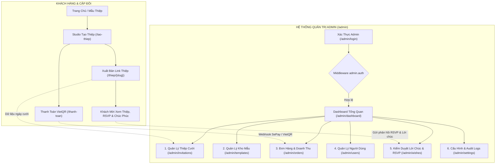

# 🏛️ KHUNG SƯỜN & LỘ TRÌNH PHÁT TRIỂN HỆ THỐNG QUẢN TRỊ ADMIN (MAYHEN.VN)

> **Tài liệu đặc tả kỹ thuật & kiến trúc phân hệ Quản trị (Admin Panel)**  
> **Dự án**: Nền tảng thiết kế & gửi thiệp cưới online cao cấp Mây Hẹn (`mayhen.vn`)  
> **Triết lý thiết kế**: Quiet Luxury, Tối giản, Tinh tế, Hiệu năng cao (Pure CSS + Native JS, Zero Third-party Admin Kits).  
> **Nguyên tắc tốc độ**: *"Code sạch sẽ, logic chặt chẽ, tốc độ tải trang là số 1; Cache chỉ dùng để giảm tải database, không dùng cache để che đậy code chậm"*.

---

## MỤC LỤC TỔNG QUAN

1. [Tầm Nhìn & Triết Lý Thiết Kế Hệ Thống Admin](#1-tầm-nhìn--triết-lý-thiết-kế-hệ-thống-admin)
2. [Sơ Đồ Kiến Trúc & Luồng Dữ Liệu Tổng Thể](#2-sơ-đồ-kiến-trúc--luồng-dữ-liệu-tổng-thể)
3. [Lộ Trình Triển Khai Chi Tiết (Từ Ưu Tiên Cao Đến Mở Rộng)](#3-lộ-trình-triển-khai-chi-tiết)
   - [Giai Đoạn 1: Hoàn Thiện Nền Tảng Layout & Dashboard KPI (Đang Hoàn Tất)](#giai-đoạn-1-hoàn-thiện-nền-tảng-layout--dashboard-kpi)
   - [Giai Đoạn 2: Quản Lý Thiệp Cưới Khách Hàng (Ưu Tiên Số 1)](#giai-đoạn-2-quản-lý-thiệp-cưới-khách-hàng)
   - [Giai Đoạn 3: Quản Lý Mẫu Thiệp Cưới & Kho Giao Diện](#giai-đoạn-3-quản-lý-mẫu-thiệp-cưới--kho-giao-diện)
   - [Giai Đoạn 4: Quản Lý Đơn Hàng, Doanh Thu & Đối Soát Thanh Toán](#giai-đoạn-4-quản-lý-đơn-hàng-doanh-thu--đối-soát-thanh-toán)
   - [Giai Đoạn 5: Quản Lý Người Dùng & Phân Quyền Quản Trị](#giai-đoạn-5-quản-lý-người-dùng--phân-quyền-quản-trị)
   - [Giai Đoạn 6: Quản Lý Lời Chúc (Wishes) & Giám Sát Khách Mời RSVP](#giai-đoạn-6-quản-lý-lời-chúc-wishes--giám-sát-khách-mời-rsvp)
   - [Giai Đoạn 7: Cấu Hình Hệ Thống, Audit Logs & Bảo Vệ Dữ Liệu](#giai-đoạn-7-cấu-hình-hệ-thống-audit-logs--bảo-vệ-dữ-liệu)
4. [Quy Chuẩn Kỹ Thuật Bắt Buộc Trong Codebase Admin](#4-quy-chuẩn-kỹ-thuật-bắt-buộc-trong-codebase-admin)
5. [Bảng Checklist Nhiệm Vụ & Tiêu Chí Hoàn Thành (Definition of Done)](#5-bảng-checklist-nhiệm-vụ--tiêu-chí-hoàn-thành)

---

## 1. TẦM NHÌN & TRIẾT LÝ THIẾT KẾ HỆ THỐNG ADMIN

### 1.1. Sứ mệnh của Admin Panel Mây Hẹn
Không giống như các trang quản trị generic (như AdminLTE hay Bootstrap đại trà), Admin Panel của Mây Hẹn được xây dựng như một **Atelier Control Room** – không gian điều phối tinh tế nơi người quản trị có thể:
1. **Kiểm soát tuyệt đối chất lượng thiệp cưới**: Đảm bảo mỗi thiệp cưới của khách xuất bản ra ngoài đều hoàn hảo, không lỗi ảnh, không nội dung rác hay spam.
2. **Theo dõi dòng tiền thời gian thực**: Nắm bắt ngay lập tức từng giao dịch thanh toán VietQR / SePay, kích hoạt gói dịch vụ tức thì cho các cặp đôi.
3. **Vận hành kho mẫu mượt mà**: Bật/tắt mẫu, ghim mẫu đẹp lên trang chủ, rà soát tính hợp lệ của schema dữ liệu.
4. **Bảo mật và riêng tư**: Bảo vệ thông tin nhạy cảm của ngày cưới (số tài khoản mừng cưới, danh sách khách mời, số điện thoại gia đình hai bên).

### 1.2. 5 Nguyên Tắc Bất Di Bất Dịch
- **Nguyên tắc 1: Zero Third-party Frameworks**: 100% HTML thuần, CSS thuần, JavaScript thuần (Native ES Modules). Tuyệt đối cấm Bootstrap, Tailwind, Vue, React, jQuery trong Admin.
- **Nguyên tắc 2: Tách biệt tài sản tuyệt đối (Isolated Assets)**: Toàn bộ CSS/JS admin nằm trong `public/assets/admin/`, tiền tố class bắt buộc `mayhen_admin_*`.
- **Nguyên tắc 3: Tối ưu hiệu năng gốc (Native Fast)**: Tận dụng Eloquent Eager Loading (`with()`), phân trang nhẹ (`simplePaginate()` hoặc `cursorPaginate()` cho bảng lớn), chỉ select đúng cột cần dùng, không load JSON nặng khi chưa xem chi tiết.
- **Nguyên tắc 4: An toàn & Audit Trail**: Mọi thao tác nhạy cảm (duyệt đơn thủ công, khóa thiệp, xóa dữ liệu, đổi giá gói) bắt buộc phải có log ghi lại ai làm, lúc nào, lý do gì.
- **Nguyên tắc 5: Độc lập Route**: 100% routes admin được định nghĩa trong `routes/admin.php`.

---

## 2. SƠ ĐỒ KIẾN TRÚC & LUỒNG DỮ LIỆU TỔNG THỂ



---

## 3. LỘ TRÌNH TRIỂN KHAI CHI TIẾT

> **Chiến lược phân kỳ**: Chia nhỏ thành từng module độc lập. **Module nào cốt lõi phục vụ vận hành kinh doanh làm trước, module mở rộng làm sau**.

---

### GIAI ĐOẠN 1: HOÀN THIỆN NỀN TẢNG LAYOUT & DASHBOARD KPI
> **Trạng thái**: Đã hoàn thành 85% (Route, AuthController, Login View, Master Layout, Dashboard Controller).  
> **Mục tiêu còn lại**: Hoàn thiện các thành phần tương tác nhanh trên Topbar và trực quan hóa dữ liệu Dashboard.

#### 1.1. Các công việc cụ thể:
1. **Nâng cấp Topbar Master Layout**:
   - Breadcrumbs tự động định vị trang đang đứng (Ví dụ: `Admin > Thiệp Cưới > Chi tiết #102`).
   - Nút Xem nhanh website khách (`target="_blank"`).
   - Menu Dropdown tài khoản quản trị (Đổi mật khẩu, Nhật ký phiên làm việc, Nút đăng xuất xác nhận an toàn).
2. **Nâng cấp Dashboard KPI Blocks**:
   - Bổ sung biểu đồ SVG cột/đường thuần (Pure CSS/SVG Chart) thể hiện doanh thu 14 ngày gần nhất.
   - Bảng phân bổ thiết bị người dùng (Tỷ lệ xem thiệp trên iOS Safari vs Android Chrome vs Desktop).
   - Hộp thông báo khẩn cấp: Đơn hàng quá 24h chưa thanh toán, hoặc cảnh báo lỗi Webhook ngân hàng.

---

### GIAI ĐOẠN 2: QUẢN LÝ THIỆP CƯỚI KHÁCH HÀNG (INVITATIONS & WEDDINGS)
> **Mức độ ưu tiên**: ⭐⭐⭐⭐⭐ **(LÀM TRƯỚC TIÊN NGAY SAU DASHBOARD)**  
> **Lý do**: Đây là sản phẩm kinh doanh cốt lõi của Mây Hẹn. Admin cần biết khách hàng đang tạo thiệp gì, nội dung ra sao, có bị lỗi ảnh hay spam không để hỗ trợ khách kịp thời.

#### 2.1. Phân rã công việc chi tiết:

##### A. Trang Danh Sách Toàn Bộ Thiệp Cưới (`GET /admin/invitations`)
- **Tập tin liên quan**:
  - Controller: `app/Http/Controllers/Admin/InvitationController.php@index`
  - View: `resources/views/admin/pages/invitations/index.blade.php`
  - CSS: `public/assets/admin/css/pages/invitations.css`
- **Bộ lọc & Tìm kiếm (Filters & Search)**:
  - Ô tìm kiếm tức thời: Theo tên Chú Rể, Cô Dâu, Số điện thoại, Slug đường dẫn thiệp, Email tài khoản tạo.
  - Lọc theo Trạng thái: *Tất cả*, *Đã xuất bản (Published)*, *Bản nháp (Draft)*, *Bị khóa (Locked)*, *Hết hạn*.
  - Lọc theo Mẫu thiệp: Dropdown chọn mẫu (`Ngày Tình Yêu Đơm Hoa`, `Trọn Kiếp Này Bên Nhau`, v.v.).
  - Lọc theo Ngày cưới: Tháng cưới / Năm cưới.
- **Cột hiển thị trong bảng dữ liệu**:
  1. `Ảnh Bìa / Mẫu`: Thumbnail thiệp nhỏ kèm Badge Tên mẫu.
  2. `Cặp Đôi`: Tên Chú Rể & Cô Dâu + Ngày cưới chính thức.
  3. `Chủ Sở Hữu`: Tên khách hàng, Email, Số điện thoại liên hệ.
  4. `Đường Dẫn`: Link công khai `/thiep/{slug}` kèm nút copy một chạm và nút mở tab mới.
  5. `Chỉ Số Tương Tác`: Số lượng khách mời đã nhập, Số lượt RSVP xác nhận, Số lời chúc đã nhận.
  6. `Trạng Thái & Hạn Dùng`: Badge Xuất bản / Bản nháp + Ngày hết hạn hiển thị.
  7. `Hành Động`: Nút Xem chi tiết, Khóa/Mở khóa thiệp, Nút đổi mẫu nhanh.

##### B. Trang Chi Tiết & Giám Sát Thiệp Cưới (`GET /admin/invitations/{id}`)
- **Tập tin liên quan**:
  - Controller: `app/Http/Controllers/Admin/InvitationController.php@show`
  - View: `resources/views/admin/pages/invitations/show.blade.php`
- **Tính năng chuyên sâu**:
  - **Khung Mô Phỏng Xem Thiệp Trực Tiếp (Live Phone Mockup)**: Nhúng iframe `/thiep/{slug}?embed=1` với kích thước tỉ lệ iPhone 15 Pro để Admin trực tiếp kiểm tra giao diện thiệp của khách mà không cần mở tab ngoài.
  - **Thông tin Chi tiết Ngày Cưới**:
    - Lễ Thành Hôn / Vu Quy: Giờ giấc, địa chỉ sảnh tiệc, ngày dương lịch & âm lịch.
    - Tài khoản mừng cưới: Tên ngân hàng, số tài khoản, mã VietQR nhà trai / nhà gái.
  - **Tab Danh Sách Khách Mời Của Thiệp**:
    - Xem bảng danh sách khách do cặp đôi này tạo (Họ tên, Nhóm khách, Trạng thái tham dự, Số người đi kèm, Lời nhắn ăn uống).
    - Hỗ trợ Admin xuất file Excel/CSV danh sách khách mời giúp khách khi khách cần hỗ trợ in thiệp giấy.
  - **Tab Sổ Lưu Bút & Lời Chúc Của Thiệp**:
    - Xem toàn bộ lời chúc khách mời đã để lại trên thiệp này.
    - Nút Ẩn / Xóa lời chúc vi phạm hoặc phản cảm.
  - **Khu Vực Hành Động Cưỡng Chế (Administrative Actions)**:
    - *Khóa Thiệp (Lock Invitation)*: Điền lý do khóa (Spam, vi phạm điều khoản, tranh chấp thanh toán). Khi khóa, khách mời truy cập link sẽ thấy thông báo tạm dừng.
    - *Bật/Tắt Xuất Bản (Toggle Publish)*.
    - *Gia Hạn Thiệp (Extend Expiry Date)*: Tăng thêm 30 ngày, 60 ngày hoặc vĩnh viễn.
    - *Đổi Mẫu Thiệp (Migrate Template)*: Cho phép chuyển thiệp sang mẫu khác nếu khách mua gói nâng cấp hoặc yêu cầu đổi mẫu.

---

### GIAI ĐOẠN 3: QUẢN LÝ MẪU THIỆP CƯỚI & KHO GIAO DIỆN (TEMPLATES ENGINE)
> **Mức độ ưu tiên**: ⭐⭐⭐⭐  
> **Lý do**: Giúp Admin chủ động mở khóa mẫu mới, ẩn mẫu lỗi thời và phân loại mẫu trên trang chủ mà không cần can thiệp code PHP.

#### 3.1. Phân rã công việc chi tiết:

##### A. Nâng cấp Danh Sách Mẫu Thiệp (`GET /admin/templates`)
- **Tập tin liên quan**:
  - Controller: `app/Http/Controllers/Admin/TemplateController.php`
  - View: `resources/views/admin/pages/templates/index.blade.php`
- **Các tính năng bắt buộc**:
  1. **Bật/Tắt trạng thái hoạt động (`toggle_active`)**: AJAX toggle mượt mà không cần tải lại trang. Khi tắt, mẫu sẽ ẩn khỏi trang chủ và Studio Tạo Thiệp.
  2. **Ghim mẫu nổi bật (`toggle_featured`)**: Đưa mẫu lên khu vực "Mẫu thiệp được yêu thích nhất" ngoài trang chủ.
  3. **Hiển thị thống kê nhanh**:
     - Số lượng thiệp đang sử dụng mẫu này.
     - Số lượt click xem thử demo (`/xem-thu/{slug}`).
     - Tỷ lệ chuyển đổi mua gói từ mẫu này.

##### B. Chỉnh Sửa Thông Tin Mẫu Thiệp (`GET /admin/templates/{id}/edit` & `PUT /admin/templates/{id}`)
- Chỉnh sửa:
  - Tên mẫu hiển thị tiếng Việt (`name`).
  - Slogan / Thông điệp phong cách thiệp (`description`).
  - Hạng gói áp dụng: `free` (Miễn phí), `plus` (Hạnh phúc), `premium` (Cao cấp).
  - Phân loại danh mục phong cách: *Hoàng Gia Tem Sáp*, *Tối Giản Hiện Đại*, *Hoa Lá Thơ Mộng*, *Cổ Điển Vintage*.
  - Thứ tự hiển thị ưu tiên (`sort_order`).
  - Cập nhật ảnh đại diện thumbnail (`thumbnail_url`).
- **Trình Kiểm Tra Tính Toàn Vẹn Schema (Schema Validator)**:
  - Hệ thống tự động quét và kiểm tra tệp `schema.json` của mẫu:
    * Có đủ 10 Section tiêu chuẩn không?
    * Có đủ các trường bắt buộc (`groom_name`, `bride_name`, `wedding_date`, `gallery` 10 ảnh) không?
    * Báo lỗi đỏ nếu phát hiện thiếu key hoặc vi phạm hợp đồng dữ liệu.

##### C. Đăng Ký & Quét Mẫu Mới (Template Discovery Engine)
- Nút bấm *"Quét Thư Mục Mẫu"*: Tự động đọc thư mục `resources/views/client/invitations/` để phát hiện các thư mục mẫu mới vừa được thiết kế, nạp tự động vào database với trạng thái Nháp.

---

### GIAI ĐOẠN 4: QUẢN LÝ ĐƠN HÀNG, DOANH THU & ĐỐI SOÁT THANH TOÁN (ORDERS & PAYMENTS)
> **Mức độ ưu tiên**: ⭐⭐⭐⭐  
> **Lý do**: Đảm bảo nguồn thu nhập minh bạch, xử lý khiếu nại khách hàng ngay lập tức khi ngân hàng trễ lệnh.

#### 4.1. Phân rã công việc chi tiết:

##### A. Danh Sách Đơn Hàng & Doanh Thu (`GET /admin/orders`)
- **Tập tin liên quan**:
  - Controller: `app/Http/Controllers/Admin/OrderController.php`
  - View: `resources/views/admin/pages/orders/index.blade.php`
  - CSS: `public/assets/admin/css/pages/orders.css`
- **Bộ lọc chuyên sâu**:
  - Trạng thái: *Tất cả*, *Đã thanh toán (Paid)*, *Chờ thanh toán (Pending)*, *Thất bại / Hết hạn (Expired)*.
  - Gói cước: Gói Hạnh Phúc (Plus - 149k), Gói Trải Nghiệm (Free), v.v.
  - Cổng thanh toán: *VietQR*, *SePay Bank Transfer*.
  - Lọc khoảng thời gian: Hôm nay, Tuần này, Tháng này, Tùy chọn ngày bắt đầu - ngày kết thúc.
- **Dữ liệu hiển thị**:
  1. `Mã Đơn Hàng`: Ví dụ `MH-20261106-9281` (Font monospace, có nút copy).
  2. `Khách Hàng`: Họ tên, Email, Số điện thoại.
  3. `Gói Dịch Vụ`: Tên gói + Thời hạn bản quyền.
  4. `Số Tiền`: Định dạng tiền tệ VND chuẩn rõ ràng (Ví dụ `149.000đ`).
  5. `Thời Gian Tạo & Thanh Toán`: Timestamp chi tiết đến từng giây.
  6. `Trạng Thái`: Badge màu trực quan (Xanh: Đã thanh toán, Vàng: Chờ chuyển khoản, Đỏ: Đã hủy).

##### B. Chi Tiết Đơn Hàng & Thao Tác Thủ Công (`GET /admin/orders/{id}`)
- Hiển thị đầy đủ Payload giao dịch: Mã giao dịch ngân hàng, Số tài khoản người chuyển, Nội dung chuyển khoản thực tế.
- **Nút "Duyệt Thanh Toán Thủ Công" (Manual Approval)**:
  - Dành cho trường hợp khách chuyển khoản ghi nhầm nội dung hoặc ngân hàng bảo trì làm Webhook không bắn về hệ thống.
  - Có popup xác nhận: *"Bạn có chắc chắn đã nhận được tiền vào tài khoản ngân hàng không?"*.
  - Khi duyệt thủ công:
    * Chuyển trạng thái đơn sang `paid`.
    * Tự động kích hoạt bản quyền gói cho thiệp cưới tương ứng của khách.
    * Ghi log Audit: `Admin [Tên] đã kích hoạt đơn hàng #MH-... thủ công`.

##### C. Nhật Ký Webhook Thanh Toán (Payment Webhook Audit Log)
- Tab phụ xem lịch sử các lượt Webhook gửi từ SePay / VietQR:
  - Thời gian nhận request, IP gửi đến, Headers, Payload JSON thô.
  - Trạng thái xử lý: `200 OK Thành công`, `400 Sai chữ ký`, `404 Không tìm thấy đơn hàng`.
  - Giúp phát hiện ngay lập tức nếu đối tác thanh toán bị lỗi hoặc có kẻ gian cố tình giả mạo webhook.

---

### GIAI ĐOẠN 5: QUẢN LÝ NGƯỜI DÙNG & PHÂN QUYỀN (USERS & ROLES)
> **Mức độ ưu tiên**: ⭐⭐⭐  
> **Lý do**: Quản lý tài khoản khách hàng, hỗ trợ đặt lại mật khẩu và phân quyền nội bộ.

#### 5.1. Phân rã công việc chi tiết:
- **Danh sách người dùng (`GET /admin/users`)**:
  - Tabs phân loại: *Khách Hàng (Customer)*, *Quản Trị Viên (Admin)*, *Studio / Đối Tác (Partner)*.
  - Tìm kiếm theo Họ tên, Email, Số điện thoại.
  - Cột hiển thị: Avatar/Chữ cái đầu, Tên, Email, Số điện thoại, Số thiệp đã tạo, Tổng tiền đã thanh toán, Ngày đăng ký.
- **Chi tiết người dùng (`GET /admin/users/{id}`)**:
  - Danh sách tất cả các thiệp cưới thuộc về user này.
  - Lịch sử các đơn hàng đã thanh toán.
  - Chức năng Admin:
    * Đặt lại mật khẩu mới cho khách khi khách quên hoặc đổi số điện thoại.
    * Khóa tài khoản khách (chặn đăng nhập khi có hành vi vi phạm).
    * Phân quyền: Thăng cấp user lên làm Admin hoặc Partner Studio.

---

### GIAI ĐOẠN 6: QUẢN LÝ LỜI CHÚC (WISHES) & GIÁM SÁT KHÁCH MỜI RSVP
> **Mức độ ưu tiên**: ⭐⭐⭐  
> **Lý do**: Giữ gìn sự thanh lịch và văn minh cho nền tảng thiệp cưới Mây Hẹn.

#### 6.1. Phân rã công việc chi tiết:
- **Trung Tâm Kiểm Duyệt Lời Chúc (`GET /admin/wishes`)**:
  - Gom toàn bộ lời chúc của khách mời trên mọi thiệp cưới vào một bảng tập trung.
  - Tự động gắn nhãn cảnh báo (Filter từ khóa xấu, nhạy cảm, quảng cáo cá độ/link bẩn).
  - Admin có quyền:
    * Duyệt hiển thị.
    * Ẩn khỏi thiệp.
    * Xóa vĩnh viễn lời chúc thô thiển.
- **Báo Cáo RSVP Toàn Hệ Thống**:
  - Tổng số khách mời được mời trên toàn nền tảng.
  - Tỷ lệ phản hồi trung bình (Bao nhiêu % khách bấm Có tham dự, Bao nhiêu % Không tham dự).

---

### GIAI ĐOẠN 7: CẤU HÌNH HỆ THỐNG, AUDIT LOGS & BẢO VỆ DỮ LIỆU
> **Mức độ ưu tiên**: ⭐⭐  
> **Lý do**: Cung cấp công cụ quản trị nâng cao, đảm bảo tuân thủ pháp lý bảo vệ dữ liệu cá nhân.

#### 7.1. Phân rã công việc chi tiết:
- **Cấu hình bảng giá & gói dịch vụ (`GET /admin/settings/plans`)**:
  - Điều chỉnh giá gói Hạnh Phúc (Plus), gói Cao Cấp (Premium).
  - Bật/tắt tính năng trong từng gói (Số ngày lưu trữ, Nhạc nền, Tải ảnh không giới hạn).
- **Cấu hình ngân hàng nhận thanh toán (`GET /admin/settings/banking`)**:
  - Cấu hình tài khoản VietQR nhận tiền mua gói của Mây Hẹn (Số tài khoản, Tên chủ tài khoản, Mã ngân hàng VietQR).
  - Cấu hình Secret API Key của SePay / Webhook token.
- **Nhật ký Quản trị Toàn Diện (System Audit Logs)**:
  - Bảng ghi vết mọi hành vi trong Admin:
    * *Thời gian* | *Admin thực hiện* | *Hành động* | *Đối tượng tác động* | *Chi tiết thay đổi*.
- **Công cụ Quản lý Lưu Trữ & Tối Ưu Tệp (Asset Storage Inspector)**:
  - Đo lường tổng dung lượng ảnh người dùng đã tải lên thư mục `storage/`.
  - Quét và dọn dẹp các tệp ảnh nháp mồ côi (ảnh khách tải lên lúc làm nháp nhưng sau đó không lưu thiệp).

---

## 4. QUY CHUẨN KỸ THUẬT BẮT BUỘC TRONG CODEBASE ADMIN

### 4.1. Quy chuẩn Thư mục & Tệp tin
```
mayhen.vn/
├── app/
│   ├── Http/
│   │   ├── Controllers/Admin/
│   │   │   ├── AuthController.php          # Đăng nhập, đăng xuất, điều hướng thông minh
│   │   │   ├── DashboardController.php     # KPI & Metrics tổng quan
│   │   │   ├── InvitationController.php    # Quản lý thiệp cưới khách hàng
│   │   │   ├── TemplateController.php      # Quản lý mẫu thiệp & schema
│   │   │   ├── OrderController.php         # Quản lý đơn hàng & đối soát thanh toán
│   │   │   ├── UserController.php          # Quản lý tài khoản & phân quyền
│   │   │   ├── WishController.php          # Kiểm duyệt lời chúc & RSVP
│   │   │   └── SettingController.php       # Cấu hình hệ thống & bảng giá
│   │   └── Middleware/
│   │       └── AdminAuthenticate.php       # Bảo vệ middleware admin.auth
├── routes/
│   └── admin.php                           # Toàn bộ định tuyến admin
├── resources/views/admin/
│   ├── layouts/
│   │   └── master.blade.php                # Layout khung sườn chung
│   ├── auth/
│   │   └── login.blade.php                 # Giao diện đăng nhập thiệp cưới
│   └── pages/
│       ├── dashboard.blade.php             # Trang tổng quan KPI
│       ├── invitations/                    # Danh sách & chi tiết thiệp
│       ├── templates/                      # Danh sách & sửa mẫu thiệp
│       ├── orders/                         # Danh sách & chi tiết đơn hàng
│       ├── users/                          # Danh sách & phân quyền user
│       ├── wishes/                         # Kiểm duyệt lời chúc
│       └── settings/                       # Cấu hình hệ thống
└── public/assets/admin/
    ├── css/
    │   ├── common/
    │   │   ├── base.css                    # Biến tokens & reset layout
    │   │   └── layout.css                  # Sidebar, Topbar, Table, Modal
    │   └── pages/
    │       ├── login.css                   # Phong cách thiệp cưới sang trọng
    │       ├── dashboard.css               # KPI cards & grid
    │       ├── invitations.css             # Phone mockup & bộ lọc thiệp
    │       └── orders.css                  # Bảng đơn hàng & badges
    └── js/
        ├── common/
        │   └── admin-core.js               # Toggle menu, modal, AJAX helpers
        └── pages/
            └── ...                         # JS từng trang nếu cần tương tác
```

### 4.2. Quy chuẩn Đặt Tên CSS Class
- Bắt buộc tiền tố: `mayhen_admin_*`
- Ví dụ thành phần:
  - Bảng: `mayhen_admin_table`, `mayhen_admin_table_header`
  - Thẻ: `mayhen_admin_card`, `mayhen_admin_card_title`
  - Nút bấm: `mayhen_admin_btn`, `mayhen_admin_btn_primary`, `mayhen_admin_btn_sm`
  - Trạng thái: `mayhen_admin_badge_success`, `mayhen_admin_badge_warning`, `mayhen_admin_badge_danger`
  - Bộ lọc: `mayhen_admin_filter_bar`, `mayhen_admin_search_input`

---

## 5. BẢNG CHECKLIST NHIỆM VỤ & TIÊU CHÍ HOÀN THÀNH

| Thứ tự | Module / Tính năng | Mô tả tóm tắt | Trạng thái | Mức ưu tiên |
| :---: | :--- | :--- | :---: | :---: |
| **01** | **Xác thực Admin & Điều hướng** | Login thiệp cưới, Session Auth, Rate Limit, Redirect thông minh | ✅ ĐÃ XONG | Cốt lõi |
| **02** | **Master Layout & Dashboard KPI** | Master Blade, 5 thẻ KPI vận hành, Topbar tên admin & logout | ✅ ĐÃ XONG | Cốt lõi |
| **03** | **Quản lý Thiệp cưới: Danh sách** | Bộ lọc trạng thái, tìm kiếm cô dâu chú rể, phân trang mượt | ⏳ BẮT ĐẦU NGAY | **ƯU TIÊN 1** |
| **04** | **Quản lý Thiệp cưới: Chi tiết & Khóa** | Phone mockup live preview, xem RSVP/khách, khóa/mở thiệp | ⏳ BẮT ĐẦU NGAY | **ƯU TIÊN 1** |
| **05** | **Quản lý Mẫu thiệp: Bật/Tắt & Ghim** | AJAX toggle active/featured, xem schema.json, thống kê mẫu | ⏳ Tiếp theo | Ưu tiên 2 |
| **06** | **Quản lý Đơn hàng: Duyệt thủ công** | Bảng đơn hàng, lọc theo ngày, nút duyệt nạp tiền SePay tay | ⏳ Tiếp theo | Ưu tiên 2 |
| **07** | **Quản lý Khách hàng & Phân quyền** | Bảng user, lịch sử tạo thiệp, phân quyền Admin/Partner | ⏳ Kế tiếp | Ưu tiên 3 |
| **08** | **Kiểm duyệt Lời chúc & RSVP** | Lọc từ ngữ xấu, ẩn/xóa lời chúc spam trên thiệp cưới | ⏳ Kế tiếp | Ưu tiên 3 |
| **09** | **Cấu hình Bảng giá & Hệ thống** | Chỉnh giá gói dịch vụ, cấu hình VietQR Mây Hẹn, Audit log | ⏳ Hoàn thiện | Ưu tiên 4 |

---

*Tài liệu được thiết lập và phê chuẩn cho Dự án Mây Hẹn (mayhen.vn).*

Dự án mây hẹn sẽ phân quyền như sau: "quản trị viên, nhân viên, quản lý, người dùng, cộng tác viên"
Hiện tại đang làm trang /admin, các trang khác sau này sẽ làm sau, cứ làm /admin và user trước