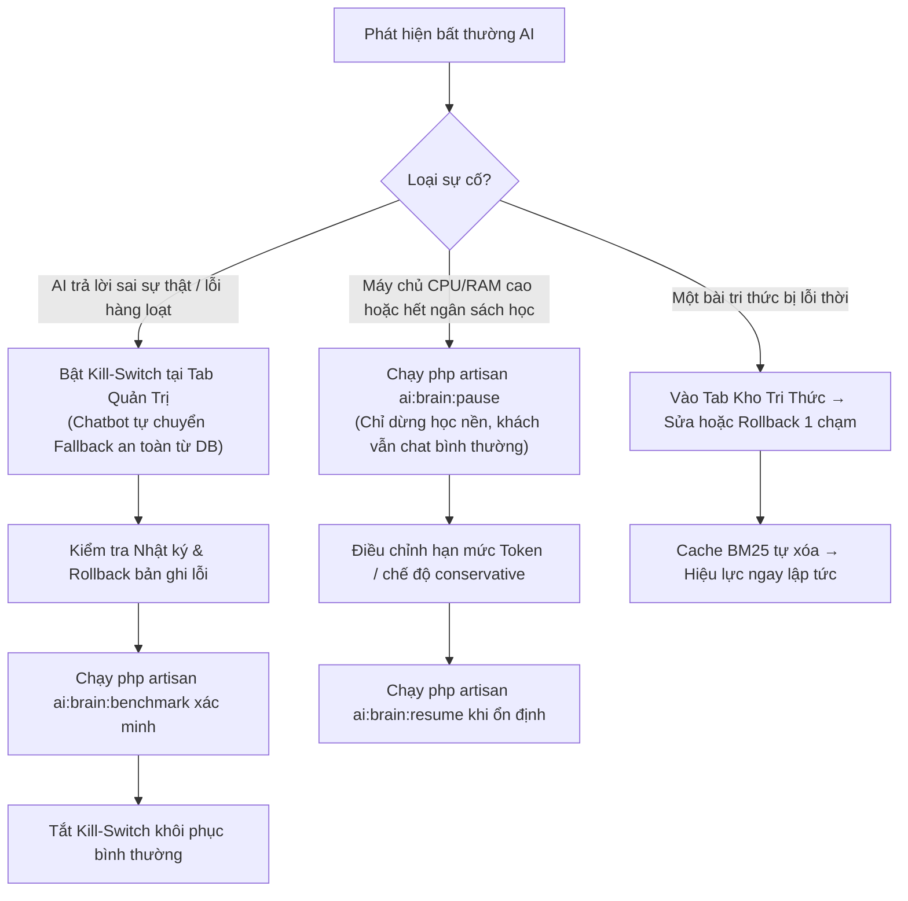

# Sổ Tay Vận Hành & Checklist Hệ Thống AI — Mây Hẹn (`mayhen.vn`)

> Tài liệu thực chiến dành cho **Admin vận hành** và **đối tác kỹ thuật** quản lý Trợ lý AI tại đường dẫn `/admin/ai-chatbot`.

---

## 1. Bản Đồ 4 Tab Quản Trị Tại `/admin/ai-chatbot`

| Tab trong Admin | Vai trò chính | Thao tác thường làm |
| --- | --- | --- |
| **1. Kho Tri Thức (`approved`)** | Quản lý toàn bộ bài Hỏi–Đáp đang phục vụ khách thật | Thêm mới, chỉnh sửa, tìm kiếm, đánh dấu lỗi thời, hoặc **khôi phục phiên bản cũ (Rollback)** |
| **2. Huấn Luyện & Duyệt (`learning`)** | Trung tâm chạy tự học và duyệt đề xuất mới | Chạy Multi-Agent Learning, xem hàng đợi `pending`, bấm **Duyệt 1 chạm** hoặc **Duyệt hàng loạt** |
| **3. Chất Lượng & Nhật Ký (`quality`)** | Theo dõi hiệu quả thực tế của Chatbot | Xem tỷ lệ trả lời thành công, câu bị khách đánh giá *Chưa đúng*, danh sách **Lỗ hổng tri thức (Gaps)**, chạy **Benchmark 12 kịch bản** |
| **4. Quản Trị & An Toàn (`governance`)** | Cấu hình mô hình AI, ngân sách & công tắc khẩn cấp | Chọn Draft/Reviewer model, đặt hạn mức Token/ngày, bật/tắt **Kill-Switch** hoặc **Pause All AI Learning** |

---

## 2. Quy Trình Vận Hành Theo Chu Kỳ (Checklist)

### A. Vận hành hằng ngày (khoảng 5 phút)
- [ ] Mở tab **Huấn Luyện & Duyệt**: kiểm tra các ứng viên tri thức mới ở trạng thái `pending`.
- [ ] Kiểm tra 3 điểm trước khi bấm **Duyệt**: *(1) Đúng sự thật/giá hiện hành? (2) Câu trả lời ngắn gọn, lịch sự? (3) Đường dẫn mẫu/Docs đính kèm có mở đúng không?*
- [ ] Mở tab **Chất Lượng & Nhật Ký**: lướt nhanh mục câu hỏi bị khách bấm *"Chưa đúng"* hoặc *Thiếu bằng chứng* (`no_context`) để bổ sung bài chuẩn nếu là câu hỏi phổ biến.

### B. Vận hành hằng tuần (khoảng 15 phút)
- [ ] Kiểm tra tổng chi phí và lượng Token tiêu thụ trong tuần tại tab **Quản Trị & An Toàn** và trang `/admin/ai-observatory`.
- [ ] Chạy kiểm tra sức khỏe và bộ đo chất lượng chuẩn:
  ```bash
  php artisan ai:brain:doctor
  php artisan ai:brain:benchmark
  ```
- [ ] Nếu điểm Benchmark giảm so với mốc trước (`regression_detected = true`), kiểm tra các bản ghi vừa sửa gần nhất và **Rollback** bản ghi gây sai lệch.
- [ ] Dọn dẹp dữ liệu hết hạn lưu trữ (Retention):
  ```bash
  php artisan mayhen:ai-retention-purge
  ```

### C. Khi có thay đổi sản phẩm (Mẫu thiệp mới / Bảng giá mới / Tài liệu Docs mới)
1. **Thêm mẫu thiệp mới**: Hệ thống tự động xóa cache chỉ mục mẫu BM25 ngay khi lưu trong Admin (`InvitationTemplate::clearTemplateCaches`). Chỉ cần đảm bảo phần **mô tả mẫu** ghi rõ phong cách & tông màu chủ đạo để AI gợi ý chính xác.
2. **Thay đổi bảng giá**: Bảng giá đọc trực tiếp từ bảng `plans` theo thời gian thực. Kiểm tra lại các bài tri thức cũ có nhắc giá cũ trong tab **Kho Tri Thức** để cập nhật đồng bộ.
3. **Cập nhật bài Docs mới**: Nếu cần áp dụng tức thì mà không chờ hết chu kỳ cache 5 phút, chạy `php artisan cache:clear`.

---

## 3. Sơ Đồ Xử Lý Sự Cố Khẩn Cấp (Flowchart)



---

## 4. Bảng Tra Cứu Nhanh Các Lệnh CLI Vận Hành

| Mục đích | Lệnh Artisan | Ghi chú an toàn |
| --- | --- | --- |
| Kiểm tra sức khỏe toàn hệ thống AI | `php artisan ai:brain:doctor` | Chỉ đọc, an toàn chạy bất kỳ lúc nào |
| Xem trạng thái hàng đợi & độ phủ tri thức | `php artisan ai:brain:status` | Chỉ đọc |
| Chạy 1 chu kỳ học nền an toàn (Cron/Hosting) | `php artisan ai:brain:work --once` | Có khóa chống chạy trùng & tự nhường CPU |
| Chạy Multi-Agent Learning từ dữ liệu nội bộ | `php artisan mayhen:ai-self-train` | Chỉ tạo ứng viên `pending`, không tự xuất bản |
| Tạm dừng khẩn cấp toàn bộ luồng học nền | `php artisan ai:brain:pause --reason="..."` | Không ảnh hưởng khách hàng đang chat |
| Tiếp tục lại luồng học nền | `php artisan ai:brain:resume` | Gỡ trạng thái tạm dừng |
| Đo điểm chất lượng Trước/Sau (12 kịch bản) | `php artisan ai:brain:benchmark` | Tự phát hiện sụt giảm chất lượng (Regression) |
| Dọn dẹp log & bộ nhớ quá hạn Retention | `php artisan mayhen:ai-retention-purge` | Tuân thủ chính sách bảo mật riêng tư |

---

## 5. Phân Quyền & Trách Nhiệm (Ma Trận RACI Rút Gọn)

| Hạng mục | Quản trị viên (Admin) | Vận hành nội dung | Đội Kỹ thuật | Hệ thống AI tự động |
| --- | :---: | :---: | :---: | :---: |
| Soạn đề xuất tri thức từ Gaps & Nghiên cứu | Theo dõi | Đề xuất thêm | Bảo trì | **Thực hiện** |
| Phê duyệt xuất bản tri thức (`pending` → `approved`) | **Phê duyệt cuối** | Soát nội dung | — | *Cấm tự duyệt* |
| Cấu hình Model, Ngân sách, Kill-Switch | **Phê duyệt cuối** | — | Hỗ trợ | — |
| Rollback phiên bản khi phát hiện sai lệch | **Thực hiện** | Báo cáo | Hỗ trợ | Cảnh báo |
| Trả lời khách hàng & lọc Allowlist Zero-Trust | Giám sát | — | Bảo trì | **Thực hiện** |
