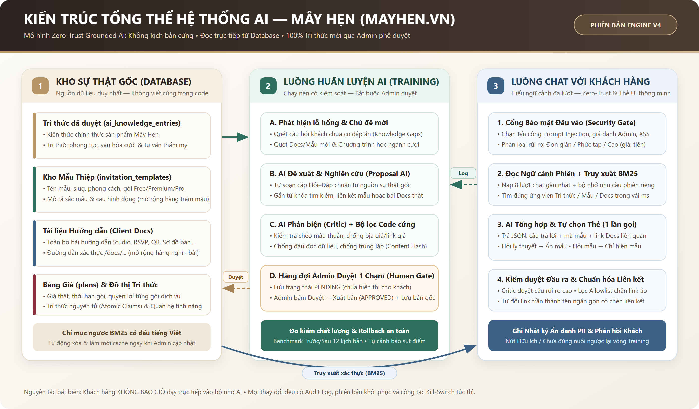
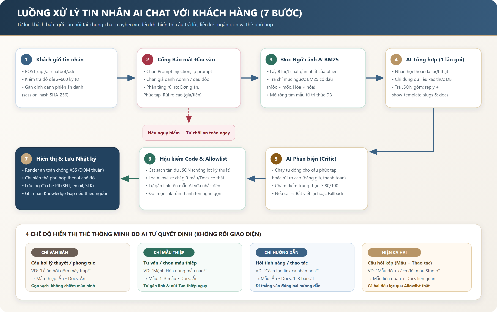
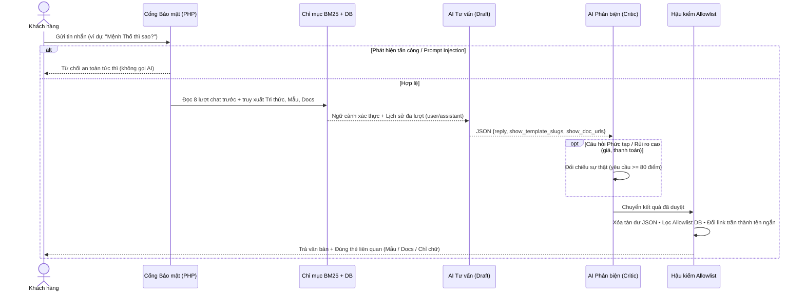
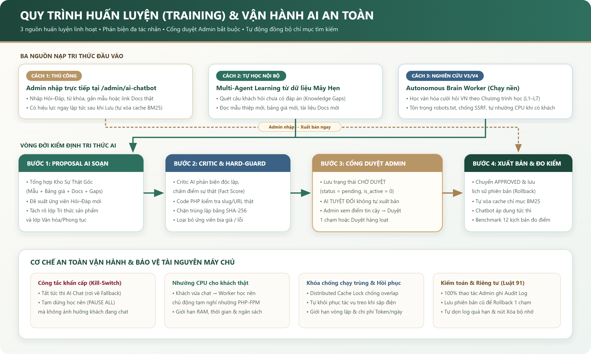
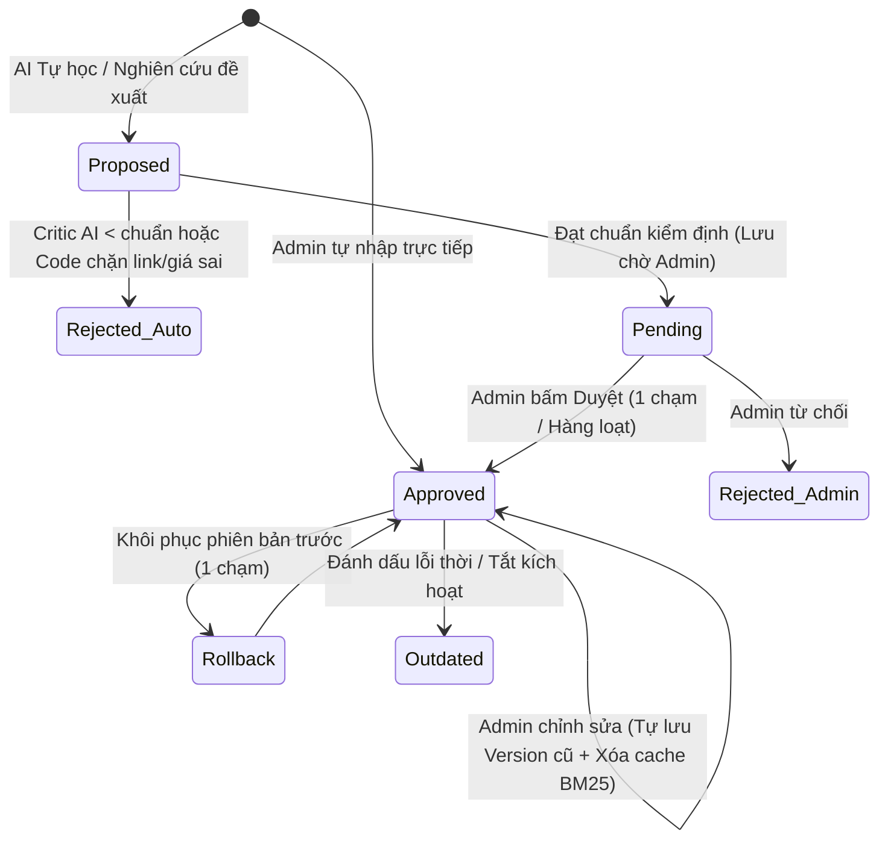

# Tài Liệu Hệ Thống Trợ Lý AI & Quy Trình Huấn Luyện AI — Mây Hẹn (`mayhen.vn`)

> **Mục tiêu tài liệu**: Giúp thành viên mới, đội ngũ vận hành và đối tác bên ngoài hiểu rõ trong **5 phút** cách Trợ lý AI của Mây Hẹn **trò chuyện với khách hàng**, **được huấn luyện (training)** và **vận hành an toàn** mà không cần đọc sâu mã nguồn.

---

## Bộ Tài Liệu & Định Dạng Trực Quan Đi Kèm

| Định dạng | Tệp tin | Phù hợp khi |
| --- | --- | --- |
| **Tài liệu chính (Markdown)** | `docs/AI/README.md` *(tệp hiện tại)* | Đọc tổng quan kiến trúc, luồng Chat, luồng Training & Bảo mật |
| **Sổ tay vận hành & Checklist** | [QUY_TRINH_VAN_HANH_VA_CHECKLIST.md](./QUY_TRINH_VAN_HANH_VA_CHECKLIST.md) | Giao việc cho Admin / nhân sự vận hành hằng ngày & xử lý sự cố |
| **Sơ đồ tương tác (HTML offline)** | [so-do-tuong-tac.html](./so-do-tuong-tac.html) | Mở trực tiếp trên trình duyệt để thuyết trình cho đối tác / người mới |
| **Bộ 3 sơ đồ hình ảnh (PNG 2x & SVG)** | `docs/AI/images/01-*.png`, `02-*.png`, `03-*.png` | Đưa vào slide thuyết trình, báo cáo hoặc gửi nhanh qua Zalo/Email |

---

## 1. Hiểu Nhanh Trong 30 Giây: AI Mây Hẹn Hoạt Động Như Thế Nào?

Hãy hình dung Trợ lý AI của Mây Hẹn giống một **nhân viên tư vấn chuyên nghiệp mới vào làm**:

1. **Không tự bịa kiến thức, không viết kịch bản cứng trong code**: Nhân viên này chỉ được phép trả lời dựa trên **4 cuốn sổ chính thức trong Database** của công ty: *Kho Tri Thức đã duyệt*, *Danh sách Mẫu Thiệp đang mở*, *Tài liệu Hướng dẫn Khách hàng (Docs)* và *Bảng Giá chính thức*.
2. **Học bài mới nhưng bắt buộc có Quản lý (Admin) ký duyệt**: Khi AI tự phát hiện câu hỏi mới hoặc tự học thêm kiến thức cưới hỏi, bài học đó luôn nằm ở trạng thái **Chờ duyệt (`pending`)**. Chỉ khi Admin bấm **Duyệt**, kiến thức mới được đưa vào phục vụ khách hàng.
3. **Biết đọc mạch hội thoại và giữ khung chat gọn gàng**: AI nhớ 8 lượt trò chuyện gần nhất trong phiên và tự quyết định lúc nào nên hiện thẻ mẫu thiệp, lúc nào chỉ hiện tài liệu hướng dẫn, lúc nào chỉ trả lời chữ gọn gàng (ví dụ câu hỏi phong tục/lý thuyết sẽ không bung thẻ mẫu thiệp gây rối màn hình).

### Sơ đồ Kiến trúc Tổng thể (Hình ảnh)

*(Bản vector phóng to không vỡ nét: [01-kien-truc-tong-the-ai.svg](./images/01-kien-truc-tong-the-ai.svg))*

---

## 2. Luồng AI Chat Với Khách Hàng (7 Bước)

Mỗi khi khách hàng nhắn một câu bất kỳ tại khung chat trên `mayhen.vn`, tin nhắn sẽ đi qua **đúng 7 bước kiểm soát chặt chẽ**:

*(Bản vector phóng to không vỡ nét: [02-luong-chat-khach-hang.svg](./images/02-luong-chat-khach-hang.svg))*

### Diễn giải dễ hiểu từng bước

| Bước | Thành phần xử lý | Việc hệ thống làm |
| --- | --- | --- |
| **1. Tiếp nhận** | `AiChatbotController::ask` | Kiểm tra hợp lệ (2–600 ký tự), chống gửi dồn dập (rate limit), mã hóa ẩn danh phiên trò chuyện (`session_hash`). |
| **2. Cổng bảo mật đầu vào** | `SecurityPolicyGate` | Chặn bằng code cứng mọi hành vi tấn công (ép đổi vai, đòi lộ prompt, giả danh Admin, đòi xem dữ liệu người khác). Phân loại rủi ro: **Đơn giản**, **Phức tạp**, hoặc **Rủi ro cao** (liên quan tiền bạc, bảng giá, hoàn tiền). |
| **3. Đọc ngữ cảnh & Chỉ mục BM25** | `ProjectChatbotService` + `ChatbotKnowledgeService` | Đọc **8 lượt hội thoại gần nhất** của đúng phiên đó (nếu khách bấm Xóa đoạn chat thì tự ngắt ngữ cảnh cũ) rồi tra cứu **3 Chỉ mục ngược BM25** (Tri thức DB, Mẫu thiệp, Docs). Chỉ mục này **phân biệt dấu tiếng Việt nghiêm ngặt** (*Mộc ≠ mốc*, *Hỏa ≠ hóa*) và tự hạ trọng số từ phổ thông bằng toán học nên mở rộng mượt lên hàng trăm mẫu và hàng nghìn bài Docs. |
| **4. AI tổng hợp & Tự chọn thẻ** | `ChatbotProviderClient::synthesize` | Truyền lịch sử hội thoại đa lượt thực sự (`user`/`assistant`) + dữ liệu xác thực từ Bước 3 cho AI. Trong **1 lần gọi duy nhất**, AI trả về JSON gồm: nội dung trả lời (`reply`), danh sách mã mẫu cần hiện (`show_template_slugs`) và danh sách link hướng dẫn cần hiện (`show_doc_urls`). |
| **5. AI Phản biện (Critic)** | `reviewDraftWithCritic` | Tự động kích hoạt cho câu hỏi **Phức tạp / Rủi ro cao**. Một mô hình AI mạnh hơn sẽ đối chiếu bản nháp với dữ liệu gốc; dưới 80/100 điểm sẽ yêu cầu viết lại hoặc chuyển sang câu trả lời dự phòng an toàn. |
| **6. Hậu kiểm Code & Allowlist** | `resolveDisplayCards` + `inspectFinalOutput` | Cắt sạch mọi mảnh JSON lỡ sót; **lọc Allowlist** (chỉ cho phép hiển thị mã mẫu và link Docs thực sự tồn tại trong DB); tự động gắn liên kết cho tên mẫu AI nhắc đến và đổi mọi đường dẫn trần (`mayhen.vn/mau-thiep`) thành nhãn ngắn gọn (`Kho Mẫu Thiệp`). |
| **7. Trả lời & Ghi nhật ký** | `AiChatbotLog` + `AiKnowledgeGap` | Hiển thị an toàn trên trình duyệt (chống XSS), che giấu thông tin cá nhân (SĐT, email, STK) trước khi lưu log. Nếu câu hỏi thiếu nguồn dữ liệu, tự động ghi vào danh sách **Lỗ hổng tri thức** để đưa sang luồng Training bổ sung. |

### 4 Chế độ hiển thị thẻ UI thông minh (Do AI tự quyết định theo ngữ cảnh)

| Loại câu hỏi khách hàng | Ví dụ thực tế | Thẻ Mẫu thiệp | Thẻ Hướng dẫn (Docs) |
| --- | --- | :---: | :---: |
| **Thuần lý thuyết / Phong tục / Chào hỏi** | *"Lễ ăn hỏi miền Bắc gồm mấy tráp?"* | Ẩn (`[]`) | Ẩn (`[]`) |
| **Tư vấn chọn mẫu / Màu sắc / Ngũ hành** | *"Tôi mệnh Hỏa dùng mẫu nào?" → "Thổ thì sao?"* | **Hiện 1–3 mẫu sát nhất** | Ẩn (`[]`) |
| **Hỏi tính năng nội bộ / Cách thao tác** | *"Cách tạo link cá nhân hóa?"*, *"Hộp thời gian là gì?"* | Ẩn (`[]`) | **Hiện 1–3 bài sát nhất** |
| **Câu hỏi kép (Mẫu + Thao tác)** | *"Gợi ý mẫu màu xanh và cách đổi màu trong Studio"* | **Hiện mẫu phù hợp** | **Hiện bài hướng dẫn phù hợp** |

### Sơ đồ trình tự tương tác (Mermaid Sequence Diagram)

---

## 3. Luồng Huấn Luyện AI (Training) & Vòng Đời Tri Thức

Mây Hẹn hỗ trợ **3 cách dạy AI** bổ trợ lẫn nhau, tất cả đều hội tụ về một **Kho Tri Thức Duy Nhất (`ai_knowledge_entries`)** trong Database:

*(Bản vector phóng to không vỡ nét: [03-luong-huan-luyen-va-van-hanh-ai.svg](./images/03-luong-huan-luyen-va-van-hanh-ai.svg))*

### Ba nguồn huấn luyện AI

1. **Cách 1 — Admin nhập trực tiếp (Thủ công, hiệu lực tức thì)**:
   - Dùng khi có chính sách mới, chương trình mới, hoặc câu hỏi khách hay hỏi cần chốt đáp án chuẩn ngay.
   - Admin vào `/admin/ai-chatbot` → thêm bản ghi Hỏi–Đáp, từ khóa và (tùy chọn) gắn mã mẫu hoặc bài Docs. Ngay khi bấm Lưu, chỉ mục BM25 tự làm mới và Chatbot áp dụng sau **0 giây**.
2. **Cách 2 — Tự học từ dữ liệu nội bộ (`MultiAgentLearningService`)**:
   - Hệ thống gom các tín hiệu thực tế: câu khách hỏi mà AI chưa trả lời được (**Knowledge Gaps**), câu bị khách bấm *"Chưa đúng"*, cùng mẫu thiệp/bảng giá/Docs mới cập nhật.
   - **Proposal AI** soạn đề xuất Hỏi–Đáp mới → **Critic AI** kiểm tra chéo & chấm điểm sự thật (`Fact Score`) → **Code PHP Hard-Guard** kiểm tra trùng lặp (`SHA-256`) và xác minh slug/link thật → lưu vào **Hàng đợi chờ Admin duyệt**.
3. **Cách 3 — Nghiên cứu nền theo Chương trình học (`AutonomousBrainWorkerService` V3/V4)**:
   - Chạy nền hữu hạn theo chu kỳ (Cron trên hosting hoặc worker nội bộ), mở rộng tri thức về **văn hóa cưới hỏi, phong tục ba miền, nghi lễ** theo lộ trình `L1–L7`.
   - **Tách lớp tri thức nghiêm ngặt**: Kiến thức văn hóa/phong tục lưu riêng ở lớp `research_general` (chỉ dùng tư vấn kinh nghiệm), tuyệt đối không lẫn vào lớp `official_mayhen` (chính sách/giá sản phẩm). Các ý tưởng sản phẩm nội bộ (`applied_insight`) bị ẩn hoàn toàn khỏi khung chat khách hàng.

### Vòng đời trạng thái của 1 bản ghi Tri thức (Mermaid State Diagram)

> **Nguyên tắc vàng**: Mọi tri thức do AI tự học **100% ở trạng thái `pending` (chưa hoạt động)**. AI **không bao giờ** tự ý sửa giá, tự xuất bản tri thức chính thức hay học trực tiếp từ tin nhắn khách hàng (chống đầu độc dữ liệu).

---

## 4. Bốn Tầng Bảo Mật & Bảo Vệ Hạ Tầng (Zero-Trust)

| Tầng bảo vệ | Nguy cơ được ngăn chặn | Cơ chế thực thi thực tế |
| --- | --- | --- |
| **1. Chống tấn công & Đầu độc** | Prompt Injection, giả danh Admin, ép xuất toàn bộ tài liệu, khách cố tình "dạy sai" AI | Quy tắc code cứng trong `SecurityPolicyGate`; khách hàng không có quyền nhập bài huấn luyện, chỉ được bấm đánh giá *Hữu ích / Chưa đúng* (có lọc spam). |
| **2. Chống bịa đặt (Hallucination)** | Bịa giá tiền, bịa mã giảm giá, bịa đường dẫn ngoài hoặc tên mẫu không tồn tại | Allowlist đối chiếu thẳng Database/Docs, Critic AI kiểm duyệt câu rủi ro cao, chặn mọi URL ngoài tên miền `mayhen.vn`. |
| **3. Bảo mật riêng tư (Luật 91/2025/QH15)** | Rò rỉ SĐT, email, số tài khoản ngân hàng hoặc lộ ngữ cảnh giữa các khách khác nhau | Cô lập bộ nhớ theo `user_id` hoặc `session_hash`; tự động che giấu PII trước khi lưu log; khách có nút **Xóa cuộc trò chuyện** để xóa ngay ngữ cảnh phiên; tự dọn dữ liệu quá hạn Retention. |
| **4. Bảo vệ máy chủ & Chi phí** | Hết tiền API Token, sập PHP-FPM khi nhiều khách truy cập cùng lúc | Có **Ngân sách Token/ngày**, **Distributed Cache Lock** chống chạy trùng worker, cơ chế **Worker học nền tự nhường CPU khi phát hiện khách thật đang chat**, và **2 công tắc khẩn cấp** (*Kill-Switch Chat* & *Pause All AI Learning*). |

---

## 5. Tài Liệu Tiếp Theo

- Để xem hướng dẫn thao tác từng tab trong trang Quản trị Admin, checklist hằng ngày/hằng tuần và các lệnh xử lý sự cố: đọc tiếp **[Sổ tay Vận hành & Checklist Admin](./QUY_TRINH_VAN_HANH_VA_CHECKLIST.md)**.
- Để xem sơ đồ minh họa dạng bấm tương tác trực tiếp trên trình duyệt (không cần cài đặt): mở tệp **[so-do-tuong-tac.html](./so-do-tuong-tac.html)**.
