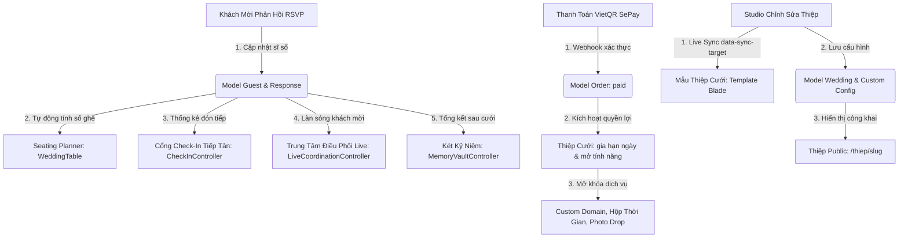

# MÂY HẸN (MAYHEN.VN) — MA TRẬN LIÊN THÔNG ĐA PHÂN HỆ XUYÊN SUỐT
# (CROSS-MODULE END-TO-END INTERCONNECTION MATRIX)

> **Mục tiêu**: Xây dựng bản đồ tương tác dây chuyền giữa tất cả các phân hệ nghiệp vụ của hệ thống Mây Hẹn (`mayhen.vn`), đảm bảo mọi hành động thay đổi dữ liệu tại một điểm đều được kiểm soát và đồng bộ chính xác đến tất cả các điểm thụ hưởng.

---

## 1. BẢN ĐỒ TÁC ĐỘNG DÂY CHUYỀN GIỮA CÁC MODULE

---

## 2. MA TRẬN 20 LUỒNG NGHIỆP VỤ LIÊN HOÀN (20 CROSS-MODULE FLOWS)

| Mã Luồng | Tên Luồng Nghiệp Vụ | Nguồn Sự Thật Chính (SSOT) | Sự Kiện Kích Hoạt | Tác Động Dây Chuyền / Các Phân Hệ Thụ Hưởng | Bất Biến Kiểm Soát | File Kiểm Thử Tự Động |
|---|---|---|---|---|---|---|
| **FLOW-01** | **Khách Mời Xác Nhận RSVP Tăng Sĩ Số** | `guest_responses` | Khách gửi form RSVP với 2 người lớn + 1 trẻ em | 1. Bàn tiệc trong Seating Planner tăng lên 3 ghế chiếm dụng. 2. Cổng tiếp tân QR check-in ghi nhận dự kiến 3 người. 3. Trung tâm Điều Phối Live cập nhật sĩ số thời gian thực. 4. Két kỷ niệm cập nhật số người tham dự. | `INV-12`, `INV-13`, `INV-14` | `CrossModuleLogicInvariantsTest.php` |
| **FLOW-02** | **Khách Mời Báo Bận (Declined RSVP)** | `guest_responses` | Khách gửi form RSVP báo không tham dự | 1. Bàn tiệc trong Seating Planner giải phóng ghế về 0. 2. Khách vẫn lưu trong danh sách nhưng không tính vào tổng dự kiến cỗ. 3. Tiếp tân hiển thị trạng thái đã từ chối nếu có tra cứu. | `INV-12`, `INV-14` | `CrossModuleLogicInvariantsTest.php` |
| **FLOW-03** | **Quét Mã QR Check-in Tại Cổng Tiệc** | `guests.checked_in_at` | Tiếp tân quét camera hoặc nhập mã token | 1. Đánh dấu `checked_in_at = now()`. 2. Lưu `checked_in_attendees` theo RSVP. 3. Báo cáo Live Coordination cập nhật tỷ lệ đón tiếp (Arrival Rate). 4. Bàn tiệc trên màn hình điều phối đổi màu (xanh lá - đã vào bàn). | `INV-17`, `INV-18` | `CheckInTableCoordinationTest.php`, `CrossModuleLogicInvariantsTest.php` |
| **FLOW-04** | **Quét Lại Mã QR Của Khách Đã Điểm Danh** | `guests.checked_in_at` | Tiếp tân quét lại mã của khách đã vào tiệc | 1. Không tăng thêm sĩ số. 2. Trả về thông báo cảnh báo "Khách đã check-in lúc HH:mm". 3. Trả về thông tin bàn tiệc để lễ tân hướng dẫn khách. | `INV-18` | `CheckInTableCoordinationTest.php` |
| **FLOW-05** | **Gán Bàn Tiệc Từ Quản Lý Khách Mời** | `guests.table_name` & `table_id` | Cặp đôi nhập hoặc chọn tên bàn cho khách | 1. Tự động tra cứu `WeddingTable` cùng tên để gán `table_id`. 2. Khách lập tức hiển thị bên trong bàn tiệc trên Seating Planner. 3. Khách bị loại khỏi danh sách "Chưa xếp bàn". | `INV-15` | `CrossModuleLogicInvariantsTest.php` |
| **FLOW-06** | **Xóa / Gỡ Khách Khỏi Bàn Tiệc** | `guests.table_id` | Cặp đôi xóa tên bàn hoặc gỡ khách trên Canvas | 1. Cả `table_name` và `table_id` chuyển về `null`. 2. Khách tự động chuyển về danh sách "Chưa xếp bàn". 3. Bàn tiệc giảm số ghế chiếm dụng tương ứng. | `INV-15`, `INV-16` | `CrossModuleLogicInvariantsTest.php` |
| **FLOW-07** | **Đổi Tên Bàn Tiệc Trong Studio Sơ Đồ** | `wedding_tables.name` | Cặp đôi đổi tên bàn từ "Bàn 01" thành "Bàn VIP Gia Đình" | 1. Cập nhật tên bàn trong `wedding_tables`. 2. Toàn bộ khách thuộc bàn (`table_id = table.id`) tự động cập nhật `table_name`. 3. Cổng tiếp tân và trang in danh sách hiển thị tên mới. | `INV-15` | `CheckInTableCoordinationTest.php` |
| **FLOW-08** | **Xóa Bàn Tiệc Khỏi Sơ Đồ Sảnh** | `wedding_tables` | Cặp đôi bấm xóa bàn tiệc | 1. Bàn tiệc bị xóa khỏi database. 2. Toàn bộ khách thuộc bàn được gỡ liên kết an toàn (`table_id = null`, `table_name = null`). 3. Không làm mất thông tin hay xóa bất kỳ khách mời nào. | `INV-16` | `SeatingPlannerTest.php` |
| **FLOW-09** | **Nhập Hàng Loạt Khách Mời Kèm Tên Bàn** | `guests` | Cặp đôi dán danh sách 50 khách (họ tên, sđt, tên bàn) | 1. Thực thi trong `DB::transaction`. 2. Tự động liên kết `table_id` với các bàn tiệc đã có. 3. Sinh mã `guest_token` độc nhất cho từng khách. | `INV-11`, `INV-15`, `INV-27` | `CrossModuleLogicInvariantsTest.php` |
| **FLOW-10** | **Thanh Toán Gói Qua Webhook SePay** | `orders.status` | Webhook SePay gửi dữ liệu giao dịch VietQR | 1. Kiểm tra chữ ký bảo mật và tính lũy đẳng (Idempotency). 2. Chuyển trạng thái đơn hàng sang `paid`. 3. Kích hoạt hạn mức lưu trữ và các tính năng Premium. 4. Gửi email xác nhận đơn hàng thành công. | `INV-01`, `INV-02`, `INV-03` | `PaymentWebhookTest.php` |
| **FLOW-11** | **Gia Hạn Gói Đám Cưới** | `invitations.expires_at` | Cặp đôi thanh toán gia hạn thêm 12 tháng | 1. Thời hạn mới = Thời hạn cũ + 12 tháng (nếu chưa hết hạn). 2. Nếu thiệp đang bị khóa (`locked`), tự động mở khóa về `published`. 3. Không bao giờ làm giảm số ngày lưu trữ còn lại của khách. | `INV-03` | `SubscriptionRenewalTest.php` |
| **FLOW-12** | **Cấu Hình Tên Miền Riêng (Custom Domain)** | `custom_domains` | Cặp đôi nhập `cuoiduymai.vn` | 1. Kiểm tra bản ghi DNS CNAME trỏ về máy chủ. 2. Kích hoạt chứng chỉ SSL Let's Encrypt. 3. Định tuyến yêu cầu từ tên miền riêng vào thiệp cưới tương ứng. | `INV-05` | `CustomDomainTest.php` |
| **FLOW-13** | **Đổi Mẫu Thiệp Cưới Trong Studio** | `invitations.template_id` | Cặp đôi chuyển từ mẫu Hiện đại sang Cổ điển | 1. Chỉ cập nhật `template_id`. 2. Toàn bộ dữ liệu đám cưới (cô dâu chú rể, bố mẹ, album ảnh, lời mời) được bảo toàn 100%. 3. Khung 10 Section tự động render theo phong cách của mẫu mới. | `INV-31`, `INV-38` | `InvitationTemplateSwitchTest.php` |
| **FLOW-14** | **Chỉnh Sửa Trực Tiếp Trên Studio (Live Sync)** | `weddings` & `custom_config` | Cặp đôi gõ tên cô dâu hoặc chọn màu chủ đạo | 1. Studio gửi sự kiện `postMessage` sang iframe xem trước. 2. `editor-bridge.blade.php` cập nhật ngay phần tử có `data-sync-target`. 3. Không cần reload lại toàn bộ trang iframe. | `INV-33`, `INV-34` | `StudioLiveSyncTest.php` |
| **FLOW-15** | **Khách Tải Ảnh Kỷ Niệm (Photo Drop)** | `guest_photos` | Khách quét mã QR tại bàn tiệc để tải ảnh chụp ngày cưới | 1. Ảnh lưu với trạng thái `is_approved = false`. 2. Cặp đôi nhận thông báo trên bảng điều khiển. 3. Khi cặp đôi duyệt, ảnh lập tức xuất hiện trên Màn hình Trình Chiếu và Két Kỷ Niệm. | `INV-24`, `INV-42` | `GuestPhotoDropTest.php` |
| **FLOW-16** | **Khách Gửi Lời Chúc Mừng & Chữ Ký** | `wishes` & `guest_responses` | Khách gửi lời chúc từ thiệp công khai | 1. Kiểm duyệt từ ngữ thô tục (`NoProfanity`). 2. Hiển thị trên tường lời chúc của thiệp cưới. 3. Lưu vết vĩnh viễn vào Sổ Lưu Bút Kỷ Niệm sau ngày cưới. | `INV-25`, `INV-43` | `WishSubmissionTest.php` |
| **FLOW-17** | **Khóa & Mở Hộp Thời Gian (Time Capsule)** | `wedding_time_capsules` | Cặp đôi gửi thông điệp và hẹn mở sau 5 năm | 1. Thông điệp được bảo vệ bằng mật khẩu và khóa thời gian. 2. Trước ngày hẹn mở, trang công khai hiển thị đồng hồ đếm ngược. 3. Đúng ngày hẹn mở, cho phép nhập mật khẩu để giải mã. | `INV-29`, `INV-44` | `WeddingTimeCapsuleTest.php` |
| **FLOW-18** | **Mở Khóa Két Kỷ Niệm Sau Ngày Cưới** | `invitations.custom_config` | Đám cưới đã qua ngày tổ chức (`wedding_date->isPast()`) | 1. Tự động mở quyền truy cập Két Kỷ Niệm cho khách mời. 2. Hiển thị số ngày kỷ niệm hôn nhân. 3. Tổng hợp toàn bộ số khách tham dự, lời chúc và album ảnh tiệc cưới. | `INV-41`, `INV-45` | `MemoryVaultTest.php` |
| **FLOW-19** | **Xuất Danh Sách Khách & Bàn Tiệc Ra Excel/PDF** | `guests` & `wedding_tables` | Cặp đôi tải file in ấn trước ngày cưới | 1. Xuất file UTF-8 BOM chuẩn hiển thị tiếng Việt trên mọi phiên bản Excel. 2. Xuất file sơ đồ bố trí bàn tiệc chuẩn khổ in A4/A3 gửi nhà hàng tiệc cưới. 3. Đồng bộ chính xác sĩ số thực tế theo RSVP. | `INV-49` | `GuestExportTest.php` |
| **FLOW-20** | **Bảo Mật Truy Cập Đa Ranh Giới (Multi-tenant Isolation)** | `invitations.user_id` | Người dùng A cố tình gọi API sửa thiệp hoặc khách của Người dùng B | 1. Middleware và Policy bắt chặn và trả về lỗi 403 Forbidden. 2. Ghi nhật ký cảnh báo an ninh. 3. Tuyệt đối không để lộ dữ liệu chéo giữa các cặp đôi. | `INV-21`, `INV-30` | `AuthorizationSecurityTest.php` |

