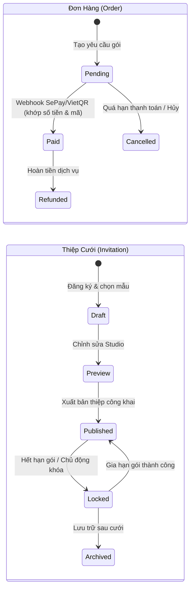
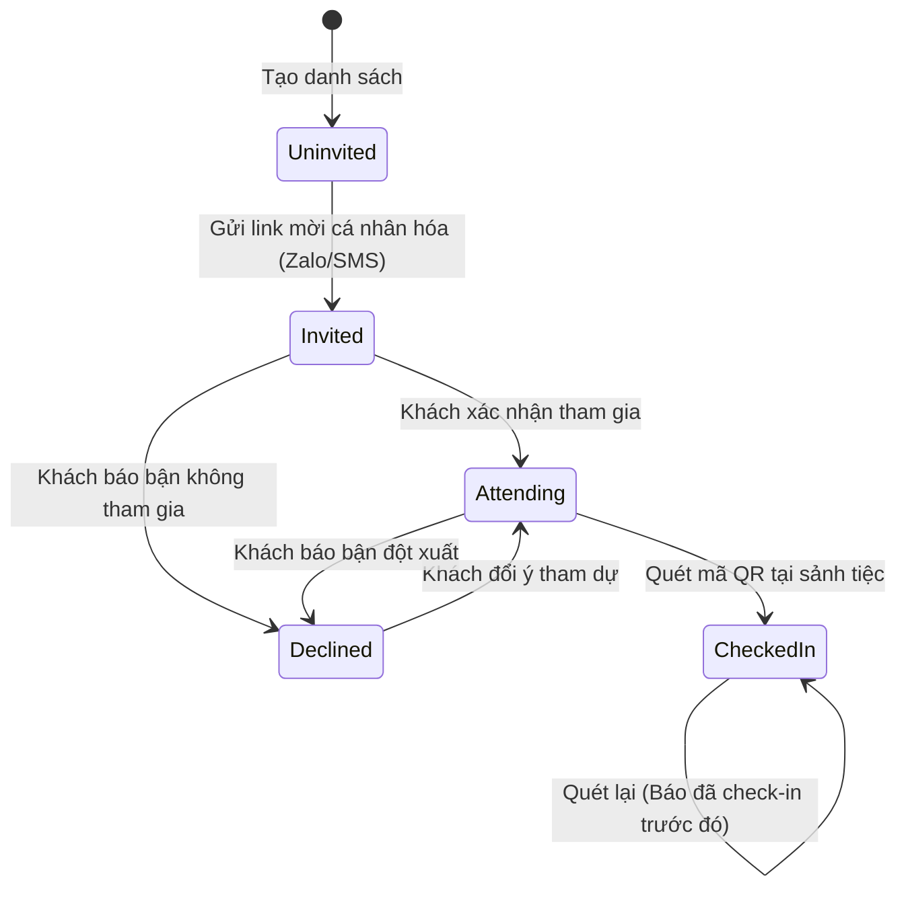

# MÂY HẸN (MAYHEN.VN) — QUY CHUẨN BẤT BIẾN NGHIỆP VỤ & MÁY TRẠNG THÁI TOÀN HỆ THỐNG
# (DOMAIN INVARIANTS & STATE MACHINES)

> **Mục tiêu**: Định nghĩa toán học và nghiệp vụ chính xác cho mọi trạng thái hợp lệ, quy tắc chuyển dịch trạng thái (Transitions) và 50 Bất biến nghiệp vụ cốt lõi (Domain Invariants) của hệ thống Mây Hẹn (`mayhen.vn`).

---

## PHẦN 1: MÁY TRẠNG THÁI CHÍNH THỨC (FORMAL STATE MACHINES)

### 1. Máy Trạng Thái Đơn Hàng (`Order`)
- **Các trạng thái**:
  * `pending`: Khởi tạo đơn hàng, tạo mã thanh toán VietQR với nội dung duy nhất `MH{order_id}` hoặc `MH{code}`.
  * `paid`: Nhận webhook hợp lệ từ SePay/Ngân hàng với số tiền `>= amount`. Kích hoạt đặc quyền gói (Tier Duration, Custom Domain, Hi-res Gallery, v.v.).
  * `cancelled`: Đơn hàng bị hủy do quá hạn 72 giờ hoặc người dùng hủy thủ công.
  * `refunded`: Đơn hàng được admin xử lý hoàn tiền; lập tức thu hồi các đặc quyền tương ứng.
- **Quy tắc chuyển dịch (Transitions)**:
  * `pending -> paid`: Chỉ xảy ra trong Database Transaction có `lockForUpdate()`. Idempotent 100%: nếu webhook gửi lại lần 2, không cộng dồn thời hạn hoặc bắn sự kiện trùng lặp.
  * `paid -> pending`: CẤM TUYỆT ĐỐI.
  * `cancelled -> paid`: Nếu tiền về sau khi đã hủy, chuyển về trạng thái `paid` và kích hoạt lại gói kèm ghi log kiểm toán (Audit Log).

### 2. Máy Trạng Thái Thiệp Cưới (`Invitation`)
- **Các trạng thái**:
  * `draft`: Thiệp đang khởi tạo, chưa sẵn sàng cho khách truy cập.
  * `published`: Thiệp đã xuất bản công khai tại route `/thiep/{slug}`. Khách có thể xem, gửi lời chúc, ký tên và gửi RSVP.
  * `locked`: Thiệp tạm thời bị khóa tương tác (do hết hạn lưu trữ hoặc cặp đôi chủ động tạm khóa). Người ngoài chỉ xem thông báo thiệp tạm khóa; mọi hành động RSVP/Ký tên bị chặn 403.
  * `archived`: Thiệp chuyển sang chế độ kỷ niệm vĩnh viễn (Memory Vault), đóng form tương tác tiệc cưới, chỉ hiển thị Album kỷ niệm và Sổ lưu bút.

### 3. Máy Trạng Thái Khách Mời (`Guest` & `GuestResponse`)

- **Quy tắc chuyển dịch**:
  * Khi chuyển sang `Attending`: Sĩ số chiếm dụng bàn tiệc và sĩ số tiếp tân = `max(1, adults_count + children_count)`.
  * Khi chuyển sang `Declined`: Sĩ số chiếm dụng = `0`. Tự động giải phóng ghế trên bàn tiệc mà không làm mất lịch sử lời chúc.
  * Khi `CheckedIn`: Lưu mốc thời gian `checked_in_at = now()`, số lượng thực tế `checked_in_attendees`. Nếu quét lại, trả về mã `already_checked_in = true` kèm giờ check-in trước đó để tránh trùng lặp.

### 4. Máy Trạng Thái Bàn Tiệc & Sức Chứa (`WeddingTable`)
- `Empty`: `assigned_attendees_count == 0`
- `Available`: `0 < assigned_attendees_count < capacity`
- `Full`: `assigned_attendees_count == capacity`
- `OverCapacity`: `assigned_attendees_count > capacity` (Giao diện hiển thị cảnh báo đỏ trên sơ đồ và bảng điều khiển).

### 5. Máy Trạng Thái Hộp Thời Gian Kỷ Niệm (`WeddingTimeCapsule`)
- `Locked`: `now() < unlock_date` hoặc chưa nhập mật khẩu giải mã. Toàn bộ hình ảnh, audio và tâm thư được mã hóa / che mờ an toàn.
- `Unlocked`: `now() >= unlock_date` VÀ xác thực đúng mật khẩu. Hiển thị trang kỷ niệm tương lai với lời chúc từ quá khứ.

---

## PHẦN 2: 50 BẤT BIẾN NGHIỆP VỤ CỐT LÕI (50 DOMAIN INVARIANTS)

### I. Tiền Tệ, Đơn Hàng & Kích Hoạt Gói (Invariants 01 - 10)
1. **INV-01**: Một đơn hàng chỉ được kích hoạt gói khi số tiền thanh toán thực tế ghi nhận từ Webhook lớn hơn hoặc bằng (`>=`) tổng giá trị đơn hàng `order.total_amount`.
2. **INV-02**: Webhook xử lý thanh toán phải có tính lũy đẳng (Idempotency): thực thi nhiều lần với cùng một mã giao dịch `transaction_id` chỉ tạo ra một lần nâng cấp duy nhất.
3. **INV-03**: Thời hạn lưu trữ thiệp (`expires_at`) khi gia hạn gói phải được tính lũy kế từ ngày hết hạn hiện tại (nếu chưa hết hạn) hoặc từ ngày thanh toán (nếu đã quá hạn), tuyệt đối không bao giờ làm giảm thời hạn còn lại của người dùng.
4. **INV-04**: Không có bất kỳ gói dịch vụ nào cho phép giá trị thanh toán nhỏ hơn 0.
5. **INV-05**: Khi thiệp được nâng cấp lên gói có Custom Domain, miền tùy chỉnh phải vượt qua xác thực bản ghi DNS CNAME trỏ về `cname.mayhen.vn` trước khi kích hoạt SSL.
6. **INV-06**: Mã thanh toán SePay/VietQR cho mỗi đơn hàng phải là chuỗi ngẫu nhiên hoặc tiền tố không trùng lặp trong toàn bộ bảng `orders`.
7. **INV-07**: Khi một đơn hàng chuyển sang trạng thái `refunded`, các tính năng Premium mở rộng (như dung lượng ảnh cao cấp, tên miền riêng) phải lập tức trở về trạng thái giới hạn tương ứng.
8. **INV-08**: Không bao giờ lộ Secret Key của SePay hay mã bí mật webhook trong phản hồi API hoặc mã nguồn frontend.
9. **INV-09**: Giá niêm yết các gói dịch vụ hiển thị tại trang Bảng Giá (`mayhen_pricing_*`) phải khớp chính xác với giá trị lưu trong cơ sở dữ liệu `packages`.
10. **INV-10**: Mọi giao dịch tài chính phát sinh đều phải lưu vết trong bảng giao dịch (`payment_transactions`) kèm mã phản hồi gốc từ ngân hàng/cổng thanh toán.

### II. Khách Mời, RSVP & Sức Chứa Bàn Tiệc (Invariants 11 - 20)
11. **INV-11**: Mỗi khách mời trong một đám cưới có một `guest_token` duy nhất với độ dài tối thiểu 32 ký tự ngẫu nhiên để phục vụ đường link cá nhân hóa và mã QR.
12. **INV-12**: Sĩ số tham dự thực tế của một khách mời (`actualAttendeesCount()`) luôn bằng `0` nếu trạng thái là `declined`; bằng `adults_count + children_count` nếu là `attending`; và bằng `expected_attendees` nếu chưa phản hồi.
13. **INV-13**: Số ghế chiếm dụng của một bàn tiệc (`assigned_attendees_count`) luôn là tổng `actualAttendeesCount()` của tất cả các khách thuộc bàn đó.
14. **INV-14**: Khi một khách mời thay đổi trạng thái RSVP từ Attending sang Declined hoặc ngược lại, số ghế bàn tiệc liên quan phải được cập nhật tức thì trong cùng chu kỳ truy vấn.
15. **INV-15**: Trường `table_name` và `table_id` của khách mời phải luôn đồng bộ: nếu `table_name` trùng với tên của một `WeddingTable` thuộc đám cưới đó thì `table_id` phải trỏ đúng vào ID của bàn; nếu `table_name` bị xóa thì `table_id` phải là `null`.
16. **INV-16**: Khi xóa một bàn tiệc khỏi sảnh (`WeddingTable::delete`), toàn bộ khách mời thuộc bàn đó phải được gỡ liên kết (`table_id = null`, `table_name = null`) mà không được phép xóa khách mời.
17. **INV-17**: Khi tiếp tân quét mã QR điểm danh mà không nhập số khách đè lên, hệ thống phải tự động ghi nhận số người theo đúng phản hồi RSVP (`actualAttendeesCount()`).
18. **INV-18**: Một khách mời đã điểm danh (`checked_in_at !== null`) khi quét lại không được phép làm tăng thêm sĩ số của tiệc cưới.
19. **INV-19**: Khách mời chỉ được gửi phản hồi RSVP cho đúng đám cưới của mình; không bao giờ được phép gửi RSVP chéo sang thiệp cưới khác.
20. **INV-20**: Chủ nhân của thiệp cưới khi đang đăng nhập tài khoản sở hữu thì không thể tự gửi xác nhận tham dự cho chính thiệp của mình (chống ô nhiễm dữ liệu tiếp tân).

### III. Bảo Mật, Quyền Sở Hữu & Quyền Riêng Tư (Invariants 21 - 30)
21. **INV-21**: Người dùng A tuyệt đối không được phép xem, sửa hoặc xóa khách mời, bàn tiệc, cấu hình thiệp cưới của người dùng B (kiểm soát bởi `authorizeGuestManagement` và Policies).
22. **INV-22**: Mã PIN tiếp tân (`checkin_pin`) là mã bí mật độc lập (mặc định 6 số), không bao giờ sử dụng chung với mật khẩu tài khoản quản trị của cô dâu chú rể.
23. **INV-23**: Mọi dữ liệu cá nhân của khách mời (số điện thoại, ghi chú dị ứng) phải tuân thủ Luật Bảo vệ Dữ liệu Cá nhân số 91/2025/QH15, không được hiển thị công khai trên giao diện khách vãng lai.
24. **INV-24**: File tải lên (ảnh kỷ niệm, ảnh cưới, nhạc cưới) phải được kiểm tra MIME type thực tế trên máy chủ, ngăn chặn việc tải lên các tệp thực thi (`.php`, `.exe`, `.sh`).
25. **INV-25**: Mọi đầu vào văn bản do người dùng hoặc khách mời gửi lên (lời chúc, tên khách, ghi chú dị ứng) phải được kiểm tra bằng bộ lọc từ ngữ thô tục (`NoProfanity`) và được escape ký tự an toàn trước khi hiển thị trong Blade view.
26. **INV-26**: Route quản trị Admin (`/admin/*`) phải được bảo vệ bởi middleware `auth` và kiểm tra quyền `is_admin`, người dùng thông thường truy cập phải nhận mã 403 hoặc chuyển hướng đăng nhập.
27. **INV-27**: Mọi thao tác cập nhật dữ liệu quan trọng (chuyển quyền thiệp, xóa bàn, nhập danh sách hàng loạt) phải được bọc trong `DB::transaction`.
28. **INV-28**: Khóa công khai và API Token của Cổng Tiếp Tân Điểm Danh được giới hạn tốc độ truy vấn (`rate_limiting` / `throttle`) để chống lại hành vi quét vét mã QR tự động.
29. **INV-29**: Không lưu trữ mật khẩu giải mã Hộp Thời Gian (Time Capsule) dưới dạng plaintext nếu có cơ chế so khớp băm bảo mật.
30. **INV-30**: Đối tác (Agency / Studio) chỉ có quyền truy cập vào các thiệp cưới được gán quyền cộng tác cụ thể thông qua bảng `wedding_collaborators` hoặc liên kết agency; không có quyền truy cập thiệp ngoài phạm vi.

### IV. Chuẩn Hóa Mẫu Thiệp Cưới & Bộ Công Cụ Studio (Invariants 31 - 40)
31. **INV-31**: Mọi mẫu thiệp cưới bắt buộc phải có đủ 10 Section tiêu chuẩn theo đúng thứ tự logic quy định tại `mayhen-invitation-standards`.
32. **INV-32**: Mọi mẫu thiệp cưới phải sử dụng hệ thống class tiền tố BEM `mayhen_invitation_*` cho khung cốt lõi, không được phá vỡ chuẩn đặt tên.
33. **INV-33**: Mọi phần tử hiển thị nội dung động trong `template.blade.php` bắt buộc phải có thuộc tính `data-sync-target="{tên_trường}"` để đảm bảo hợp đồng Live Sync 2 chiều với Studio.
34. **INV-34**: Khi nhúng vào Studio Editor (`?embed=1`), thiệp cưới bắt buộc phải mở sẵn cánh thiệp (`opened`), loại bỏ toàn bộ class khóa cuộn (`no-scroll`), và cưỡng chế `.card-wrapper { display: block !important; }` để không bao giờ bị màn hình trắng.
35. **INV-35**: Toàn bộ tài nguyên (ảnh, icon, font, audio) của mẫu thiệp phải được lưu trữ 100% cục bộ trong thư mục `assets/` của mẫu đó; CẤM TUYỆT ĐỐI việc sử dụng URL từ server bên ngoài.
36. **INV-36**: Mọi mẫu thiệp cưới bắt buộc phải kế thừa `@extends('client.layouts.invitation')` để tích hợp tự động handshake 2 chiều `MAYHEN_BRIDGE_READY`.
37. **INV-37**: Phần Ký tên điện tử (`Signature`) và Xác nhận tham dự (`RSVP`) tuyệt đối CẤM chèn ảnh cặp đôi hoặc ảnh stock người; chỉ được sử dụng hoa văn đồ họa hoàng gia, tem niêm phong sáp hoặc hiệu ứng CSS thuần.
38. **INV-38**: Đổi mẫu thiệp cưới không được phép làm mất dữ liệu nội dung đám cưới (tên cô dâu chú rể, ngày cưới, phụ mẫu hai bên, câu chuyện tình yêu). Dữ liệu nằm trong `weddings` và `custom_config`, chỉ có giao diện hiển thị (`template_id`) thay đổi.
39. **INV-39**: Tiêu đề trang xem thiệp cưới (`$pageTitle`) phải tuân thủ nghiêm ngặt định dạng chuẩn chung:
    * Xem thử: `'Xem thử: "' . $templateName . '" | ' . config('app.name')`
    * Thiệp thật: `'Thiệp mời cưới: "' . $groomName . ' & ' . $brideName . '" | ' . config('app.name')`
40. **INV-40**: 100% layout thiệp cưới được dựng bằng Flow Layout (Flexbox & CSS Grid thuần), tuyệt đối cấm định vị tuyệt đối `position: absolute` kiểu kéo thả làm vỡ giao diện trên di động.

### V. Vòng Đời Kỷ Niệm & Trải Nghiệm Sau Cưới (Invariants 41 - 50)
41. **INV-41**: Két Kỷ Niệm (Memory Vault) chỉ hiển thị công khai khi chủ tiệc chủ động kích hoạt hoặc sau ngày cưới chính thức (`wedding_date->isPast()`). Trước ngày cưới, nếu chưa mở và không phải chủ tiệc, hệ thống tự động chuyển hướng về thiệp công khai.
42. **INV-42**: Ảnh do khách mời tải lên thông qua Photo Drop chỉ được hiển thị trong Két Kỷ Niệm và màn hình trình chiếu sau khi được chủ tiệc duyệt (`is_approved = true`).
43. **INV-43**: Lời chúc của khách mời chỉ hiển thị trên Sổ Lưu Bút Kỷ Niệm khi `is_approved = true`.
44. **INV-44**: Hộp Thời Gian (Time Capsule) không thể mở khóa thông điệp trước ngày hẹn mở (`unlock_date`), ngay cả khi chủ nhân đăng nhập tài khoản.
45. **INV-45**: Khi đám cưới kết thúc, toàn bộ dữ liệu danh sách khách, số tiền mừng cưới, lời chúc và ảnh kỷ niệm phải được lưu giữ an toàn theo chính sách gói của người dùng.
46. **INV-46**: Màn hình Trình Chiếu Ảnh Cưới (Photo Drop Live Slideshow) phải hỗ trợ tính năng tự động làm mới theo chu kỳ để hiển thị ảnh mới duyệt mà không cần tải lại trang.
47. **INV-47**: File âm thanh nền (nhạc cưới) trên thiệp di động phải tuân thủ chính sách trình duyệt (Autoplay Policy): người dùng phải tương tác chạm (touch/click) mở thiệp trước khi phát âm thanh.
48. **INV-48**: Nút chuyển đổi âm thanh (Play/Pause) phải luôn nổi trên màn hình và phản ánh đúng trạng thái phát thực tế của thẻ `<audio>`.
49. **INV-49**: Tải xuống danh sách khách mời (Excel/CSV/PDF) phải mã hóa chuẩn UTF-8 có BOM để hiển thị tiếng Việt có dấu chuẩn xác 100% trên Microsoft Excel.
50. **INV-50**: Mọi trang giao diện phải hoạt động hoàn hảo trên thiết bị di động (Mobile-First 360px - 430px) và không sử dụng bất kỳ thư viện CSS/JS bên thứ ba nào.

