# MÂY HẸN (MAYHEN.VN) — NGHIÊN CỨU TÂM LÝ & ĐỊNH VỊ GIÁ TRỊ PREMIUM
# (PREMIUM VALUE PROPOSITION AUDIT)

> **Mục tiêu**: Trả lời trực diện câu hỏi cốt lõi của khách hàng: *"Vì sao tôi phải trả tiền cho Mây Hẹn thay vì dùng các nền tảng tạo thiệp cưới miễn phí?"*. Xác lập bản đồ tâm lý 9 nhóm đối tượng, 8 nỗi sợ ngày cưới và giải pháp kiến tạo giá trị cao cấp vượt trội.

---

## 1. TRẢ LỜI 7 CÂU HỎI QUYẾT ĐỊNH CỦA KHÁCH HÀNG TRẢ PHÍ

### 1. Vì sao tôi phải mua Mây Hẹn thay vì dùng thiệp miễn phí đại trà?
- **Sự khác biệt cốt lõi**: Các trang web thiệp cưới miễn phí thường chèn quảng cáo của bên thứ ba, gắn logo thương hiệu lớn thô kệch, bố cục kéo thả lộn xộn, hay bị lỗi font tiếng Việt và không có tính năng hỗ trợ ngày cưới.
- **Giá trị Mây Hẹn mang lại**: Phong cách **Quiet Luxury** chuẩn mực. Thiệp cưới là tác phẩm nghệ thuật kỹ thuật số mang tên miền riêng của cặp đôi (`cuoiduymai.vn`), 100% không quảng cáo, mở ra hiệu ứng lụa hoàng gia mượt mà, thể hiện sự trân trọng tuyệt đối dành cho khách mời và vị thế của hai bên gia đình.

### 2. Tôi nhận được sự tiện lợi nào ngay sau khi thanh toán?
- **Giá trị tức thời (Immediate Value Unlock)**:
  * Kích hoạt ngay hạn mức lưu trữ dài hạn (từ 12 tháng đến vĩnh viễn), thiệp không bao giờ bị gián đoạn trước ngày cưới.
  * Mở khóa trọn bộ công cụ điều phối cao cấp: Sơ đồ xếp bàn tiệc (Seating Planner), Cổng tiếp tân quét mã QR tại sảnh tiệc, Màn hình trình chiếu ảnh cưới trực tiếp (Photo Drop Live Wall), Hộp thời gian kỷ niệm tương lai (Time Capsule).
  * Cho phép tùy biến bảng màu độc quyền, nhạc nền bản quyền chất lượng cao và tem niêm phong sáp cá nhân hóa.

### 3. Chức năng Premium có giải quyết nỗi lo thực tế nào không?
- **Giải quyết triệt để bài toán đặt cỗ tiệc cưới**: Tính năng RSVP cá nhân hóa + Sơ đồ xếp bàn động tự động tính toán chính xác số người thực tế dự tiệc (`actualAttendeesCount()`). Cặp đôi không bao giờ bị rơi vào cảnh đặt thiếu bàn gây khó xử với khách, hoặc đặt thừa cỗ lãng phí hàng chục triệu đồng tiền tiệc.

### 4. Tôi có cảm thấy thiệp của mình sang trọng, riêng biệt và được chăm chút không?
- Mọi mẫu thiệp cưới của Mây Hẹn đều được thiết kế độc quyền theo quy chuẩn 10 Section tinh hoa. Không một mẫu nào giống mẫu nào: từ tông Đỏ rượu vang hoàng gia, Hồng tro phấn lụa, Xanh xô thơm tự nhiên đến Xanh hoàng gia ánh bạc. Tên miền riêng tạo cảm giác cặp đôi đã thuê riêng một studio công nghệ cao cấp xây dựng website ngày cưới cho mình.

### 5. Gia đình và khách mời có cảm thấy được trân trọng không?
- Khách mời nhận được đường link mang tên mình (`/thiep/slug?token=...`), lời chào trang trọng đúng vai vế ("Kính mời Bác Hai", "Thân mời Bạn"), địa chỉ bản đồ dẫn đường chính xác chỉ bằng 1 chạm, và xác nhận tham dự trong 10 giây mà không cần cài đặt ứng dụng hay đăng ký tài khoản phiền phức.

### 6. Mây Hẹn có giúp tôi tiết kiệm thời gian, tránh sai sót và quản lý ngày cưới hiệu quả hơn không?
- **Tiết kiệm hàng tuần làm việc**: Thay vì dùng sổ tay hay file Excel rời rạc để ghi chép ai đi ai ở, Mây Hẹn tự động tổng hợp danh sách khách, số suất cỗ, người ăn chay, lời chúc mừng và số bàn tiệc. Vào ngày cưới, lễ tân chỉ cần cầm điện thoại quét mã QR là biết ngay khách ngồi bàn nào và dẫn đường chu đáo.

### 7. Sau ngày cưới, tôi còn nhận được giá trị gì?
- Hầu hết các trang thiệp số khác sẽ bị lãng quên hoặc xóa bỏ sau ngày cưới. Tại Mây Hẹn, thiệp cưới chuyển hóa thành **Két Kỷ Niệm (Memory Vault)** và **Hộp Thời Gian (Time Capsule)**: lưu giữ toàn bộ chữ ký, lời chúc, album ảnh do bạn bè chụp và tâm thư hẹn mở sau 1 năm, 5 năm hoặc 10 năm kỷ niệm ngày cưới.

---

## 2. BẢN ĐỒ 9 PHÂN KHÚC KHÁCH HÀNG (PERSONA MAPPING)

```mermaid
graph TD
    P1[1. Cặp đôi bận rộn, ít thời gian] --> S1[Cần template chuẩn đẹp ngay, form nhập 10 phút, tự ghép tên bố mẹ]
    P2[2. Cặp đôi có gu thẩm mỹ cao] --> S2[Cần Quiet Luxury, tên miền riêng, không quảng cáo, typography chuẩn]
    P3[3. Cặp đôi tối ưu ngân sách] --> S3[Cần bảng giá minh bạch, dùng thử trước, ROI rõ ràng qua tiết kiệm bàn tiệc]
    P4[4. Phụ huynh hai bên gia đình] --> S4[Cần chuẩn lễ nghi, phân tách nhà trai/nhà gái, có bản in danh sách A4]
    P5[5. Khách mời trẻ tuổi & bạn bè] --> S5[Cần link cá nhân hóa, RSVP 1 chạm, xem ảnh sắc nét, gửi lời chúc vui vẻ]
    P6[6. Khách mời lớn tuổi] --> S6[Cần chữ lớn dễ đọc, chỉ đường 1 chạm, gọi điện xác nhận nhanh chóng]
    P7[7. Lễ tân & Đội ngũ điều phối] --> S7[Cần Cổng quét mã QR cực nhanh, tra cứu tên bàn tức thời, chống trùng lặp]
    P8[8. Studio & Wedding Planner] --> S8[Cần không gian quản trị đa dự án, mã bàn giao rõ ràng, hoa hồng đối tác]
    P9[9. Cặp đôi sau lễ cưới] --> S9[Cần lưu trữ vĩnh viễn, tải trọn bộ ảnh ZIP, két kỷ niệm ngày cưới]
```

---

## 3. BẢN ĐỒ 8 NỖI SỢ TÂM LÝ & GIẢI PHÁP TRIỆT TIÊU

| Mã Nỗi Sợ | Nỗi Sợ Tâm Lý Của Cặp Đôi | Hậu Quả Tiêu Cực Nếu Bị Lỗi | Giải Pháp Kỹ Thuật & Trải Nghiệm Mây Hẹn |
|---|---|---|---|
| **FEAR-01** | **Sợ thiệp cưới bị xấu, lỗi thời hoặc đại trà** | Cảm thấy tự ti khi gửi thiệp mời đến bạn bè, đồng nghiệp và sếp. | Bộ sưu tập mẫu thiệp độc quyền phong cách Quiet Luxury, typography Cormorant Garamond / Playfair Display cổ điển. |
| **FEAR-02** | **Sợ sai sót thông tin trọng yếu (Ngày, Giờ, Sảnh, Tên Bố Mẹ)** | Sự cố nghiêm trọng ảnh hưởng danh dự hai bên gia đình, khách đi nhầm ngày/nhầm sảnh tiệc. | Trình biên tập có bộ kiểm tra dữ liệu trọng yếu, tự động đối soát hiển thị trên cả 10 Section và bản đồ Google Maps. |
| **FEAR-03** | **Sợ mất dữ liệu thiệp khi đang chỉnh sửa dở** | Mất công sức hàng giờ chọn ảnh, viết câu chuyện tình yêu. | Cơ chế Tự động lưu nháp (Autosave) nền + Phòng vệ xung đột Concurrency 409 + Lưu đệm LocalStorage cục bộ. |
| **FEAR-04** | **Sợ gửi nhầm thông tin cho khách hoặc bị spam** | Khách VIP bị nhận thiệp sơ sài, lộ thông tin cá nhân. | Mỗi khách mời có một mã `guest_token` riêng biệt, chỉ hiển thị lời chào cá nhân hóa cho đúng người được gửi. |
| **FEAR-05** | **Sợ không ai phản hồi RSVP, không biết đặt bao nhiêu bàn cỗ** | Đặt thiếu cỗ thì khách không có chỗ ngồi; đặt thừa cỗ thì lãng phí hàng chục triệu đồng. | Form RSVP trực quan 1 chạm, phân loại rõ Đi / Bận / Kèm người nhà, tự động đồng bộ thời gian thực vào Seating Planner. |
| **FEAR-06** | **Sợ sảnh tiệc bị hỗn loạn vào giờ đón khách** | Khách chen lấn tại cửa, lễ tân không tìm thấy tên khách trên giấy, khách ngồi nhầm bàn người khác. | Cổng Tiếp Tân Quét Mã QR siêu tốc (< 1 giây) + Hiển thị ngay tên bàn tiệc + Có bản in sơ đồ bàn A4/A3 dự phòng khi mất mạng. |
| **FEAR-07** | **Sợ lộ thông tin tài chính mừng cưới hoặc ảnh riêng tư** | Bị kẻ gian lợi dụng thông tin tài khoản ngân hàng hoặc hình ảnh gia đình. | Mã QR mừng cưới chỉ hiển thị số tài khoản chính chủ, ảnh Photo Drop bắt buộc duyệt trước khi chiếu màn hình lớn. |
| **FEAR-08** | **Sợ bỏ tiền mua dịch vụ nhưng không nhận được giá trị xứng đáng** | Cảm giác bị lừa dối, dịch vụ chập chờn hoặc biến mất sau vài tháng. | Cam kết hạ tầng ổn định 99.9%, hỗ trợ kỹ thuật tận tâm, lưu giữ kỷ niệm hôn nhân dài hạn theo chính sách gói công khai. |

---

## 4. MA TRẬN PHÂN LOẠI GIÁ TRỊ (FEATURE VALUE TAXONOMY)

1. **Nhóm Tính Năng Bắt Buộc (Must-Have)**:
   - Thiệp cưới responsive hoàn hảo trên di động, không lỗi font tiếng Việt.
   - Bản đồ Google Maps dẫn đường chính xác.
   - Form gửi lời chúc và form xác nhận RSVP cơ bản.
   - Tốc độ tải trang dưới 1.5 giây.
2. **Nhóm Tính Năng Gây Bất Ngờ Thích Thú (Delighters)**:
   - Hiệu ứng mở phong bì sáp hoàng gia mượt mà.
   - Nhạc nền đám cưới tự động phát khi chạm mở thiệp.
   - Đồng hồ đếm ngược ngày cưới kèm lịch âm dương song hành.
   - Hiệu ứng bụi sao lấp lánh (Stardust Motion) trên nền giấy mỹ thuật.
3. **Nhóm Tính Năng Tạo Ra Giá Trị Trả Phí Vượt Trội (Premium Differentiators)**:
   - **Tên Miền Riêng (Custom Domain)**: Khẳng định tính độc bản của đám cưới.
   - **Sơ Đồ Xếp Bàn Trực Quan (Visual Seating Planner Studio)**: Giải phóng hoàn toàn gánh nặng bố trí sảnh tiệc.
   - **Cổng Tiếp Tân Điểm Danh QR & Trung Tâm Điều Phối Live**: Biến đám cưới thành sự kiện công nghệ chuyên nghiệp.
   - **Màn Hình Trình Chiếu Ảnh Cưới Live Wall**: Gắn kết tương tác sống động giữa mọi khách mời trong khán phòng.
   - **Két Kỷ Niệm (Memory Vault) & Hộp Thời Gian (Time Capsule)**: Giá trị tinh thần bền vững sau ngày cưới.

