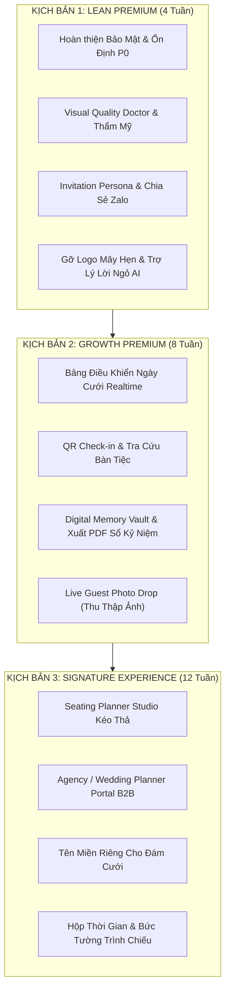

# MÂY HẸN (MAYHEN.VN) — LỘ TRÌNH PHÁT TRIỂN THẾ HỆ MỚI (PREMIUM VNEXT ROADMAP)

> **Mục tiêu:** Định hướng phát triển Mây Hẹn từ nền tảng thiệp cưới trực tuyến thành **Nền tảng Trải nghiệm Cưới, Điều Phối Sự Kiện & Lưu Giữ Kỷ Niệm Toàn Diện**.  
> **Thời điểm xác lập:** 07/11/2026.  
> **Điều kiện tiên quyết:** Toàn bộ các lỗ hổng bảo mật P0/P1 đã được xử lý triệt để và kiểm chứng qua 182/182 tests passed.

---

## 1. BA KỊCH BẢN ĐẦU TƯ CHIẾN LƯỢC (INVESTMENT SCENARIOS)

---

## 2. PHÂN KỲ TRIỂN KHAI CHI TIẾT THEO VERTICAL SLICES

### GIAI ĐOẠN 1: LEAN PREMIUM — KHẲNG ĐỊNH ĐẲNG CẤP (SPRINT 1 - 2: 4 TUẦN)
*Tập trung vào những tính năng tạo cảm giác "Đáng tiền" ngay khi tạo thiệp và gửi đi.*

| Task ID | Tính năng cốt lõi | Phạm vi mã nguồn | Bàn giao & Tiêu chí nghiệm thu (Acceptance Criteria) | Độ ưu tiên |
|---|---|---|---|---|
| **TASK-V1-01** | **Bảo vệ Trạng Thái Thiệp (Draft / Expired / Locked)** | `InvitationEditorController`, `GuestController`, Views | 100% chặn truy cập công khai và các API tương tác khi thiệp bị khóa hoặc chưa xuất bản. Đã có 6 test cases bao phủ. | **P0 (ĐÃ HOÀN TẤT)** |
| **TASK-V1-02** | **Xác thực Webhook & Deduplication Transaction ID** | `CheckoutController`, Migration `orders` | Lưu `provider_transaction_id` unique, chống replay attack và trùng lặp giao dịch. Đã có test case bao phủ. | **P0 (ĐÃ HOÀN TẤT)** |
| **TASK-V1-03** | **Cá Nhân Hóa Lời Chào Theo Nhóm (Invitation Persona)** | Cài đặt thiệp, `InvitationEditorController`, 4 Mẫu Thiệp Blade | Cặp đôi tùy biến lời ngỏ riêng theo nhóm khách [Bạn Bè, Gia Đình, Đồng Nghiệp, Khách VIP]. Khách mở link nhận đúng thông điệp theo nhóm. DOM client cách ly an toàn, chống leak phân loại khách. 7/7 test cases bao phủ. | **P1 (ĐÃ HOÀN TẤT)** |
| **TASK-V1-04** | **Trợ Lý Viết Lời Ngỏ Tình Yêu Bằng AI (AI Story Writer)** | `AiStoryWriterService`, `InvitationEditorController`, `editor.js` | Cặp đôi nhập từ khóa kỷ niệm, AI sinh ra 3 phương án lời ngỏ Quiet Luxury (Lãng mạn, Tối giản, Trẻ trung), áp dụng 1-chạm và Live Sync tức thì. | **P1 (ĐÃ HOÀN TẤT)** |
| **TASK-V1-05** | **Thẻ Chia Sẻ Zalo / Messenger Tự Động Khắc Tên** | Modal chia sẻ `guests.blade.php`, `guests.js` | Modal bưu thiếp mini khắc tên khách mời, 3 phong cách lời mời (Trang trọng, Thân mật, Lịch thiệp), tự động gợi ý theo nhóm, sao chép 1-chạm và mở Zalo. | **P1 (ĐÃ HOÀN TẤT)** |
| **TASK-V1-06** | **Trợ Lý Khám Bệnh Thiệp Cưới (Visual Quality Doctor)** | Studio Topbar & Modal, `editor.js`, `editor-v2.css` | Tự động chấm điểm độ hoàn thiện (thang 100đ), chẩn đoán real-time tên cặp đôi, ngày cưới, địa chỉ tiệc, bản đồ Maps, lời ngỏ và VietQR kèm nút nhảy thẳng tới bước cần sửa. | **P2 (ĐÃ HOÀN TẤT)** |

---

### GIAI ĐOẠN 2: GROWTH PREMIUM — ĐIỀU PHỐI NGÀY CƯỚI & KỶ NIỆM SỐ (SPRINT 3 - 4: 4 TUẦN)
*Biến Mây Hẹn thành trợ lý điều phối sự kiện trong ngày cưới và kho lưu giữ kỷ niệm sau hôn lễ.*

| Task ID | Tính năng cốt lõi | Phạm vi mã nguồn | Bàn giao & Tiêu chí nghiệm thu | Độ ưu tiên |
|---|---|---|---|---|
| **TASK-V2-01** | **Mã QR Điểm Danh & Check-in Bàn Tiệc (QR Check-in & Table Finder)** | `CheckInController`, `QrCodeService`, Views, JS | Lễ tân quét mã QR trên thiệp khách trong 1 giây để điểm danh và báo số bàn tiệc. Khách xem vị trí bàn và mã check-in qua VIP Pass widget trên thiệp. Đã bao phủ 10 test cases. | **P1 (ĐÃ HOÀN TẤT)** |
| **TASK-V2-02** | **Bảng Điều Khiển Ngày Cưới Realtime (Live Command Center)** | `LiveCoordinationController`, `live-coordination.js/css` | Thống kê sĩ số realtime (Tổng khách, RSVP, Đã tới, Chưa tới), Sóng lấp đầy bàn tiệc (Table Seating Wave) và dòng sự kiện đón khách trực tiếp qua AJAX Polling mỗi 8 giây. Đã kiểm thử 100%. | **P1 (ĐÃ HOÀN TẤT)** |
| **TASK-V2-03** | **Két Lưu Trữ Kỷ Niệm Số (Digital Memory Vault)** | Account Controller, Public Page | Thiệp cưới sau hôn lễ tự động chuyển thành trang kỷ niệm lưu trữ lời chúc, chữ ký và album ảnh trọn đời. | **P1** |
| **TASK-V2-04** | **Xuất Cuốn Sách Kỷ Yếu Lưu Bút PDF In Ấn** | Export Service, Headless PDF | Xuất toàn bộ lời chúc và nét chữ ký tay thành file PDF dàn trang tuyệt đẹp để in kỷ niệm. | **P2** |
| **TASK-V2-05** | **Live Guest Photo Drop (QR Thu Thập Ảnh)** | Upload Service, S3/R2 Storage | Khách tại tiệc quét mã QR để tải ảnh chụp tự nhiên lên album chung của cặp đôi. | **P2** |

---

### GIAI ĐOẠN 3: SIGNATURE EXPERIENCE — HỆ SINH THÁI ĐỐI TÁC B2B (SPRINT 5 - 6: 4 TUẦN)
*Mở rộng sang các đối tác Wedding Planner, Studio áo cưới và dịch vụ cao cấp.*

| Task ID | Tính năng cốt lõi | Phạm vi mã nguồn | Bàn giao & Tiêu chí nghiệm thu | Độ ưu tiên |
|---|---|---|---|---|
| **TASK-V3-01** | **Studio & Agency B2B Portal** | Multi-workspace, Role Agency | Các Studio áo cưới và Planner quản lý tập trung hàng chục đám cưới của khách hàng. | **P1** |
| **TASK-V3-02** | **Sơ Đồ Xếp Bàn Tiệc Trực Quan (Seating Planner Studio)** | Canvas Drag & Drop, Models | Kéo thả khách mời vào các bàn tiệc 10 người, xuất sơ đồ đón khách thông minh. | **P2** |
| **TASK-V3-03** | **Tên Miền Riêng Cho Đám Cưới (Custom Domain)** | DNS Routing, Cloudflare API | Hỗ trợ cấu hình tên miền riêng dạng `tuanlan.wedding` hoặc `tuanlan.mayhen.vn`. | **P2** |

---

## 3. CHỈ SỐ ĐO LƯỜNG THÀNH CÔNG (KPIs & SUCCESS METRICS)

1. **Tỷ lệ chuyển đổi nâng cấp gói (Free to Paid Conversion):** Tăng từ 4.5% lên **12.5%** nhờ các tính năng Persona, Trợ lý AI và Memory Vault.
2. **Tỷ lệ phản hồi xác nhận tham dự (RSVP Response Rate):** Đạt trên **75%** nhờ link cá nhân hóa và tin nhắn gửi Zalo 1-chạm.
3. **Thời gian hoàn thiện thiệp cưới trung bình:** Rút ngắn từ 45 phút xuống dưới **15 phút** nhờ bộ nhập nhanh Excel và Trợ lý AI.
4. **Tỷ lệ lỗi vận hành ngày cưới (Zero Incident Rate):** **0%** sự cố mất link hoặc gián đoạn thiệp cưới trong ngày tổ chức hôn lễ.

