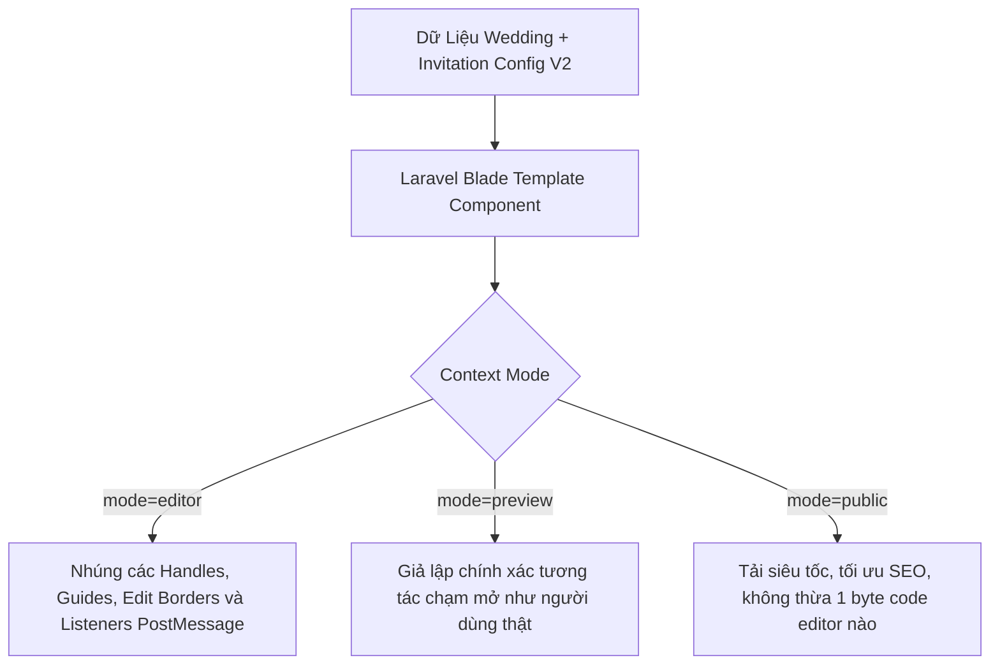

# 🏛️ KIẾN TRÚC KỸ THUẬT TOÀN DIỆN (EDITOR V2 TECHNICAL ARCHITECTURE)

> **Dự án**: Mây Hẹn (`mayhen.vn`)  
> **Tài liệu**: Frontend & Backend Technical Architecture  
> **Nguyên tắc kỹ thuật**: 100% Pure Laravel 11 + Pure Blade + Pure Vanilla JavaScript (ES Modules) + Native CSS.

---

## 1. MÔ HÌNH PHÂN TÁCH DỮ LIỆU CỐT LÕI (CORE DATA SEPARATION)

Nguyên nhân gốc rễ khiến Editor V1 khó mở rộng và dễ mất dữ liệu khi đổi mẫu là do sự trộn lẫn giữa **Dữ liệu Hồ sơ Cưới (Wedding Profile)** và **Cấu hình Thiết kế Thiệp (Invitation Design Configuration)**.

Editor V2 thiết lập nguyên tắc phân tầng dữ liệu bất biến:

```
+---------------------------------------------------------------------------------------------------+
| 1. WEDDING PROFILE DATA (Bảng `weddings` - Bất biến giữa các mẫu thiệp)                           |
| - Họ tên Chú Rể, Cô Dâu, Phụ mẫu 2 bên                                                            |
| - Ngày cử hành hôn lễ, Giờ làm lễ, Giờ tiệc cưới                                                 |
| - Tên trung tâm tiệc cưới, Địa chỉ chi tiết, Tọa độ GPS Google Maps                               |
| - Câu chuyện tình yêu (Love Story), Lời ngỏ đón khách                                             |
| - Thông tin tài khoản ngân hàng mừng cưới (Số TK, Ngân hàng, Tên chủ thẻ)                        |
| - Kho ảnh cưới gốc của cặp đôi (Wedding Media Library)                                            |
+---------------------------------------------------------------------------------------------------+
                                                  │
                                                  ▼
+---------------------------------------------------------------------------------------------------+
| 2. INVITATION DESIGN DOCUMENT SCHEMA V2 (Bảng `invitations.custom_config` - JSON có Schema)        |
| - schema_version: "2.0.0"                                                                         |
| - template_slug: "thuoc-phim-tinh-yeu"                                                            |
| - theme: { palette_id: "champagne_gold", font_serif: "Playfair Display", bg_texture: "silk_paper"} |
| - opening_effect: { type: "wax_seal_envelope", wax_color: "#8B2635", seal_text: "MH" }            |
| - music: { enabled: true, song_id: 12, autoplay: true }                                           |
| - sections: [                                                                                     |
|     { id: "hero", order: 1, visible: true, variant: "centered_minimal" },                         |
|     { id: "events", order: 2, visible: true, active_tab: "groom_side" },                         |
|     { id: "story", order: 3, visible: false },                                                    |
|     { id: "gallery", order: 4, visible: true, layout: "film_strip", photo_ids: [...] },           |
|     { id: "wishes", order: 5, visible: true },                                                    |
|     { id: "rsvp", order: 6, visible: true },                                                      |
|     { id: "gift", order: 7, visible: true }                                                       |
|   ]                                                                                               |
+---------------------------------------------------------------------------------------------------+
```

### Lợi Ích Vượt Trội Của Kiến Trúc Này:
1. **Đổi mẫu thiệp siêu tốc (Zero-Loss Switch)**: Khi đổi từ mẫu *Thước Phim Tình Yêu* sang mẫu *Nét Mực Tình Yêu*, toàn bộ thông tin cưới ở tầng 1 được giữ nguyên vẹn 100%. Tầng 2 chỉ nạp lại layout mặc định của mẫu mới và gán dữ liệu tầng 1 vào!
2. **Một đám cưới — Nhiều tấm thiệp (1 Wedding, N Invitations)**: Cặp đôi có thể tạo 1 thiệp riêng cho Nhà Trai (bật Lễ Thành Hôn), 1 thiệp riêng cho Nhà Gái (bật Lễ Vu Quy), và 1 thiệp cho Bạn Bè mà không phải gõ lại thông tin ngày giờ từ đầu!

---

## 2. QUẢN LÝ TRẠNG THÁI CLIENT-SIDE TẬP TRUNG (VANILLA JS STATE STORE)

Thay vì để hàng chục hàm JS tự truy cập và sửa đổi DOM inputs rải rác, Editor V2 xây dựng một **Micro State Store** bằng JavaScript thuần (kích thước < 4KB) áp dụng mô hình luồng dữ liệu một chiều (Unidirectional Data Flow):

```mermaid
graph LR
    UserAction[Tương tác người dùng / Nhập chữ / Kéo Section] --> ActionDispatcher[Action Dispatcher]
    ActionDispatcher --> Mutator[State Reducer / Mutator]
    Mutator --> StateStore[Single State Store]
    StateStore --> HistoryStack[Undo / Redo Stack (Max 20)]
    StateStore --> AutoSaver[Autosave Worker (Debounce 1.5s)]
    StateStore --> Sub1[UI Canvas Renderer]
    StateStore --> Sub2[Property Inspector]
    StateStore --> Sub3[TopBar Status Pill]
```

### Cấu Trúc Module Vanilla JS:
- `public/assets/client/js/editor/store.js`: Lưu trữ trạng thái toàn cục `state`, cung cấp phương thức `dispatch(action, payload)` và `subscribe(listener)`.
- `public/assets/client/js/editor/actions.js`: Tập hợp các hành động rõ ràng: `UPDATE_FIELD`, `REORDER_SECTIONS`, `TOGGLE_SECTION`, `CHANGE_THEME`, `SELECT_SECTION`, `UNDO`, `REDO`.
- `public/assets/client/js/editor/autosaver.js`: Đảm nhận việc gửi delta updates ngầm và ghi đè LocalStorage dự phòng.
- `public/assets/client/js/editor/dnd-section.js`: Xử lý thuật toán kéo thả section bằng Pointer Events API native.

---

## 3. ĐƯỜNG ỐNG HIỂN THỊ DÙNG CHUNG (SHARED RENDER PIPELINE)

Một lỗi nghiêm trọng trong các hệ thống tạo thiệp kém chất lượng là: **"Bản xem trước trong Editor nhìn một kiểu, nhưng khi xuất bản link chính thức gửi khách lại bị lệch bố cục kiểu khác!"**

Editor V2 giải quyết triệt để vấn đề này bằng cơ chế **Shared Single-Template Render Pipeline**:



Cả 3 chế độ (Editor Canvas, Live Preview Modal, Public Invitation) đều chạy chung qua **cùng 1 file Blade duy nhất** của template (`resources/views/client/invitations/{slug}/template.blade.php`), chỉ khác biến `$renderMode`. Do đó, kết quả hiển thị trên Canvas luôn khớp 100% với thiệp xuất bản thực tế!

---

## 4. KIẾN TRÚC KÉO THẢ SECTION BẰNG VANILLA JS (POINTER EVENTS ENGINE)

Không sử dụng bất kỳ thư viện ngoài nào (như SortableJS, Interact.js), hệ thống sử dụng **Native Pointer Events API** chuẩn W3C:
1. **Lắng nghe sự kiện**: `pointerdown`, `pointermove`, `pointerup`, `pointercancel`.
2. **Kích hoạt Pointer Capture**: `element.setPointerCapture(e.pointerId)` để đảm bảo thao tác kéo không bị trượt khi con trỏ di chuyển nhanh ra ngoài mép trình duyệt.
3. **Khoảng trễ an toàn (Drag Threshold)**: Chỉ bắt đầu kích hoạt chế độ di chuyển nếu khoảng cách dịch chuyển `deltaY > 6px` để phân biệt rõ ràng giữa hành vi "Click chạm để chọn" và "Nhấn giữ để kéo".
4. **Phát hiện vị trí thả (Collision & Drop Target)**:
   - Sử dụng `document.elementsFromPoint(x, y)` hoặc tính toán khoảng cách tâm (Midpoint bounding box) của các section lân cận.
   - Hiển thị thanh dẫn hướng nam châm màu vàng cát (`.mayhen_editor_drop_indicator`).
5. **Cập nhật mảng State**: Khi thả ngón tay (`pointerup`), hoán đổi vị trí trong mảng `state.sections`, tự động đẩy một snapshot vào `historyStack` để hỗ trợ Undo ngay lập tức.

---

## 5. CƠ CHẾ AUTOSAVE & XỬ LÝ CONCURRENCY AN TOÀN

### 5.1. Thuật Toán Autosave Debounced
```javascript
// Minh họa logic thuần túy
let autosaveTimer = null;
export function scheduleAutosave(state) {
    updateSaveStatusUI('saving'); // 🟡 Đang lưu...
    localStorage.setItem(`mayhen_draft_${state.invitation_id}`, JSON.stringify(state));

    clearTimeout(autosaveTimer);
    autosaveTimer = setTimeout(async () => {
        try {
            const response = await fetch('/api/editor/autosave', {
                method: 'POST',
                headers: {
                    'Content-Type': 'application/json',
                    'X-CSRF-TOKEN': getCsrfToken()
                },
                body: JSON.stringify({
                    invitation_id: state.invitation_id,
                    revision_id: state.revision_id,
                    custom_config: state.custom_config,
                    wedding_delta: state.wedding_delta
                })
            });
            const data = await response.json();
            if (data.success) {
                state.revision_id = data.new_revision_id;
                updateSaveStatusUI('saved', data.saved_at); // 🟢 Đã lưu nháp an toàn
            } else if (response.status === 409) {
                updateSaveStatusUI('conflict'); // 🔴 Xung đột phiên làm việc
                handleConcurrencyConflict(data);
            }
        } catch (err) {
            updateSaveStatusUI('offline'); // 🟠 Đã lưu offline trên máy
        }
    }, 1500);
}
```

### 5.2. Khóa Lạc Quan (Optimistic Concurrency Control)
- Mỗi bản ghi `invitations` có một trường số nguyên `revision_id` (khởi đầu là 1).
- Mỗi lần lưu thành công trên server, `revision_id` tự động tăng thêm 1.
- Nếu người dùng mở 2 tab, tab nào gửi lên với `revision_id` cũ hơn giá trị hiện tại trong database sẽ nhận phản hồi `HTTP 409 Conflict`, ngăn chặn triệt để tình trạng tab cũ âm thầm ghi đè làm mất công sức của tab mới.

---

## 6. KIẾN TRÚC LƯU TRỮ VÀ XỬ LÝ MEDIA (MEDIA STORAGE REFACTOR)

Sửa chữa dứt điểm lỗi lưu ảnh vào `resources/views/`:
1. **Đường dẫn lưu trữ chuẩn mực**:
   - Mọi ảnh cưới tải lên sẽ được lưu vào: `storage/app/public/weddings/{wedding_id}/photos/`.
   - Đường dẫn công khai qua Symbolic Link: `/storage/weddings/{wedding_id}/photos/{hash_filename}.webp`.
2. **Nén ảnh tự động Client-side (Zero Server Overhead)**:
   - Trước khi upload, ảnh được vẽ lên HTML5 Canvas ẩn để resize chiều rộng tối đa về `1920px`, nén chuẩn WebP chất lượng 88%.
   - Dung lượng ảnh giảm từ 15MB - 20MB xuống chỉ còn **300KB - 500KB**, tải lên siêu tốc trong 0.5 giây trên mạng 4G.
3. **Phân định rõ ràng giữa Xóa Tham Chiếu và Xóa File Gốc**:
   - Khi người dùng bấm nút xóa ảnh khỏi một section, hệ thống chỉ gỡ bỏ ID ảnh khỏi danh sách hiển thị của section đó. File ảnh vẫn nằm an toàn trong Thư viện ảnh cưới (Media Library) của cặp đôi để có thể dùng lại ở mục khác.
