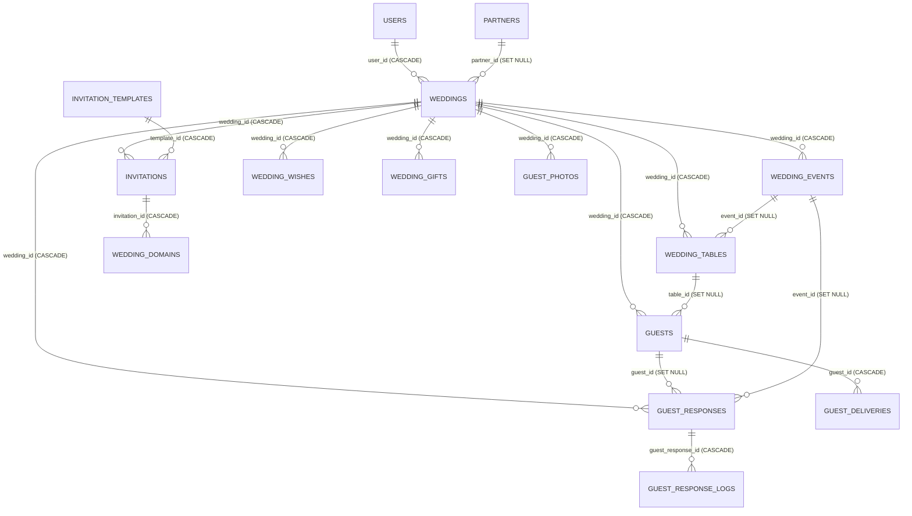

# 00 — SOURCE TRUTH & ROUTE INVENTORY (MÂY HẸN CLIENT OPERATIONS)

> **Trạng thái kiểm kê:** Đã xác minh trực tiếp từ `php artisan route:list --json` (`779` routes toàn hệ thống), `routes/web.php` (`711` dòng), `82` Client Controllers + `4` Partner Controllers, Models, Migrations, Blade Views, Vanilla ES Modules và Vanilla CSS.

---

## 1. Kiến trúc dữ liệu thực tế (`wedding_id` vs `invitation_id` vs `event_id`)

### 1.1. Sơ đồ phân cấp thực thể trong Database

### 1.2. Sự thật quan trọng về phạm vi dữ liệu (`Data Scope Truth`)

| Bảng dữ liệu | Khóa phạm vi chính | Có cột `invitation_id`? | Có cột `event_id`? | Ghi chú kiến trúc quan trọng |
| :--- | :--- | :---: | :---: | :--- |
| `weddings` | `user_id`, `partner_id` | — | — | Chứa thông tin cặp đôi, ngày cưới chính, địa điểm, tài khoản mừng cưới. Không dùng `SoftDeletes`. |
| `invitations` | `wedding_id`, `template_id` | PK `id` | — | Chứa `slug`, `is_published`, `expires_at`, `revision_id`, `custom_config` (JSON: `checkin_pin`, `rsvp_deadline`, `allow_rsvp`, `allow_wishes`, `privacy_settings`, `reception_shifts`, `table_finder`, `persona_messages`, `parking_guide`), `draft_config`. |
| `guests` | `wedding_id` | Không | `event_ids` (JSON mảng ID) | Mỗi bản ghi là **1 lời mời / hộ khách / nhóm khách đi chung** với `guest_token` duy nhất, `expected_attendees`, `max_attendees`, `table_id`, `table_name`, `is_sent`, `opened_at`, `open_count`, `checked_in_at`, `checked_in_attendees`. `is_checked_in` là **PHP accessor** (`checked_in_at !== null`), không phải cột SQL! |
| `guest_responses` | `wedding_id`, `guest_id` (nullable), `event_id` (nullable) | Không | Có (`nullable`) | Lưu phản hồi RSVP: `attending_status` (`attending` \| `declined` \| `uncertain`), `adults_count`, `children_count`, `dietary_requirements`, `wishes`, `shuttle_bus_needed`. Khi khách vãng lai gửi qua link chung không có `?token=`, `guest_id = NULL`. |
| `guest_response_logs` | `wedding_id`, `guest_id`, `guest_response_id` | Không | — | Nhật ký biến động RSVP (`source`: `public_token`, `public_form`, `manual_host`, `family_portal`, `reception_desk`). |
| `guest_deliveries` | `wedding_id`, `invitation_id`, `guest_id` | Có | — | Nhật ký chuẩn bị lời mời / đánh dấu gửi thủ công (`channel`: `zalo`, `copy`, `sms`, `email`). **Không có kết nối cổng SMS/Zalo OA tự động gửi thay chủ thiệp.** |
| `wedding_tables` | `wedding_id`, `event_id` (nullable) | Không | Có (`nullable`) | Bàn tiệc: `name`, `shape`, `capacity`, `zone` (không có cột `side`), `pos_x`, `pos_y`, `display_order` (không có cột `order`). |
| `wedding_events` | `wedding_id` | Không | PK `id` | Các buổi lễ con (Vu Quy, Thành Hôn, Tiệc Cưới, Báo Hỷ): `name`, `event_type`, `event_date`, `event_time`, `display_order`, `is_active`. |
| `wedding_wishes` | `wedding_id`, `guest_id` (nullable) | Không | — | Sổ lưu chúc phúc: `is_approved`, `is_private`, `is_pinned`, `signature_url`, `reply`. |
| `wedding_gifts` | `wedding_id`, `guest_id` (nullable) | Không | — | Sổ mừng cưới tài chính của gia đình (`side`, `gift_type`, `amount`, `thank_you_sent`). |
| `guest_photos` | `wedding_id`, `invitation_id`, `guest_id` (nullable) | Có | — | Kho ảnh khách mời tải lên (`Photo Drop`), hỗ trợ kiểm duyệt hiển thị trên `Live Wall` & `Memory Vault`. |

---

## 2. Kiểm kê đầy đủ Route Khu Vực Khách Hàng & Vận Hành Đám Cưới

### 2.1. Cổng Tài Khoản Chung (`/tai-khoan*` — Middleware `auth`)

| Method | URI | Route Name | Controller @ Action | View / Output |
| :--- | :--- | :--- | :--- | :--- |
| `GET` | `/tai-khoan` | `account.dashboard` | `AccountController@index` | `client.pages.account.dashboard` |
| `GET` | `/tai-khoan/thiep` | `account.invitations` | `AccountController@invitations` | `client.pages.account.invitations` |
| `GET` | `/tai-khoan/don-hang` | `account.orders` | `AccountController@orders` | `client.pages.account.orders` |
| `GET` | `/tai-khoan/ho-so` | `account.profile` | `AccountController@profile` | `client.pages.account.profile` |
| `PUT` | `/tai-khoan/ho-so` | `account.profile.update` | `AccountController@updateProfile` | Redirect `account.profile` |
| `PUT` | `/tai-khoan/mat-khau` | `account.password.update` | `AccountController@updatePassword` | Redirect `account.profile` |
| `GET` | `/tai-khoan/ho-tro` | `account.support.index` | `ClientSupportController@index` | `client.pages.account.support.index` |
| `POST` | `/tai-khoan/ho-tro` | `account.support.store` | `ClientSupportController@store` | Redirect |
| `GET` | `/tai-khoan/ho-tro/{ticketNumber}` | `account.support.show` | `ClientSupportController@show` | `client.pages.account.support.show` |
| `POST` | `/tai-khoan/ho-tro/{ticketNumber}/phan-hoi` | `account.support.reply` | `ClientSupportController@reply` | Redirect |
| `POST` | `/tai-khoan/ho-tro/{ticketNumber}/dong` | `account.support.close` | `ClientSupportController@close` | Redirect |

### 2.2. Quản Lý Thiệp, Vòng Đời & Cài Đặt (`/tai-khoan/thiep/{id}/*`)

| Method | URI | Route Name | Controller @ Action | Chức năng chính |
| :--- | :--- | :--- | :--- | :--- |
| `GET` | `/tai-khoan/thiep/{id}/cai-dat` | `account.invitations.settings` | `AccountController@settings` | Cấu hình URL slug, mật khẩu mở thiệp, mã PIN lễ tân, hạn RSVP, kiểm duyệt lời chúc, đỗ xe, OG meta |
| `PUT` | `/tai-khoan/thiep/{id}/cai-dat` | `account.invitations.settings.update` | `AccountController@updateSettings` | Lưu toàn bộ cấu hình thiệp |
| `POST` | `/tai-khoan/thiep/{id}/trang-thai` | `account.invitations.toggle_publish` | `AccountController@togglePublish` | Bật / Tạm dừng xuất bản công khai |
| `POST` | `/tai-khoan/thiep/{id}/nhan-ban` | `account.invitations.duplicate` | `AccountController@duplicate` | Nhân bản mẫu thiệp |
| `POST` | `/tai-khoan/thiep/{id}/khoi-phuc-ban-truoc` | `account.invitations.rollback` | `AccountController@rollback` | Khôi phục snapshot xuất bản liền trước |
| `DELETE` | `/tai-khoan/thiep/{id}` | `account.invitations.destroy` | `AccountController@destroy` | Xóa vĩnh viễn thiệp (yêu cầu xác nhận slug) |
| `GET/POST` | `/tai-khoan/thiep/{id}/so-sanh-xuat-ban` | `account.publish_diff.*` | `PublishDiffController@index/publish` | So sánh thay đổi nháp vs bản công khai & xuất bản |
| `GET/POST` | `/tai-khoan/thiep/{id}/kiem-tra-chat-luong` | `account.quality_doctor.*` | `QualityDoctorController@index/simulate` | Kiểm tra chất lượng thiệp trước khi gửi |
| `GET/POST` | `/tai-khoan/thiep/{id}/tach-thiep-hai-nha` | `account.ceremony_fork.*` | `CeremonyForkController@create/store` | Tách thiệp riêng Nhà Trai / Nhà Gái |
| `GET` | `/tai-khoan/thiep/{id}/gia-han` | `account.invitations.renewal` | `InvitationRenewalController@show` | Gia hạn lưu trữ thiệp cưới |
| `GET/POST` | `/tai-khoan/thiep/{id}/doi-lich-cuoi` | `account.reschedule.*` | `WeddingRescheduleController@show/execute` | Đổi ngày/địa điểm cưới & yêu cầu xác nhận lại |
| `GET` | `/tai-khoan/thiep/{id}/thong-ke` | `account.invitations.analytics` | `InvitationAnalyticsController@show` | Thống kê lượt xem, thiết bị, phễu RSVP |

### 2.3. Quản Lý Khách Mời, Phân Phối, RSVP & Hộ Gia Đình (`Guest CRM Core`)

| Method | URI | Route Name | Controller @ Action | Chức năng chính |
| :--- | :--- | :--- | :--- | :--- |
| `GET` | `/tai-khoan/thiep/{id}/khach-moi` | `guests.index` | `GuestController@index` | Trung tâm CRM khách mời, KPI, bộ lọc, bảng khách & 7 modal |
| `POST` | `/tai-khoan/thiep/{id}/khach-moi` | `guests.store` | `GuestController@store` | Thêm 1 khách mời / hộ gia đình |
| `POST` | `/tai-khoan/thiep/{id}/khach-moi/nhap-hang-loat` | `guests.batch_store` | `GuestController@batchStore` | Dán nhanh danh sách nhiều dòng |
| `POST` | `/tai-khoan/thiep/{id}/khach-moi/nhap-csv` | `guests.import_csv` | `GuestController@importCsv` | Nhập file CSV / Excel UTF-8 |
| `GET` | `/tai-khoan/thiep/{id}/khach-moi/csv-mau` | `guests.csv_template` | `GuestController@downloadCsvTemplate` | Tải file CSV mẫu chuẩn |
| `POST` | `/tai-khoan/thiep/{id}/khach-moi/hoan-tac-nhap/{batchId}` | `guests.undo_import` | `GuestController@undoImportBatch` | Hoàn tác lô nhập CSV |
| `PUT` | `/tai-khoan/khach-moi/{id}` | `guests.update` | `GuestController@update` | Sửa thông tin khách & phân tuyến sự kiện |
| `DELETE` | `/tai-khoan/khach-moi/{id}` | `guests.destroy` | `GuestController@destroy` | Xóa khách mời |
| `POST` | `/tai-khoan/khach-moi/{id}/rsvp-thu-cong` | `guests.manual_rsvp` | `GuestController@manualRsvp` | Chủ thiệp ghi nhận RSVP hộ khách |
| `POST` | `/tai-khoan/khach-moi/{id}/toggle-sent` | `guests.toggle_sent` | `GuestController@toggleSent` | Đánh dấu / Bỏ đánh dấu đã gửi thiệp |
| `POST` | `/tai-khoan/khach-moi/{id}/tai-tao-token` | `guests.regenerate_token` | `GuestController@regenerateToken` | Thu hồi link cũ & cấp mã token mới |
| `GET` | `/tai-khoan/thiep/{id}/khach-moi/xuat-csv` | `guests.export` | `GuestController@exportCsv` | Xuất CSV theo bộ lọc hiện hành |
| `GET` | `/tai-khoan/thiep/{id}/khach-moi/in-danh-sach` | `guests.print` | `GuestController@print` | Bản in danh sách đón khách khổ A4 |
| `GET` | `/tai-khoan/thiep/{id}/khach-moi/soat-loi-gui` | `guests.presend_validation` | `GuestController@preSendValidation` | JSON kiểm tra thiếu SĐT / trùng tên / chưa xuất bản |
| `GET` | `/tai-khoan/thiep/{id}/khach-moi/ke-hoach-nhac-hen` | `guests.reminder_plan` | `GuestController@reminderPlan` | JSON danh sách khách cần nhắc phản hồi |
| `POST` | `/tai-khoan/khach-moi/{id}/danh-dau-da-nhac` | `guests.mark_reminded` | `GuestController@markReminded` | Ghi nhận đã gửi lời nhắc |
| `GET` | `/tai-khoan/thiep/{id}/khach-moi/loi-cam-on-sau-cuoi` | `guests.thank_you_messages` | `GuestController@thankYouMessages` | JSON gợi ý lời cảm ơn sau tiệc |
| `GET` | `/tai-khoan/thiep/{id}/phan-phoi/xem-truoc/{guestId}` | `guests.delivery.preview` | `InvitationDeliveryController@preview` | Xem trước nội dung lời mời cá nhân hóa |
| `POST` | `/tai-khoan/khach-moi/{id}/phan-phoi` | `guests.delivery.dispatch` | `InvitationDeliveryController@dispatchSingle` | Ghi nhận chuẩn bị / đánh dấu gửi cho 1 khách |
| `POST` | `/tai-khoan/thiep/{id}/phan-phoi/gui-hang-loat` | `guests.delivery.batch` | `InvitationDeliveryController@dispatchBatch` | Ghi nhận chuẩn bị / đánh dấu gửi hàng loạt |
| `GET` | `/tai-khoan/thiep/{id}/phan-phoi/lich-su` | `guests.delivery.history` | `InvitationDeliveryController@history` | Lịch sử ghi nhận gửi lời mời |
| `GET/POST` | `/tai-khoan/thiep/{id}/loc-trung-khach*` | `account.duplicate_guests.*` | `DuplicateGuestController` | Quét trùng SĐT/tên, gộp khách, xuất CSV |
| `GET/POST` | `/tai-khoan/thiep/{id}/nhac-hen-rsvp*` | `account.reminder.*` | `GentleReminderController` | Studio nhắc hẹn tế nhị & xuất CSV |
| `GET` | `/tai-khoan/thiep/{id}/lich-su-rsvp*` | `account.rsvp_history.*` | `RsvpChangeHistoryController` | Nhật ký kiểm toán biến động RSVP & xuất CSV |
| `GET/PUT` | `/tai-khoan/thiep/{id}/quan-tri-rsvp*` | `account.rsvp_enforcement.*` | `RsvpEnforcementController` | Khóa hạn chót RSVP, xe đưa đón, ăn chay/dị ứng |
| `GET/PUT` | `/tai-khoan/thiep/{id}/ho-gia-dinh*` | `account.household.*` | `HouseholdRsvpController` | Định mức suất theo hộ & Phiếu báo bếp trưởng |
| `GET/PUT` | `/tai-khoan/thiep/{id}/phan-nhom-thiep` | `account.smart_groups.*` | `SmartGroupInvitationController` | Phân tuyến hiển thị sự kiện theo nhóm khách |
| `GET/POST` | `/tai-khoan/thiep/{id}/su-kien-cuoi*` | `account.events.*` | `WeddingEventController` | Quản lý đa sự kiện (Vu Quy, Thành Hôn, Báo Hỷ) |
| `GET/POST` | `/tai-khoan/thiep/{id}/cong-gia-dinh*` | `account.family_portal.*` | `FamilyPortalController` | Cổng phụ huynh hai họ xem & thêm khách riêng |

### 2.4. Xếp Bàn Tiệc, Đón Khách QR & Điều Phối Ngày Cưới (`Venue & Reception Ops`)

| Method | URI | Route Name | Controller @ Action | Chức năng chính |
| :--- | :--- | :--- | :--- | :--- |
| `GET` | `/tai-khoan/thiep/{id}/so-do-ban-tiec` | `seating.index` | `SeatingPlannerController@index` | Sơ đồ bàn tiệc tương tác & Bác sĩ sức chứa |
| `POST` | `/tai-khoan/thiep/{id}/so-do-ban-tiec/ban` | `seating.storeTable` | `SeatingPlannerController@storeTable` | Tạo bàn tiệc mới |
| `PUT` | `/tai-khoan/thiep/{id}/so-do-ban-tiec/ban/{tableId}` | `seating.updateTable` | `SeatingPlannerController@updateTable` | Cập nhật thông tin bàn |
| `DELETE` | `/tai-khoan/thiep/{id}/so-do-ban-tiec/ban/{tableId}` | `seating.deleteTable` | `SeatingPlannerController@deleteTable` | Xóa bàn (đưa khách về chưa xếp bàn) |
| `POST` | `/tai-khoan/thiep/{id}/so-do-ban-tiec/xep-khach` | `seating.assignGuest` | `SeatingPlannerController@assignGuest` | Xếp khách vào bàn hoặc gỡ khỏi bàn |
| `POST` | `/tai-khoan/thiep/{id}/so-do-ban-tiec/vi-tri` | `seating.updatePositions` | `SeatingPlannerController@updatePositions` | Lưu tọa độ bố trí bàn trên sảnh |
| `GET` | `/tai-khoan/thiep/{id}/so-do-ban-tiec/in` | `seating.print` | `SeatingPlannerController@printChart` | In sơ đồ sảnh tiệc khổ A4 |
| `GET/PUT` | `/tai-khoan/thiep/{id}/tra-cuu-ban-tiec` | `account.table_finder.*` | `GuestTableFinderController@index/update` | Cấu hình công cụ khách tự tra cứu bàn |
| `GET` | `/tai-khoan/thiep/{id}/si-so-ban-tiec` | `account.table_capacity.index` | `TableCapacityWaveController@index` | Theo dõi lấp đầy bàn & đợt lên món |
| `GET` | `/tai-khoan/thiep/{id}/goi-ngoai-tuyen*` | `account.offline_pack.*` | `EmergencyOfflinePackController` | Tải gói HTML/JSON điểm danh ngoại tuyến |
| `GET` | `/tai-khoan/thiep/{id}/bo-du-phong-ngay-cuoi` | `account.invitations.resilience_kit` | `AccountController@resilienceKit` | Bộ tài liệu in dự phòng mất mạng |
| `GET` | `/tai-khoan/thiep/{id}/dieu-phoi` | `coordination.index` | `LiveCoordinationController@index` | Bảng điều phối trực tiếp ngày cưới |
| `GET` | `/api/thiep/{id}/dieu-phoi/feed` | `coordination.feed` | `LiveCoordinationController@liveFeed` | JSON realtime tiến độ đón khách & bàn |
| `GET` | `/diem-danh-tiec/{slug}` | `checkin.portal` | `CheckInController@showPortal` | Cổng lễ tân quét QR & tìm nhanh khách |
| `POST` | `/diem-danh-tiec/{slug}/xac-thuc-pin` | `checkin.verify_pin` | `CheckInController@verifyPin` | Xác thực mã PIN lễ tân / ca trực |
| `POST` | `/api/diem-danh-tiec/{slug}/quet-ma` | `checkin.scan` | `CheckInController@processScan` | Xử lý quét QR / điểm danh theo khách |
| `GET` | `/api/diem-danh-tiec/{slug}/tim-nhanh` | `checkin.quickSearch` | `CheckInController@quickSearch` | Tìm khách theo tên / SĐT / bàn |
| `POST` | `/api/diem-danh-tiec/{slug}/huy/{guestId}` | `checkin.undo` | `CheckInController@undoCheckIn` | Hoàn tác điểm danh nhầm |
| `POST` | `/api/diem-danh-tiec/{slug}/ban-tiec/{guestId}` | `checkin.updateTable` | `CheckInController@updateTable` | Đổi bàn nhanh tại quầy lễ tân |
| `POST` | `/api/diem-danh-tiec/{slug}/ngoai-le/*` | `checkin.exception.*` | `CheckInController` | Khách walk-in, điều chỉnh số người đến, chuyển báo bận -> tham dự |
| `GET/POST` | `/api/diem-danh-tiec/{slug}/ca-truc/*` | `checkin.shift.*` | `CheckInController` | Tóm tắt & bàn giao ca trực lễ tân |

### 2.5. Trải Nghiệm Công Khai Của Khách Mời (`Public Invitation & Guest Endpoints`)

| Method | URI | Route Name | Controller @ Action | Chức năng chính |
| :--- | :--- | :--- | :--- | :--- |
| `GET` | `/thiep/{slug}` | `invitation.show` | `InvitationEditorController@show` | Xem thiệp công khai (hỗ trợ `?token={guestToken}`) |
| `POST` | `/thiep/{slug}/mo-khoa` | `invitation.unlock` | `InvitationEditorController@unlockPassword` | Mở khóa thiệp có mật mã riêng tư |
| `POST` | `/thiep/{slug}/rsvp` | `rsvp.submit` | `GuestController@submitRsvp` | Khách gửi / cập nhật xác nhận tham dự |
| `GET/POST` | `/thiep/{slug}/wishes` | `invitation.wish.*` | `GuestController@getWishes/submitWish` | Xem & gửi lời chúc mừng |
| `POST` | `/thiep/{slug}/tra-cuu-ban-tiec` | `invitation.table_finder.search` | `GuestTableFinderController@search` | Khách tự tra cứu vị trí bàn tiệc |
| `POST` | `/api/thiep/{id}/so-ky-ten/luu-chu-ky` | `invitation.signature.save` | `WeddingInteractiveEndingController@saveSignature` | Khách lưu chữ ký canvas kỷ niệm |
| `POST` | `/api/thiep/{id}/hop-mung-cuoi/nhan-qua` | `invitation.gift.reserve` | `WeddingGiftRegistryController@reserveItem` | Khách đăng ký tặng quà Wishlist |
| `GET` | `/khach-moi/{guestToken}` & `/diem-danh/{token}` | `checkin.concierge` / `checkin.qr_direct` | `CheckInController@guestConcierge` | Thẻ đón tiếp cá nhân hóa (QR + bàn + lịch + bản đồ) |
| `GET` | `/khach-moi/{guestToken}/lich-ics` | `checkin.concierge.ics` | `CheckInController@downloadIcs` | Tải lịch `.ics` về điện thoại |
| `GET` | `/thiep/{slug}/the-tham-du/{token}` | `guest.pass` | `CheckInController@guestPass` | Thẻ mời QR cá nhân |
