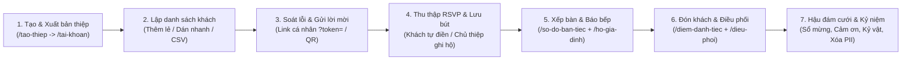

# 01 — USER JOURNEYS & ROLE AUTHORIZATION MATRIX

## 1. Bảy Hành Trình Cốt Lõi Của Cặp Đôi & Khách Mời

| Hành trình | Điểm bắt đầu | Các trang tham gia | Đầu ra nghiệp vụ bắt buộc đúng |
| :--- | :--- | :--- | :--- |
| **1. Khởi tạo & Quản lý thiệp** | `/tao-thiep` -> Lưu -> `/tai-khoan` | `/tai-khoan`, `/tai-khoan/thiep`, `/tai-khoan/thiep/{id}/cai-dat` | Chủ thiệp thấy đúng thiệp đang hoạt động, phân biệt rõ `Bản nháp` vs `Đã xuất bản` vs `Đã hết hạn` vs `Bị khóa`, có thể chọn thiệp nếu sở hữu nhiều thiệp. |
| **2. Xây dựng danh sách khách** | `/tai-khoan/thiep/{id}/khach-moi` | Tab Thêm 1 khách, Dán hàng loạt, Nhập CSV, Lọc trùng | Mỗi lời mời sinh `guest_token` duy nhất, chuẩn hóa SĐT, phát hiện trùng tên/SĐT, mặc định `expected_attendees` nhất quán, hoàn tác được lô nhập CSV nhầm. |
| **3. Cá nhân hóa & Gửi lời mời** | Bảng khách mời / Modal Mời Zalo | `/khach-moi`, `/chia-se-zalo`, `/nhac-hen-rsvp` | Chép đúng nội dung + link riêng `?token={guestToken}`. **Trung thực 100%:** hệ thống chỉ chuẩn bị nội dung & ghi nhận đánh dấu thủ công của chủ thiệp, không giả mạo trạng thái đã gửi SMS/Zalo tự động. |
| **4. Phản hồi RSVP (Đa kênh)** | `/thiep/{slug}?token=...` hoặc `/thiep/{slug}` hoặc Modal RSVP thủ công | Trang thiệp công khai, `/khach-moi`, `/lich-su-rsvp` | Ghi nhận chính xác `attending` (`adults_count + children_count >= 1`) hoặc `declined` (`0` người tham dự), tách bạch khách trong danh sách vs khách phản hồi qua link chung (`guest_id = null`), lưu đầy đủ `GuestResponseLog`. |
| **5. Xếp bàn & Chốt suất nhà hàng** | `/tai-khoan/thiep/{id}/so-do-ban-tiec` | `/so-do-ban-tiec`, `/ho-gia-dinh`, `/ban-giao-nha-cung-cap` | Sức chứa bàn tính theo `actualAttendeesCount()` (khách báo bận = `0` ghế, không được cộng nhầm vào suất ăn bếp tiệc), hỗ trợ cả kéo thả trên máy tính lẫn chọn bàn trực tiếp trên điện thoại. |
| **6. Đón khách & Điều phối lễ tân** | `/diem-danh-tiec/{slug}` (mã PIN lễ tân) | `/diem-danh-tiec/{slug}`, `/dieu-phoi`, `/si-so-ban-tiec` | Mã PIN lễ tân hiển thị đồng nhất 100% giữa Cài đặt, Điều phối, Bộ dự phòng và Cổng điểm danh; quét QR chống trùng (`lockForUpdate`), xử lý khách đi vượt suất / khách walk-in / hoàn tác điểm danh cập nhật ngay bộ đếm. |
| **7. Tri ân & Lưu trữ hậu sự kiện** | Sau ngày cưới | `/mung-cuoi`, `/loi-chuc`, `/ky-niem`, `/quyen-rieng-tu` | Gửi lời cảm ơn cá nhân hóa cho khách đã đến / gửi quà, xuất sổ lưu bút & sổ mừng cưới an toàn (chống CSV Formula Injection), ẩn thông tin nhạy cảm theo cấu hình Quyền riêng tư và xóa sạch PII khi chủ thiệp yêu cầu. |

---

## 2. Ma Trận Phân Quyền Theo Vai Trò (`Role & Access Control Matrix`)

| Tài nguyên / Thao tác | Chủ thiệp (`User` sở hữu `Wedding`) | Chủ thiệp ẩn danh (`owned_invitation_slugs` trong Session) | Người dùng khác (`Stranger User`) | Đối tác (`Partner` quản lý `Wedding`) | Phụ huynh (`Family Portal` Token + PIN) | Lễ tân (`Check-in PIN` / Ca trực) | Khách mời có `?token=` | Khách công khai (chỉ có `slug`) | Quản trị viên (`Admin` / `Manager`) |
| :--- | :---: | :---: | :---: | :---: | :---: | :---: | :---: | :---: | :---: |
| `/tai-khoan*` (Dashboard, Đơn hàng, Hồ sơ) | Cho phép | Chuyển hướng `/dang-nhap` | Chỉ thấy dữ liệu của chính họ | Khu vực `/doi-tac*` | Không | Không | Không | Không | Cho phép |
| `/tai-khoan/thiep/{id}/khach-moi` (CRUD khách, CSV, In) | Cho phép | Cho phép (thiệp tự tạo trong phiên) | **Chặn `404`** | Cho phép | Không (dùng Cổng Gia Đình riêng) | Không | Không | Không | Cho phép |
| `/tai-khoan/thiep/{id}/so-do-ban-tiec` | Cho phép | Cho phép | **Chặn `404`** | Cho phép | Không | Không | Không | Không | Cho phép |
| `/tai-khoan/thiep/{id}/phan-phoi/*`, `wishes`, `household`, `rsvp_history` | Cho phép | Không (`auth`) | **Chặn `403`** | Theo từng module | Không | Không | Không | Không | Cho phép (`isAdmin()`) |
| `/cong-gia-dinh/{token}` | Cho phép | Không | Chặn (yêu cầu PIN) | Không | Chỉ xem/cập nhật đúng bên Nội hoặc Ngoại khi cổng đang bật | Không | Không | Không | Cho phép |
| `/diem-danh-tiec/{slug}*` (Quét QR, Tìm khách, Ngoại lệ) | Cho phép thẳng | Cho phép thẳng | Chặn (yêu cầu PIN 6 số) | Cho phép | Không | Cho phép khi đúng PIN lễ tân / ca trực đang hoạt động | Không | Không | Cho phép |
| `/thiep/{slug}` (Xem thiệp, RSVP, Lời chúc, Ký tên, Tra cứu bàn) | Xem trước cả khi nháp / hết hạn (trừ khi `is_locked`); **cấm tự gửi RSVP** (`403`) | Xem trước cả khi nháp; **cấm tự gửi RSVP** (`403`) | Như khách công khai | Xem trước | Như khách công khai | Như khách công khai | Xem thiệp đã xuất bản + lời chào riêng; nếu token thu hồi -> **`410`** | Chỉ khi `is_published = true`, chưa hết hạn, không bị khóa, đã mở mật khẩu (nếu có) | Xem trước |
| `/khach-moi/{guestToken}` & `/diem-danh/{token}` (VIP Concierge & `.ics`) | Xem được | Xem được | Không có token -> `404` | Xem được | Không | Quét mã | Chỉ khi thiệp `is_published`, chưa hết hạn, không `is_locked` | Không có token -> `404` | Xem được |
| Xuất CSV / Sao lưu dữ liệu khi thiệp đã hết hạn (`isExpired`) | **Cho phép 100%** (Dữ liệu thuộc về chủ thiệp) | Theo phiên | Chặn | Theo quyền đối tác | Chặn | Chặn | Chặn | Chặn | Cho phép |
