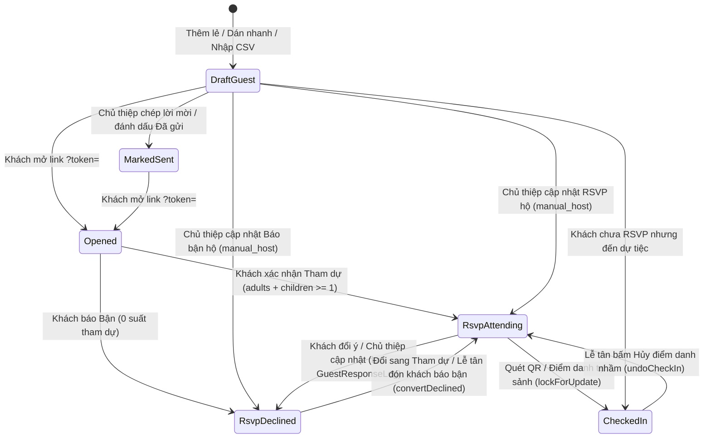

# 04 — GUEST HEADCOUNT & STATE MACHINE CONTRACT (HỢP ĐỒNG BẤT BIẾN VỀ SỐ LIỆU & TRẠNG THÁI)

> Tài liệu này định nghĩa **Nguồn Sự Thật Duy Nhất (`Single Source of Truth`)** cho toàn bộ số liệu khách mời, RSVP, bàn tiệc và điểm danh trên Mây Hẹn, được thực thi thống nhất thông qua `App\Services\WeddingGuestMetricsService`.

---

## 1. Bốn Khái Niệm Tuyệt Đối Không Bao Giờ Trộn Lẫn

| Khái niệm chuẩn | Tên hiển thị tiếng Việt chuẩn | Đơn vị | Công thức bất biến |
| :--- | :--- | :--- | :--- |
| **1. Invited Households / Links** | **Số lời mời trong danh sách** | `lời mời` (hoặc `nhóm khách`) | `COUNT(guests WHERE wedding_id = W)` |
| **2. Initial Expected Seats** | **Số suất dự kiến ban đầu** | `suất dự kiến` | `SUM(MAX(1, guests.expected_attendees) WHERE wedding_id = W)` |
| **3. Confirmed Attendees** | **Số người xác nhận tham dự** | `người` (`người lớn` + `trẻ em`) | Tổng số người từ các phản hồi `attending` đã khử trùng theo khách (`1 khách trả lời nhiều buổi lễ không bị nhân đôi tổng số người toàn đám cưới`, cộng riêng phản hồi qua link chung `guest_id IS NULL` nếu được bật). Khi xem theo từng buổi lễ (`event_id = E`), tính chính xác trên buổi lễ `E`. |
| **4. Checked-in Arrivals** | **Số người đã đến thực tế** | `người đã đến` (trên `lượt lời mời đã đón`) | `SUM(COALESCE(guests.checked_in_attendees, actualAttendeesCount(guest)) WHERE checked_in_at IS NOT NULL)` |

### Các chỉ số dẫn xuất bắt buộc khớp 100%:

1. **Số suất dự báo thực tế để đặt bàn (`Projected Banquet Seats`):**
   - Với mỗi `Guest` trong danh sách:
     - Nếu đã có phản hồi `attending`: lấy `MAX(1, adults_count + children_count)` (hoặc `checked_in_attendees` nếu đã đến đông hơn dự kiến).
     - Nếu tất cả phản hồi của khách là `declined`: **`0` suất** (tuyệt đối không tính vào mâm cỗ hay ghế ngồi!).
     - Nếu chưa phản hồi (`pending` / `uncertain`): giữ nguyên `MAX(1, expected_attendees)`.
   - Đây chính là hàm `Guest::actualAttendeesCount(?int $eventId = null)` dùng chung cho **Sơ đồ bàn tiệc**, **Phiếu báo bếp trưởng**, **Bản bàn giao nhà hàng** và **Cổng tiếp tân**.

2. **Tỷ lệ phản hồi danh sách mời (`Invited Response Rate`):**
   - Tử số: `respondedInvitedCount` = số `Guest` trong danh sách đã có ít nhất 1 `GuestResponse` (`0 <= respondedInvitedCount <= totalInvitedLinks`).
   - Mẫu số: `totalInvitedLinks` = `COUNT(guests)`.
   - Công thức: `totalInvitedLinks > 0 ? MIN(100, ROUND((respondedInvitedCount / totalInvitedLinks) * 100)) : 0`.
   - Các phản hồi từ khách vãng lai qua link chung (`guest_id IS NULL`) được hiển thị minh bạch thành chỉ số phụ **"+X phản hồi qua link chung"** thay vì cộng dồn vào tử số gây lỗi `>100%`!

3. **Trạng thái Gửi lời mời (`Delivery Status`) vs Mở thiệp (`Open Tracking`):**
   - `Đã đánh dấu gửi` (`is_sent = true`): phản ánh thao tác chuẩn bị / đánh dấu thủ công của chủ thiệp (sao chép lời mời, mở Zalo). **Tuyệt đối không hiển thị là hệ thống đã gửi SMS/Zalo tự động.**
   - `Khách đã mở xem` (`opened_at IS NOT NULL`, `open_count > 0`): chỉ tăng khi khách thực sự truy cập `/thiep/{slug}?token={guestToken}` (không tăng khi chủ thiệp tự mở xem trước).

---

## 2. Máy Trạng Thái Của Một Khách Mời (`Guest Lifecycle State Machine`)

---

## 3. Quy Tắc Toàn Vẹn Khi Chuyển Trạng Thái

1. **Khi gửi RSVP `attending` (cả Public lẫn Manual Host):**
   - Bắt buộc `adults_count + children_count >= 1`.
   - Mọi thay đổi (kể cả lần đầu chủ thiệp ghi hộ `manual_host`) đều phải lưu bản ghi kiểm toán trong `guest_response_logs`.
2. **Khi gửi RSVP `declined`:**
   - Lưu `adults_count = 0`, `children_count = 0`.
   - `actualAttendeesCount()` trả về **`0`**. Ghế ngồi trên bàn tiệc (nếu đã xếp trước đó) tự động giải phóng về `0` ghế chiếm dụng và **không cộng vào suất ăn bếp trưởng**.
3. **Khi chủ thiệp đặt lại trạng thái về `Chưa phản hồi (pending)`:**
   - Ghi nhận sự kiện kiểm toán vào `AuditLogger` trước khi xóa phản hồi hiện tại; nếu khách có lời chúc riêng trong `wedding_wishes`, lời chúc kỷ niệm vẫn được giữ an toàn.
4. **Khi chủ thiệp cập nhật RSVP hộ (`manualRsvp`):**
   - Nếu ô ghi chú để trống, **giữ nguyên** lời nhắn cũ của khách thay vì ghi đè bằng `null`.
5. **Khi gộp 2 khách trùng lặp (`DuplicateGuestDetectorService::merge`):**
   - Chỉ nhận `table_id` thuộc cùng `wedding_id`.
   - Khử trùng `GuestResponse` theo từng `event_id` (ưu tiên bản phản hồi mới nhất), bảo toàn trạng thái `checked_in_at` / `checked_in_attendees`, chuyển liên kết `WeddingWish` & `GuestPhoto`, và đưa `guest_token` của bản ghi bị gộp vào `revoked_tokens` để link cũ trả về thông báo `410` lịch sự.
6. **Khi xóa khách mời (`Guest::destroy`):**
   - Gỡ `guest_id = null` trên `guest_photos` và `wedding_wishes` trước khi xóa khách để không vô tình xóa mất ảnh kỷ niệm khách đã gửi tặng đám cưới; xóa toàn bộ `responses()` của khách đó.
