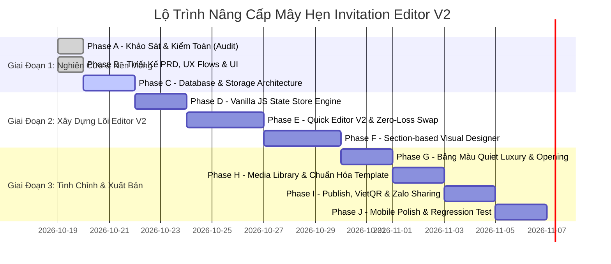

# 🗺️ LỘ TRÌNH TRIỂN KHAI NÂNG CẤP HỆ THỐNG (EDITOR V2 REFACTOR ROADMAP)

> **Dự án**: Mây Hẹn (`mayhen.vn`)  
> **Tài liệu**: Phân Kì Lộ Trình Triển Khai (Phase A — Phase J)  
> **Chiến lược**: Triển khai theo từng bước nhỏ (Incremental Refactor), kiểm thử chặt chẽ sau mỗi bước, bảo vệ 100% tính ổn định của hệ thống production.

---

## 1. TỔNG QUAN CÁC GIAI ĐOẠN TRIỂN KHAI

---

## 2. CHI TIẾT TỪNG GIAI ĐOẠN & ĐIỀU KIỆN TIÊN QUYẾT (DEPENDENCIES)

### Phase A — Nghiên Cứu & Kiểm Toán Toàn Diện (Research & Audit)
- **Mục tiêu**: Nghiên cứu sâu đối thủ Ngày Chung Đôi, mổ xẻ toàn bộ mã nguồn hiện tại của Mây Hẹn, tìm ra các lỗ hổng sản phẩm, UX và kiến trúc.
- **Trạng thái**: **ĐÃ HOÀN THÀNH**.
- **Đầu ra**: 2 tài liệu `ngaychungdoi-editor-benchmark.md` và `mayhen-editor-current-audit.md`.

### Phase B — Thiết Kế Lại Sản Phẩm & Trải Nghiệm (Product & UX Redesign)
- **Mục tiêu**: Định hình triết lý 2 tầng (Quick Editor + Visual Section Designer), chuẩn hóa User Flows, đặc tả giao diện Desktop/Mobile và Component Inventory.
- **Trạng thái**: **ĐÃ HOÀN THÀNH**.
- **Đầu ra**: 4 tài liệu `editor-v2-prd.md`, `editor-v2-user-flows.md`, `editor-v2-ux-ui.md`, `editor-v2-component-inventory.md`.

### Phase C — Nền Tảng Cơ Sở Dữ Liệu & Lưu Trữ Media (Database & Storage Foundation)
- **Mục tiêu**: 
  - Khắc phục triệt để lỗi upload ảnh vào `resources/views/`, chuyển sang `storage/app/public/weddings/`.
  - Chạy migration bổ sung `schema_version`, `revision_id`, `draft_config` cho bảng `invitations`.
  - Viết Adapter tương thích ngược để bảo vệ 100% thiệp cũ.
- **Dependency**: Không có.

### Phase D — Động Cơ Quản Lý Trạng Thái Thuần (Vanilla JS State Store Engine)
- **Mục tiêu**: Xây dựng kiến trúc State Store một chiều, Action Dispatcher, cơ chế Autosave Debounced 1.5s, LocalStorage Backup và History Stack (Undo/Redo 20 bước).
- **Dependency**: Hoàn thành Phase C.

### Phase E — Trình Tạo Thiệp Nhanh V2 (Quick Editor V2 & Zero-Loss Template Switch)
- **Mục tiêu**: 
  - Tối ưu luồng nhập 4 thông tin cốt lõi (Tên, Ngày, Sảnh tiệc, Ảnh bìa) hiển thị ngay lập tức lên Canvas.
  - Xây dựng tính năng đổi mẫu thiệp mượt mà không reload trang web, bảo lưu 100% dữ liệu cưới.
- **Dependency**: Hoàn thành Phase D.

### Phase F — Trình Thiết Kế Trực Quan Theo Khối (Section-based Visual Editor)
- **Mục tiêu**: 
  - Click chọn trực tiếp vào từng section trên canvas thiệp để mở Property Inspector.
  - Thuật toán kéo thả sắp xếp lại thứ tự section (Section Reorder) bằng Pointer Events API thuần.
  - Bật/Tắt hiển thị section bằng công tắc toggle.
- **Dependency**: Hoàn thành Phase E.

### Phase G — Tùy Biến Phong Cách Quiet Luxury & Hiệu Ứng Mở Màn
- **Mục tiêu**:
  - Tích hợp 6 bộ bảng màu hôn lễ thượng lưu (Curated Palette Picker).
  - Tùy biến font chữ Serif quý phái.
  - Tùy biến màn hình mở phong thư tem sáp hoàng gia (Wax Seal Envelope Customizer).
- **Dependency**: Hoàn thành Phase F.

### Phase H — Chuẩn Hóa Template Hiện Có & Thư Viện Ảnh (Media Library)
- **Mục tiêu**: 
  - Nâng cấp 2 template mẫu hiện có (`thuoc-phim-tinh-yeu`, `net-muc-tinh-yeu`) khớp hoàn toàn với Document Schema V2.
  - Tối ưu bộ Canvas Cropper 3:4 và Thư viện ảnh cưới tập trung.
- **Dependency**: Hoàn thành Phase G.

### Phase I — Tích Hợp Xuất Bản, Link Duyệt Watermark & Thanh Toán VietQR
- **Mục tiêu**: 
  - Sinh đường link xem thử có Watermark cho cô dâu chú rể hoặc studio duyệt thiệp.
  - Giữ nguyên vẹn đường link `/thiep/{slug}` và mã QR khi cập nhật nội dung.
  - Kiểm thử thanh toán tự động VietQR / SePay Webhook kích hoạt gói dịch vụ.
- **Dependency**: Hoàn thành Phase H.

### Phase J — Tối Ưu Mobile, Kiểm Thử Toàn Diện & Phát Hành Chính Thức
- **Mục tiêu**: 
  - Tối ưu mượt mà 60 FPS hiệu ứng trượt của Contextual Bottom Sheet trên iPhone/Android.
  - Chạy toàn bộ bộ test scenarios: mạng chậm, mất mạng, đổi mẫu liên tục, tên dài, ảnh nặng.
  - Format code Laravel Pint và bàn giao nghiệm thu.
- **Dependency**: Hoàn thành Phase I.

---

## 3. PHÂN ĐỊNH RANH GIỚI MVP V2 TỐI THIỂU ĐỦ ĐỂ RA MẮT

Để tối ưu hóa thời gian đưa sản phẩm ra thị trường (Time to Market), dự án phân rã rõ ràng:

| Hạng Mục | MVP V2 Tối Thiểu (Ra Mắt Bán Hàng Ngay) | Giai Đoạn Mở Rộng Tiếp Theo |
| :--- | :--- | :--- |
| **Phân tầng trải nghiệm** | Quick Editor V2 + Visual Section Editor cơ bản | Advanced Freeform Canvas (nếu thực sự cần) |
| **Kéo thả bố cục** | Kéo thả sắp xếp thứ tự Section (Section-based DnD) | Di chuyển tự do từng phần tử text/ảnh (Element DnD) |
| **Lưu trữ & An toàn** | Autosave ngầm + LocalStorage Recovery + Undo 20 bước | Cộng tác chỉnh sửa Realtime qua WebSocket |
| **Đổi mẫu thiệp** | Đổi mẫu tức thì không reload, giữ nguyên 100% dữ liệu | Đề xuất mẫu tự động bằng AI |
| **Thư viện ảnh** | Tải ảnh trực tiếp, Canvas Cropper 3:4, lưu storage chuẩn | Tự động tách nền cô dâu chú rể bằng AI |
| **Hiệu ứng thiệp** | Preset Phong thư tem sáp 3D, Cửa rèm lụa, Cánh hoa rơi | Trình biên soạn timeline animation tùy ý |
