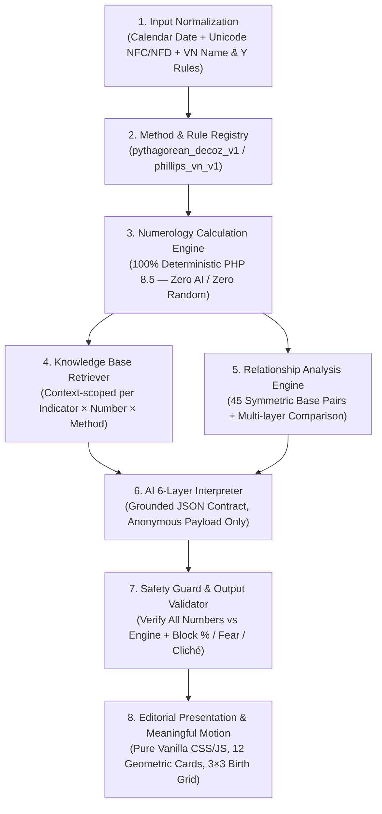

# MASTER SPECIFICATION — TRA CỨU THẦN SỐ HỌC ONLINE & THẦN SỐ HỌC TÌNH DUYÊN MIỄN PHÍ
## Mây Hẹn – Dấu Ấn Con Số (`/than-so-hoc`) • Đề án #162

- **Title chính thức (Bất biến)**: `Tra Cứu Thần Số Học Online & Thần Số Học Tình Duyên Miễn Phí`
- **Concept phụ**: *Mây Hẹn – Dấu Ấn Con Số* (Quiet Luxury · Editorial Design · Mathematical Art)
- **Ngày lập đặc tả**: `2026-11-25`
- **Trạng thái**: Chờ phê duyệt quyết định P0 trước khi triển khai mã nguồn
- **Nền tảng kỹ thuật**: 100% Native PHP 8.5 (Laravel 13) + 100% Pure Vanilla HTML5/CSS (`mayhen_numerology_*`) + Native ES Modules JS (không dùng Bootstrap, Tailwind, GSAP, Three.js, jQuery hay CDN bên ngoài).

---

## 1. Product Requirements (Yêu Cầu Sản Phẩm & Định Vị Trong Hệ Sinh Thái Mây Hẹn)

### 1.1. Tầm nhìn & Định vị
Mây Hẹn không xây dựng một trang web bói toán sinh văn bản AI đại trà. **Tra Cứu Thần Số Học Online & Thần Số Học Tình Duyên Miễn Phí** là phân hệ khám phá bản thân và kết nối cặp đôi đặt trong hệ sinh thái tình yêu – hôn nhân – gia đình của Mây Hẹn (song hành cùng Thiệp Cưới Online, Gia Phả, Mây Hẹn Dịch Tâm `/gieo-que` và Mây Hẹn – Thiên Mệnh `/tu-vi`).

### 1.2. Cam kết sản phẩm cốt lõi
1. **Chính xác 100% theo bộ quy tắc công bố**: Mọi chỉ số được tính tất định bởi Native PHP Calculation Engine độc lập hoàn toàn với AI; cùng đầu vào + cùng phương pháp + cùng phiên bản luôn cho ra đúng 1 kết quả y hệt.
2. **Minh bạch tuyệt đối (“Cách tính của tôi”)**: Mọi người dùng đều có thể mở từng bước quy đổi ký tự, phân nhóm họ – đệm – tên, phân loại nguyên âm/phụ âm (đặc biệt chữ `Y`), từng bước rút gọn và quy tắc Master Number.
3. **Không đánh đồng độ chính xác phép tính với khả năng dự đoán tương lai**: Thần số học là ngôn ngữ biểu tượng để chiêm nghiệm, thấu hiểu và đặt câu hỏi tốt hơn — không phải lời tiên tri vận mệnh hay phần trăm hợp tuổi.
4. **Miễn phí thực chất**:
   - **Khách chưa đăng nhập**: Tra cứu tức thời toàn bộ bộ chỉ số cốt lõi + mở rộng, Biểu đồ ngày sinh 3×3, Kim tự tháp 4 Đỉnh cao & 4 Thử thách, Chu kỳ cá nhân, bảng “Cách tính của tôi”, đọc bài biên tập chuẩn hóa từ kho tri thức, xem hồ sơ mẫu và tra cứu trọn bộ Bách Khoa Thần Số Học.
   - **Thành viên đăng nhập (tự động nhận gói Thành Viên Premium 0đ)**: Luận giải AI 6 tầng cá nhân hóa, Thần Số Học Tình Duyên chuyên sâu + Không gian “Câu chuyện hai chúng ta” (Lời hẹn 30 ngày), lưu Hồ Sơ & lịch sử phiên bản, Hỏi Sâu AI khóa hồ sơ, Nhật ký phát triển và Xuất Thẻ Nghệ Thuật PNG (`1:1`, `9:16`, `4:5`) mặc định ẩn ngày sinh đầy đủ.
   - **Hạn mức AI phân tầng (đồng bộ Dịch Tâm & Tử Vi)**: Premium 0đ (`5 lượt/ngày`, `5 phút/lần`), Plus (`10 lượt/ngày`, `1 phút/lần`), Pro & Admin (`30 lượt/ngày`, luận liên tục). Execution timeout riêng `120s` cho các endpoint AI.

---

## 2. Competitive Research (Báo Cáo Khảo Sát & Benchmark — Ngày 2026-11-25)

| Nền tảng / Nguồn | Ngày khảo sát | Nội dung đã xác minh thực tế | Điểm mạnh học hỏi cho Mây Hẹn | Giới hạn / Điểm không sao chép |
|---|---|---|---|---|
| **World Numerology (Hans Decoz)** (`worldnumerology.com`, *Numerology: Key to Your Inner Self*) | 2026-11-25 | Phương pháp Pythagorean hiện đại: rút gọn từng thành phần Ngày/Tháng/Năm (Life Path) và từng nhóm Họ/Đệm/Tên (Expression, Soul Urge, Personality), giữ Master `11/22/33`, bộ chỉ số mở rộng (Maturity, Balance, Rational Thought, Subconscious Self, Bridge, Hidden Passion, Karmic Lessons), 4 Pinnacles, 4 Challenges, Personal Year/Month/Day rút về 1 chữ số. | Tính nhất quán cao của công thức phân thành phần, chiều sâu phân tích tương tác đa chỉ số, minh bạch nguồn gốc Master Number (`11/2`, `22/4`, `33/6`). | Giao diện cổ điển dày chữ; không có quy ước tiếng Việt có dấu, chữ `Đ`, chữ `Y` tiếng Việt hay họ ghép Việt Nam. |
| **Numerology.com** (`numerology.com`) | 2026-11-25 | Tổ chức 5 chỉ số cốt lõi, phân loại rõ Master `11/22/33`, mô hình tương thích dùng số nền `1–9` (Master `11→2`, `22→4`, `33→6`) kèm ghi chú động năng riêng khi hai người cùng mang Master Number, cấu trúc thư viện kiến thức theo từng số & từng chỉ số. | Kiến trúc thư viện SEO xuất sắc, giải thích rõ ràng sự khác biệt giữa các chỉ số cùng mang 1 con số (vd số 6 Đường đời khác số 6 Linh hồn). | Đôi khi dùng điểm/nhãn tương thích đơn giản hóa — Mây Hẹn tuyệt đối không chấm `% hợp nhau`. |
| **David A. Phillips** (*The Complete Book of Numerology*) | 2026-11-25 | Hệ thống **Ruling Number** (`2–11` và `22/4`, cộng thẳng toàn bộ chữ số ngày sinh, giữ `10`, `11`, `22/4`; không có số 1 chủ đạo); **Biểu đồ ngày sinh 3×3** (`3-6-9` trên, `2-5-8` giữa, `1-4-7` dưới) bỏ số 0, giữ nguyên tần suất từng chữ số và **8 Đường Mũi tên** (Arrows of Individuality: đủ 3 số vs trống cả 3 số). | Rất quen thuộc với độc giả Việt Nam; Biểu đồ 3×3 trực quan, giàu giá trị tự chiêm nghiệm. | Không được trộn lẫn âm thầm công thức Ruling Number (Phillips) với Life Path (Decoz). Mây Hẹn tách rõ thành **2 phương pháp / lớp độc lập** có ghi nguồn rõ ràng. |
| **The Pattern & CHANI** | 2026-11-25 | Cách trình bày hồ sơ như một cuốn sách/tạp chí cá nhân, phân tích quan hệ theo chủ đề tâm lý & giao tiếp thực tế, nhật ký phản tư theo chu kỳ. | Tông giọng nhân văn, cá nhân hóa sâu theo hoàn cảnh thực tế, giữ người dùng quay lại qua nhật ký thay vì gây nghiện bói toán. | Thuật toán chiêm tinh phương Tây — hoàn toàn không áp dụng cho Thần Số Học. |
| **Tạp chí nghệ thuật & Thiệp cưới Letterpress** | 2026-11-25 | Bố cục Editorial rộng thoáng, giấy mỹ thuật trắng ngà, typography serif tinh tế, con số lớn dạng *Mathematical Art*, đường kẻ mảnh `1px`, dập nổi ánh kim tiết chế. | Tạo bản sắc **Quiet Luxury** riêng biệt của Mây Hẹn — triệt tiêu hoàn toàn dáng dấp website AI tím neon / bento card lặp lại. | Không biến trang thành bảo tàng khó dùng: luôn giữ thao tác tra cứu trong 3 bước gọn, tốc độ tải nhanh. |

*Giới hạn truy cập ghi nhận*: Nội dung bản quyền đầy đủ của các sách in không được sao chép nguyên văn; toàn bộ bài viết trong kho tri thức Mây Hẹn được biên soạn nguyên bản bằng tiếng Việt dựa trên quy tắc toán học công khai và ghi rõ nhãn nguồn gốc (`provenance`).

---

## 3. Numerology Method Specification (Quản Lý Phiên Bản Phương Pháp)

Hệ thống cài đặt **Method & Rule Registry (`NumerologyMethodRegistry`)** quản lý phương pháp độc lập, tuyệt đối không trộn công thức:

| Thuộc tính | Phương pháp mặc định (`pythagorean_decoz_v1`) | Phương pháp bổ sung (`phillips_vn_v1`) | Mở rộng P3 (`chaldean_v1`) |
|---|---|---|---|
| **Method ID** | `pythagorean_decoz_v1` | `phillips_vn_v1` | `chaldean_v1` *(chưa phát hành ở P0–P2)* |
| **Tên hiển thị** | Pythagorean Hiện Đại (Tham chiếu Hans Decoz) | Nhân Số Học (Tham chiếu David A. Phillips) | Chaldean (Dự kiến P3) |
| **Phiên bản công thức** | `1.0.0` | `1.0.0` | Chờ thẩm định |
| **Bảng quy đổi chữ cái** | Pythagorean `A–Z → 1–9` (26 chữ cái Latin) | Pythagorean `A–Z → 1–9` | Bảng Chaldean 1–8 (chưa kích hoạt) |
| **Quy tắc số đường đời / chủ đạo** | Rút gọn riêng Ngày, Tháng, Năm (giữ `11, 22, 33`) rồi cộng & rút gọn | Cộng thẳng toàn bộ chữ số ngày sinh; giữ `10`, `11`, `22/4` (`2–11`, `22/4`) | — |
| **Quy tắc Master** | `11/2`, `22/4`, `33/6` tại các chỉ số quy định | `10`, `11`, `22/4` theo chuẩn Phillips | — |
| **Phân nhóm họ tên** | Tách nhóm `Họ / Tên đệm / Tên chính`, rút gọn từng nhóm rồi cộng | Cung cấp như lớp phân tích tên độc lập khi bật | — |
| **Biểu đồ ngày sinh 3×3** | Hiển thị như **Lớp phân tích độc lập (Nguồn: David A. Phillips)** có ghi chú tách bạch rõ ràng | Lớp phân tích cốt lõi cùng 8 đường mũi tên | — |
| **Chu kỳ cá nhân** | Năm dương lịch `01/01–31/12` (múi giờ `Asia/Ho_Chi_Minh`), rút về `1–9` | Năm cá nhân rút về `1–9` theo chu kỳ 9 năm | — |

> **Cam kết học thuật**: Hệ thống ghi rõ bảng quy đổi 26 chữ cái Latin là quy ước Pythagorean hiện đại, không tự tuyên bố là bảng chữ cái gốc do Pythagoras trực tiếp tạo ra; quy tắc bỏ dấu tiếng Việt & `Đ → D` được gắn nhãn **Quy ước bản địa hóa Mây Hẹn**.

---

## 4. Architecture & Calculation Rules (Kiến Trúc 8 Lớp & Bộ Công Thức Chính Xác)



### 4.1. Bảng quy đổi Pythagorean (26 chữ cái Latin)
`1: A, J, S` · `2: B, K, T` · `3: C, L, U` · `4: D, M, V` · `5: E, N, W` · `6: F, O, X` · `7: G, P, Y` · `8: H, Q, Z` · `9: I, R`.

### 4.2. Công thức chi tiết cho phương pháp mặc định (`pythagorean_decoz_v1`)
1. **Life Path (Chỉ số Đường đời / Số chủ đạo)**:
   - `d = reduce(day, keepMaster=[11,22])` (vì ngày `1..31` chỉ có thể ra `11, 22`).
   - `m = reduce(month, keepMaster=[11])` (tháng `1..12` chỉ có `11`).
   - `y = reduce(year, keepMaster=[11,22,33])` (tính từng bước tổng chữ số của năm; giữ `11, 22, 33`).
   - `life_path = reduce(d + m + y, keepMaster=[11,22,33])`.
   - Lưu đồng thời `direct_sum_root` (cộng thẳng toàn bộ chữ số ngày sinh) để giải thích minh bạch khi khác nhau (vd `11/11/2009`: Decoz = `33/6`, cộng thẳng = `15 → 6`).
2. **Expression (Chỉ số Sứ mệnh)**:
   - Với mỗi nhóm tên `g` trong `[Họ, Tên đệm, Tên chính]`: `v(g) = reduce(sum(letters(g)), keepMaster=[11,22,33])`.
   - `expression = reduce(sum(v(g)), keepMaster=[11,22,33])`.
3. **Soul Urge (Chỉ số Linh hồn)**: Tương tự Expression, chỉ lấy các ký tự phân loại là **Nguyên âm**.
4. **Personality (Chỉ số Nhân cách)**: Tương tự Expression, chỉ lấy các ký tự phân loại là **Phụ âm**.
   - *Bất biến toàn vẹn*: `raw_sum(vowels) + raw_sum(consonants) === raw_sum(all_letters)`.
5. **Birthday Number (Chỉ số Ngày sinh)**: Lưu giá trị gốc `1..31` (không xóa mất ngày gốc!) kèm `reduced_root` (`1..9`, hiển thị `11/2`, `22/4` nếu ngày 11 hoặc 22).
6. **Maturity Number (Chỉ số Trưởng thành)**: `reduce(life_path.value + expression.value, keepMaster=[11,22,33])`.
7. **Attitude Number (Chỉ số Thái độ)**: `reduce(month + day, keepMaster=[])` (quy ước rõ: rút về `1..9`, không giữ Master; công bố minh bạch trong Registry).
8. **Balance Number (Chỉ số Cân bằng)**: Lấy chữ cái đầu của từng từ trong họ tên lúc sinh, cộng giá trị và rút về **1 chữ số `1..9`** (không giữ Master theo chuẩn Decoz).
9. **Hidden Passion (Đam mê tiềm ẩn)**: Giá trị `1..9` xuất hiện với tần suất lớn nhất trong họ tên lúc sinh (trả về mảng đầy đủ khi đồng hạng).
10. **Karmic Lessons (Bài học / Số thiếu trong tên)**: Tập các số `1..9` có tần suất `= 0` trong họ tên lúc sinh (không gán nhãn khiếm khuyết/bất hạnh).
11. **Rational Thought (Tư duy lý trí)**: `reduce(sum(letters(tên chính)) + day_raw, keepMaster=[11,22])`.
12. **Subconscious Self (Tiềm thức)**: `9 - count(Karmic Lessons)` (giá trị `1..9`).
13. **Bridge Numbers (Cầu nối)**:
    - `bridge_lp_exp = |life_path.base_root - expression.base_root|` (`0..8`)
    - `bridge_soul_pers = |soul_urge.base_root - personality.base_root|` (`0..8`)
14. **Karmic Debt Indicators (Số kép đặc biệt truyền thống — `13/4, 14/5, 16/7, 19/1`)**: Ghi nhận trung thực khi xuất hiện ở tổng trung gian/ngày sinh với diễn giải trưởng thành, **tuyệt đối không hù dọa hay bán dịch vụ giải hạn**.
15. **Personal Cycles (Chu kỳ cá nhân — Năm dương lịch `01/01–31/12`, múi giờ `Asia/Ho_Chi_Minh`)**:
    - `personal_year = reduce_single(birth_day + birth_month + viewed_year)` (`1..9`, KHÔNG giữ Master).
    - `personal_month = reduce_single(personal_year + viewed_month)` (`1..9`).
    - `personal_day = reduce_single(personal_month + viewed_day)` (`1..9`).
16. **4 Pinnacles (Bốn Đỉnh Cao — Decoz, giữ Master `11, 22`)**:
    - `M = reduce_single(month)`, `D = reduce_single(day)`, `Y = reduce_single(year)` (nhưng nếu tháng=11, ngày=11/22 thì quy tắc Decoz chuẩn hóa: giữ `11/22` khi cộng đỉnh cao? Kiểm chứng Test Case 3 `15/05/1949`: `M=5, D=6, Y=5`, `P1 = reduce(M+D, [11,22]) = 11`, `P2 = reduce(D+Y, [11,22]) = 11`, `P3 = reduce(P1+P2, [11,22]) = 22`, `P4 = reduce(M+Y, [11,22]) = 10 → 1` — khớp **100%** Test Case 3!).
    - Mốc tuổi không trùng/không hở: `first_end = 36 - life_path.base_root` → `P1: 0 → first_end`, `P2: (first_end+1) → (first_end+9)`, `P3: (first_end+10) → (first_end+18)`, `P4: (first_end+19)+`.
17. **4 Challenges (Bốn Thử Thách — rút `M, D, Y` về `1..9`, không giữ Master)**:
    - `C1 = |M - D|`, `C2 = |D - Y|`, `C3 = |C1 - C2|`, `C4 = |M - Y|` — giá trị `0..8`, giữ nguyên `0` hợp lệ! (Khớp **100%** Test Case 3: `C1=1, C2=1, C3=0, C4=0`).
18. **3 Life Path Period Cycles (3 Giai đoạn cuộc đời)**: Period 1 (Tháng sinh), Period 2 (Ngày sinh), Period 3 (Năm sinh).
19. **Biểu đồ ngày sinh 3×3 & 8 Đường Mũi Tên (Lớp độc lập nguồn David A. Phillips)**:
    - Lấy từng chữ số khác `0` từ chuỗi `ddmmyyyy` của ngày sinh gốc (không xóa số `0` khỏi ngày sinh gốc, không dùng Life Path để điền).
    - Khung 3×3: Hàng trên `3-6-9` (Trí tuệ), Hàng giữa `2-5-8` (Tinh thần), Hàng dưới `1-4-7` (Thể chất).
    - 8 đường hình học: `1-2-3`, `4-5-6`, `7-8-9`, `1-4-7`, `2-5-8`, `3-6-9`, `1-5-9`, `3-5-7` — phân biệt rõ 3 trạng thái: `full` (đủ 3 ô), `empty` (trống cả 3 ô), `partial` (1 hoặc 2 ô).
20. **Tên thường gọi (Current / Everyday Name)**: Tách riêng hoàn toàn khỏi họ tên khai sinh; chỉ tính thành nhóm chỉ số phụ khi người dùng tự nhập.

---

## 5. Vietnamese Name Normalization & Letter `Y` Rules

1. **Unicode Normalization**: Chạy `Normalizer::normalize($name, Normalizer::FORM_D)` (hoặc tương đương thuần PHP) rồi ánh xạ `Đ/đ → D`, loại bỏ toàn bộ dấu thanh và dấu mũ (combining marks `\p{Mn}`), chuẩn hóa chữ hoa `A–Z`. Đảm bảo chuỗi **NFC** và **NFD** cho kết quả giống nhau 100%.
2. **Ký tự ngoài Latin**: Nếu phát hiện chữ Hán/Nhật/Hàn/Cyrillic/Ả Rập..., hệ thống **không tự ý bỏ qua**, mà trả lỗi rõ ràng yêu cầu nhập cách viết Latin để đảm bảo minh bạch.
3. **Dấu gạch nối & khoảng trắng**: Chuẩn hóa nhiều khoảng trắng thành 1; giữ quy ước rõ cho dấu gạch nối (`-` tách từ khi phân nhóm, không tính điểm ký tự gạch nối).
4. **Phân nhóm Họ – Tên đệm – Tên chính**:
   - Mặc định thông minh cho tên Việt (`Nguyễn Thị Minh Anh` → Họ: `Nguyễn`, Đệm: `Thị Minh`, Tên chính: `Anh`; tên 2 từ `Đỗ An` → Họ: `Đỗ`, Tên chính: `An`).
   - Cho phép người dùng **tùy chỉnh lại nhóm** (vd họ ghép `Nguyễn Trần`, tên chính ghép `Minh Anh`) ngay trong bộ tra cứu mà không tự suy đoán sai.
5. **Quy ước chữ `Y` bản địa hóa (`vn_phonetic_y_v1`)**:
   - Trong tiếng Việt, `Y` đóng vai trò **Nguyên âm** ở cả vị trí đơn lẻ lẫn vần kép/ba (`Yến`, `Vy`, `Mỹ`, `Duy`, `Nguyễn`, `Quỳnh`, `Thúy`, `Lý`).
   - Hỗ trợ chế độ `en_phonetic_y_v1` cho tên tiếng Anh/quốc tế (`Y` đầu âm tiết trước nguyên âm = Phụ âm như `Yuri`, `Yasmine`; `Y` làm nhân âm tiết / cuối từ = Nguyên âm như `Mary`, `Lynn`).
   - Cho phép người dùng **kiểm tra & đảo vai trò từng chữ `Y`** trực tiếp trong phần “Cách tính của tôi”; AI bị khóa cứng không được sửa phân loại đã tính.

---

## 6. Master Number Rules (Quy Tắc Số Master & Dấu Vết Rút Gọn)

Mỗi chỉ số lưu đối tượng cấu trúc chuẩn `ReductionTrace`:
```json
{
  "raw_sum": 33,
  "steps": ["11 (Ngày) + 11 (Tháng) + 11 (Năm) = 33"],
  "value": 33,
  "base_root": 6,
  "is_master": true,
  "display": "33/6",
  "master_rule": "keep_11_22_33"
}
```
- **Giữ Master `11, 22, 33`**: Life Path, Expression, Soul Urge, Personality, Maturity (và `11, 22` cho Pinnacles, Rational Thought).
- **KHÔNG giữ Master**: Personal Year, Personal Month, Personal Day, Balance Number, Attitude Number, Challenges (`0..8`), Bridge Numbers (`0..8`).
- **Tuyệt đối không tự coi `44, 55, 66, 77, 88, 99` là Master Number**.

---

## 7. Knowledge Base Specification & Data Dictionary

Tổ chức kho dữ liệu độc lập trong `database/data/numerology/` (tách biệt hoàn toàn với `iching/`, `tuvi/`, chatbot):
1. `manifest.json`: Phiên bản KB (`1.0.0`), phương pháp hỗ trợ, danh mục nguồn tham chiếu, ngày thẩm định.
2. `numbers_by_indicator.json`: Ý nghĩa riêng biệt theo từng cặp `(indicator_code, number_value)` cho 5 chỉ số cốt lõi + trưởng thành (`1..9, 11, 22, 33`) — số 6 Đường đời hoàn toàn khác số 6 Linh hồn, Sứ mệnh, Nhân cách!
3. `birthdays_31.json`: Đủ 31 bản ghi cho Ngày sinh `1..31` (giữ nguyên giá trị ngày gốc + số nền).
4. `cycles_and_pinnacles.json`: Đủ 9 Năm cá nhân (`1..9`), 9 Tháng cá nhân (`1..9`), 9 Ngày cá nhân (`1..9`), 11 Đỉnh cao (`1..9, 11, 22`) và 9 Thử thách (`0..8`).
5. `birth_chart_arrows.json`: Ý nghĩa tần suất chữ số `1..9` (1 lần, 2 lần, 3+ lần) + 8 đường hình học (`full` & `empty`) tham chiếu *The Complete Book of Numerology* (David A. Phillips) kèm ghi chú biên tập tiếng Việt trung thực.
6. `relationship_matrix_45.json`: Đủ **45 tổ hợp đối xứng không phân biệt thứ tự** của 9 số nền (`1-1` đến `9-9`), với văn phong tinh tế cho 10 chủ đề tình duyên & hôn nhân, giữ nguyên vai trò Người A / Người B khi hiển thị.

Mỗi bản ghi tri thức đều chứa đủ các trường: `indicator`, `value`, `method_id`, `base_root`, `is_master`, `core_meaning`, `traditional_view`, `strengths`, `watch_outs`, `love_meaning`, `marriage_meaning`, `family_meaning`, `work_meaning`, `action_hints`, `reflection_question`, `source`, `version`, `verified`.

---

## 8. Database Schema & Privacy Architecture (Data Dictionary)

5 bảng độc lập trong migration `create_numerology_tables`:
1. `numerology_profiles`: `id`, `user_id`, `slug`, `display_name`, `full_birth_name`, `everyday_name`, `name_groups_json`, `y_mode`, `y_overrides_json`, `birth_date` (DATE chuẩn lịch — KHÔNG dùng timestamp UTC!), `calendar_input_type` (`solar`/`lunar`), `relationship_status`, `method_id`, `method_version`, `is_primary_self`, timestamps, softDeletes.
2. `numerology_readings`: `id`, `profile_id`, `user_id`, `slug`, `version_number`, `input_hash`, `method_id`, `method_version`, `kb_version`, `viewed_year`, `focus_topic`, `user_context_note`, `calculation_payload_json`, `interpretation_json`, `ai_powered`, `ai_model`, `ai_status`, `privacy_mode` (`private`/`shared_card`), `share_token`, `share_revoked_at`, `share_hide_birth_date` (default `true`), `feedback_rating`, `is_favorite`, `idempotency_key`, timestamps.
3. `numerology_followups`: `id`, `reading_id`, `user_id`, `topic_code`, `question`, `answer`, `ai_powered`, `ai_model`, timestamps.
4. `numerology_journals`: `id`, `reading_id`, `user_id`, `milestone_days` (`0/7/30/90`), `current_goal`, `actions_taken`, `lessons_learned`, `relationship_note`, timestamps.
5. `numerology_relationship_reports`: `id`, `user_id`, `slug`, `reading_a_id`, `reading_b_id`, `relationship_stage`, `partner_consent_confirmed`, `couple_answers_json`, `promise_30_days_json`, `couple_messages_json`, `comparison_payload_json`, `interpretation_json`, `ai_powered`, `ai_model`, `privacy_mode` (`private`/`shared_card`), `share_token`, `share_revoked_at`, timestamps.

**Quy tắc bảo mật bắt buộc**:
- Mặc định `privacy_mode = 'private'`, kiểm tra chính chủ phía server (`403` cho khách & tài khoản khác; `noindex, nofollow` chỉ là lớp bổ trợ).
- Không tự lấy họ tên/ngày sinh từ Gia Phả hoặc Thiệp Cưới khi chưa có sự đồng ý rõ ràng.
- Không đưa họ tên/ngày sinh vào URL công khai hay analytics; không gửi họ tên đầy đủ/email/SĐT sang nhà cung cấp AI.

---

## 9. Relationship Analysis Engine (Thần Số Học Tình Duyên & “Câu Chuyện Hai Chúng Ta”)

- Tính độc lập 2 hồ sơ `A` và `B` (hỗ trợ cả trường hợp chỉ có ngày sinh — ghi rõ giới hạn và không bịa chỉ số từ tên thiếu).
- Đối chiếu đa tầng: Đường đời (số nền `1..9` tra ma trận 45 cặp đối xứng + hiển thị rõ Master `11→2`, `22→4`, `33→6`), Sứ mệnh, Linh hồn, Nhân cách, Ngày sinh, Năm cá nhân hiện tại.
- Trình bày theo **10 chủ đề ứng dụng Mây Hẹn** (ghi rõ đây là khung tư vấn hiện đại của Mây Hẹn, không phải 10 chỉ số cổ điển).
- **Không gian tương tác “Câu chuyện hai chúng ta”**: Hai người trả lời 5 câu hỏi cặp đôi, viết lời nhắn cho nhau và thiết lập **Lời hẹn 30 ngày** (mỗi người chọn 1 hành động thực tế). Thông tin thực tế cặp đôi nhập luôn được ưu tiên trên suy đoán con số.
- **Tuyệt đối cấm**: `% hợp nhau`, `% kết hôn`, `% ly hôn`, `"không hợp số không nên cưới"`, `"ngoại tình"`, `"định mệnh chắc chắn"`.

---

## 10. AI Contract & Safety Guard

- **Input gửi AI (ẩn danh)**: `profile_id`, `method_id`, `method_version`, `kb_version`, toàn bộ chỉ số đã tính, trace ngắn gọn, trích đoạn tri thức khớp với chỉ số của người dùng (scoped retrieval), chủ đề & hoàn cảnh tự nguyện. **KHÔNG gửi tên thật/SĐT/email**.
- **Output 6 tầng cấu trúc JSON**: Tầng 1 (*Dấu ấn cốt lõi*), Tầng 2 (*Hiểu bản thân & mối liên hệ giữa các chỉ số*), Tầng 3 (*Tiềm năng & phát triển*), Tầng 4 (*Tình yêu, hôn nhân & gia đình*), Tầng 5 (*Hành trình cuộc đời — Đỉnh cao, Thử thách, Chu kỳ*), Tầng 6 (*Kế hoạch hành động 7 ngày / 30 ngày & câu hỏi chiêm nghiệm*).
- **Output Validator & Anti-Cliché Guard (`NumerologySafetyGuardService`)**:
  - Đối chiếu số liệu AI nhắc lại với kết quả Engine; nếu lệch số hoặc bịa chỉ số → từ chối & fallback kho tri thức đã biên tập.
  - Chặn câu khủng hoảng tâm lý/tự hại (`422 SAFETY_CRISIS_BLOCK`).
  - Chặn văn mẫu AI đại trà (*"vũ trụ đang gửi thông điệp"*, *"sinh ra để làm điều phi thường"*, *"bạn vừa mạnh mẽ vừa nhạy cảm"*), chặn `% hợp nhau`, chặn phán đoán y khoa/tuổi thọ/ly hôn/ngoại tình/nợ nghiệp hù dọa.

---

## 11. UI/UX, Art Direction & Meaningful Motion (Editorial Quiet Luxury · Zero AI-Slop)

- **Thẩm mỹ**: Tạp chí nghệ thuật + Sách cao cấp + Thiệp cưới Letterpress + Mathematical Art.
- **Bảng màu đồng bộ Mây Hẹn**: Nền giấy mỹ thuật Trắng Ngà `#FAF5EB` / `#FCFBF9`, chữ Mực Trầm `#292524`, điểm nhấn chọn lọc Thanh Ngọc `#1E4D3B`, Đỏ Son `#85182A`, đường kẻ & dập nổi Hoàng Kim `#CFA860`.
- **Tuyệt đối tránh**: Nền đen neon, gradient tím xanh, glassmorphism tràn lan, icon sparkle, orb chatbot, bento card lặp lại giống hệt nhau.
- **Bộ 12 Thẻ Nghệ Thuật Hình Học (`1..9, 11, 22, 33`)**: 12 tác phẩm SVG nguyên bản theo ngôn ngữ hình học tối giản (đường thẳng, giao hòa song cung, tam giác, hình vuông, đa giác động, lục giác hoa, vòng đồng tâm, đường cong vô cực, vòng tròn hoàn thiện, song trụ, kiến trúc lập phương, đối xứng hài hòa), viền dập nổi letterpress, chữ số serif lớn `tabular-nums`, mặt trước & mặt sau 3D flip mượt mà, **xòe trọn trên 1 màn hình không có thanh cuộn ngang** (kế thừa trải nghiệm hoàn hảo đã làm ở Tử Vi).
- **Trải nghiệm tạo hồ sơ & chuyển cảnh có ý nghĩa nghiệp vụ**:
  - **Landing `/than-so-hoc`**: Title & H1 chính thức `Tra Cứu Thần Số Học Online & Thần Số Học Tình Duyên Miễn Phí`; chuyển nhanh 2 chế độ ngay đầu trang (*Thần Số Học Cá Nhân* | *Thần Số Học Tình Duyên*) với form 3 bước tuần tự gọn gàng, có thể bấm tra cứu nhanh chỉ bằng Ngày sinh hoặc đủ Họ tên + Ngày sinh.
  - **Animation tính toán ngắn gọn (có nút Bỏ qua)**: Hiện chữ số ngày sinh → gom nhóm Ngày / Tháng / Năm → rút gọn từng bước → hội tụ ra Số Đường Đời lớn → mở hồ sơ cuốn sách 10 chương gọn gàng (đọc nhanh + mở rộng từng chương).
  - **Biểu đồ ngày sinh 3×3 tương tác**: Các chữ số từ ngày sinh bay vào đúng ô 1–9 theo đúng tần suất, vẽ nét SVG các mũi tên đủ/trống, chạm từng ô để đọc ý nghĩa.
  - **Kim tự tháp 4 Đỉnh cao & 4 Thử thách SVG**: Vẽ hình học chuẩn xác kèm mốc tuổi, không vẽ biểu đồ giàu nghèo.
  - **Xuất Thẻ Nghệ Thuật PNG HiDPI (`1:1`, `9:16`, `4:5`)**: Canvas 2D thuần, mặc định ẩn ngày sinh đầy đủ, chọn nội dung chia sẻ trước khi tải.

---

## 12. SEO Architecture & Routes (Đã Kiểm Tra Không Trùng `routes/web.php`)

- `GET /than-so-hoc` (`numerology.index`) — **Public SEO** — Title: `Tra Cứu Thần Số Học Online & Thần Số Học Tình Duyên Miễn Phí` + JSON-LD (`WebApplication` + `FAQPage` + `BreadcrumbList`)
- `GET /than-so-hoc/tinh-duyen` (`numerology.love.index`) — **Public SEO**
- `GET /than-so-hoc/so-chu-dao` (`numerology.library.life_path`) — **Public SEO** (Số `1..9, 11, 22, 33`)
- `GET /than-so-hoc/chi-so` (`numerology.library.indicators`) — **Public SEO**
- `GET /than-so-hoc/bieu-do-ngay-sinh` (`numerology.library.birth_chart`) — **Public SEO**
- `GET /than-so-hoc/nam-ca-nhan` (`numerology.library.personal_year`) — **Public SEO** (tự động theo năm hiện tại, không hard-code năm cố định)
- `GET /than-so-hoc/thu-vien` (`numerology.library.index`) — **Public SEO**
- `POST /than-so-hoc/tra-cuu-nhanh` (`numerology.calculate_preview`) — **Public API miễn phí** (tính toàn bộ chỉ số + bảng Cách tính của tôi + nội dung kho tri thức cho cả khách chưa đăng nhập!)
- `POST /than-so-hoc/lap-ho-so` (`numerology.store`) — **Auth (Premium 0đ+)** — lưu hồ sơ phiên bản + chạy AI 6 tầng (`120s` timeout + hạn mức phân tầng)
- `GET /than-so-hoc/ho-so` (`numerology.profiles`) — **Auth, `noindex`**
- `GET /than-so-hoc/ket-qua/{slug}` (`numerology.show`) — **Private Owner `403`, `noindex`**
- `DELETE /than-so-hoc/ket-qua/{slug}` (`numerology.destroy`) — **Private Owner `403`**
- `POST /than-so-hoc/ket-qua/{slug}/luan-giai-lai`, `/hoi-sau`, `/nhat-ky`, `/chia-se`, `/phan-hoi`
- `GET /than-so-hoc/chia-se/{shareToken}` (`numerology.shared_card`) — **Thẻ chia sẻ ẩn ngày sinh, `noindex`, thu hồi `404`**
- `POST /than-so-hoc/tinh-duyen/phan-tich` (`numerology.love.store`), `GET /than-so-hoc/tinh-duyen/{slug}` (`numerology.love.show`, **Private `403`**), `POST /than-so-hoc/tinh-duyen/{slug}/cau-chuyen` (lưu trả lời cặp đôi, lời nhắn & lời hẹn 30 ngày).

---

## 13. Test Cases, Acceptance Criteria & Deployment Roadmap

### 13.1. Bộ kiểm thử bắt buộc (Pest Unit + Feature)
1. **4 Test Case tham chiếu cứng (Section 40)**: `11/11/2009` (`33/6` vs `6`), `Đỗ An` (`Expression=7, Soul=7, Personality=9, 7+9=16`), `15/05/1949` (`P=11,11,22,1`, `C=1,1,0,0`, `first_end=29`), `15/05` năm `2026` ngày `03/02/2026` (`PY=3, PM=5, PD=8`).
2. **Kiểm thử toàn diện ngày sinh**: Toàn bộ 366 ngày trong năm nhuận (`2024`) + năm không nhuận (`2025`) + hàng trăm mốc năm `1900–2026`, kiểm tra ngày không hợp lệ (`29/02/2025`, `31/04/2024`, ngày tương lai), kiểm tra bảo toàn ngày lịch không lệch múi giờ.
3. **Kiểm thử họ tên tiếng Việt & Unicode**: Đủ 26 chữ cái, NFC vs NFD, chữ `Đ`, 6 trường hợp chữ `Y` (`Yến, Vy, Mỹ, Duy, Nguyễn, Quỳnh`), họ ghép, dấu gạch nối, ký tự ngoài Latin bị từ chối rõ ràng, bất biến `raw_vowels + raw_consonants === raw_all`.
4. **Kiểm thử Biểu đồ 3×3 & 8 Mũi tên**: Đúng tần suất số lặp (vd `111`), bỏ `0` khỏi lưới nhưng giữ trong ngày sinh gốc, phân biệt chính xác `full / empty / partial`.
5. **Kiểm thử Tình duyên**: Đủ **45 cặp đối xứng** (đảo `A ↔ B` giữ nguyên nội dung cốt lõi cặp số, đổi đúng vai trò A/B), Master `11/22/33`, thiếu tên không bịa chỉ số tên.
6. **Kiểm thử Bảo mật, Quota & AI Validator**: `403` riêng tư, Share/Revoke `404`, hạn mức `Premium/Plus/Pro`, chặn `% hợp nhau`, chặn văn mẫu AI, chặn câu hỏi khủng hoảng `422`.

### 13.2. Lộ trình triển khai
- **Đợt triển khai 1 (P0 + P1 + Core P2 — Triển khai ngay sau khi duyệt)**: Toàn bộ Calculation Engine (`pythagorean_decoz_v1` + `phillips_vn_v1` + Biểu đồ 3×3), Vietnamese Name Normalizer, 6 file Knowledge Base JSON, 5 bảng DB, Safety Guard + AI 6 tầng, Landing `/than-so-hoc` (tra cứu nhanh miễn phí cho cả khách + lưu hồ sơ AI cho thành viên), Trang kết quả 10 chương + 12 thẻ nghệ thuật hình học SVG + Kim tự tháp + Biểu đồ 3×3 + Xuất thẻ PNG (`1:1`, `9:16`, `4:5`), Thần Số Học Tình Duyên + Không gian “Câu chuyện hai chúng ta”, Bách Khoa Thần Số Học SEO + Sitemap, và toàn bộ bộ test Pest.
- **Đợt mở rộng (P3 — Sau vận hành ổn định)**: Chaldean Numerology, Transit & Essence Cycles chuyên sâu, màn hình so sánh trực tiếp song song Decoz vs Phillips.

---

## 14. Danh Sách Vấn Đề Chưa Xác Minh & Điểm Cần Người Dùng Xác Nhận (P0 Decisions)

1. **Title chính thức `/than-so-hoc`**: Giữ nguyên chính xác `Tra Cứu Thần Số Học Online & Thần Số Học Tình Duyên Miễn Phí` (có hoặc không kèm `| Mây Hẹn` ở cuối?). *Đề xuất*: giữ nguyên chính xác chuỗi yêu cầu làm Title & H1, không chèn thêm hậu tố nếu bạn muốn khớp 100% nguyên văn.
2. **Phương pháp mặc định & chuyển đổi phương pháp**: Mặc định **Pythagorean Hiện Đại (Hans Decoz — `pythagorean_decoz_v1`)** + tùy chọn chuyển sang **Nhân Số Học David A. Phillips (`phillips_vn_v1`)** ngay trong mục tùy chọn nâng cao; Biểu đồ ngày sinh 3×3 luôn gắn nhãn rõ *"Lớp phân tích theo David A. Phillips"*.
3. **Chính sách miễn phí**: Khách chưa đăng nhập **tra cứu ngay miễn phí** toàn bộ chỉ số, bảng “Cách tính của tôi”, Biểu đồ 3×3, Kim tự tháp và nội dung kho tri thức chuẩn hóa; Thành viên đăng nhập (**Premium 0đ**) mở khóa thêm **Luận giải AI 6 tầng, Lưu hồ sơ, Hỏi Sâu AI, Nhật ký, Câu chuyện hai chúng ta & Xuất thẻ PNG**.
4. **Quy ước chữ `Y` tiếng Việt**: Mặc định `vn_phonetic_y_v1` (coi `Y` là nguyên âm trong tên Việt như `Yến, Vy, Mỹ, Duy, Nguyễn, Quỳnh`), kèm công tắc chuyển sang `en_phonetic_y_v1` hoặc bật/tắt từng chữ `Y` ngay trong bảng “Cách tính của tôi”.
5. **Vị trí trên thanh Menu Header**: Thanh menu Desktop hiện đang có đúng 6 mục vừa 1 dòng (*Mẫu Thiệp Cưới · Thiệp Sự Kiện · Gia Phả · Gieo Quẻ · Tử Vi · Bảng Giá*). Bạn muốn đặt **Thần Số Học** trực tiếp trên thanh Header (thành 7 mục) hay gom nhóm gọn (vd dropdown *Khám Phá / Cổ Học & Con Số* gồm *Gieo Quẻ, Tử Vi, Thần Số Học*), hay đặt trên Header + Footer + Mobile Drawer?
6. **Điểm chưa xác minh từ ấn bản sách gốc (ghi nhận trung thực)**: Một số ấn bản tiếng Việt biên soạn lại từ David A. Phillips gọi tên khác nhau cho vài mũi tên trống (đặc biệt mũi tên trống `1–2–3` không tồn tại chính thức trong bản gốc tiếng Anh của Phillips nhưng đôi khi được diễn giải thêm ở tài liệu thứ cấp). Hệ thống sẽ ghi chú minh bạch nguồn gốc ngay trong Bách Khoa và chỉ gọi tên các mũi tên trống đã xác minh chắc chắn.
