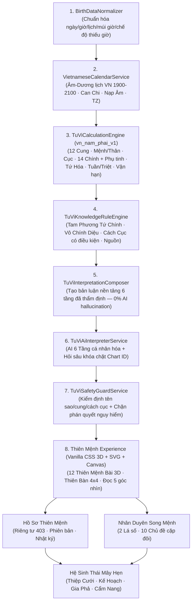

# ĐẶC TẢ TỔNG THỂ SẢN PHẨM & KIẾN TRÚC KỸ THUẬT
# MÂY HẸN – THIÊN MỆNH (TỬ VI ĐẨU SỐ, NHÂN DUYÊN SONG MỆNH & THIÊN MỆNH BÀI 3D)

> **Phiên bản tài liệu:** `1.0.0-spec`  
> **Ngày lập:** `2026-11-25`  
> **Trạng thái:** Đã hoàn tất đặc tả 22 mục bắt buộc — Chờ phê duyệt quyết định P0 trước khi triển khai mã nguồn  
> **Phạm vi tích hợp:** Dự án Laravel 13.35 / PHP 8.5 `mayhen.vn` — 100% Pure Vanilla HTML5 + CSS (`mayhen_tuvi_*`) + Native ES Modules JS (không dùng Bootstrap/Tailwind/GSAP/Three.js CDN)

---

## 1. BÁO CÁO NGHIÊN CỨU ĐỐI THỦ & CHUẨN MỰC QUỐC TẾ (BENCHMARK)

*Ngày khảo sát: 25/11/2026. Tất cả nhận định chỉ dựa trên tài liệu công khai, mã nguồn mở và trang web chính thức có thể truy cập; các tính năng nằm sau paywall ứng dụng di động được ghi rõ giới hạn truy cập.*

| Nền tảng / Mã nguồn | Nhóm | Tính năng đã quan sát | Giới hạn truy cập | Điểm mạnh nổi bật | Điểm yếu / Khoảng trống | Đề xuất kế thừa cho Mây Hẹn |
| :--- | :--- | :--- | :--- | :--- | :--- | :--- |
| **Astrodienst (astro.com)** | Tính toán & Lá số | Extended Chart Selection, Swiss Ephemeris, Historical Atlas (LMT/DST lịch sử), cờ "unknown birth time" bỏ nhà/cung | Công khai web; báo cáo Liz Greene thu phí | Chuẩn mực vàng về minh bạch lịch pháp, múi giờ lịch sử và bản in vector sắc nét | Giao diện cổ điển, nặng kỹ thuật với người mới | Học quy tắc **không âm thầm gán 12:00 trưa khi thiếu giờ sinh** và **công khai múi giờ / quy ước tính** |
| **Astro-Seek (astro-seek.com)** | Tính toán & Lá số | IANA TZ lịch sử có chỉnh tay, lá số tương tác, chế độ đối chiếu hệ thống nhà, bảng dữ liệu chi tiết | Công khai web miễn phí | Mô-đun hóa rõ ràng, minh bạch tham số kỹ thuật, tốc độ nhanh | Thiếu cảm xúc nghệ thuật, nhiều bảng dày chữ trên mobile | Học chế độ **xem đa lá số khả dĩ theo khoảng giờ sinh** và **Chế độ Chuyên gia** tách biệt |
| **Viện AOC (vienaoc.vn/lasotuvi)** | Tử Vi Việt Nam | Lá số 4×4 12 cung truyền thống, chính tinh, phụ tinh, độ sáng, Tứ Hóa, Tuần/Triệt, Đại Hạn, Tiểu Hạn, tùy chọn trường phái Nam Phái | Công khai web lập lá số | Chuẩn mực an sao Việt Nam dễ kiểm chứng cho người am hiểu | Chưa có trải nghiệm nhập liệu nhiều bước, khó đọc trên điện thoại, thiếu cá nhân hóa tình yêu – hôn nhân | Kế thừa **bảng 4×4 truyền thống** kèm highlight Tam Phương Tứ Chính & Xung Chiếu tương tác |
| **SylarLong/iztro** (GitHub, MIT) | Mã nguồn mở TS/JS | Thư viện TypeScript lập lá số Tử Vi, hỗ trợ `vi-VN`, dương lịch/âm lịch, Tứ Hóa, Đại/Tiểu/Lưu Niên | Công khai mã nguồn MIT | Kiến trúc clean, cấu trúc JSON lá số rất chuẩn, có bộ test | Mặc định theo hệ Trung Châu/Đài Loan (khác Việt Nam ở Tứ Hóa Can Canh, tháng nhuận, UTC+8) | Dùng làm **nguồn đối chiếu độc lập & tham khảo schema JSON**, KHÔNG nhúng trực tiếp làm nguồn an sao Việt Nam duy nhất |
| **doanguyen/lasotuvi** (GitHub, MIT) | Mã nguồn mở Python | Lập lá số Tử Vi Việt Nam theo *Tử Vi Đẩu Số Tân Biên* (Thái Thứ Lang): 12 cung, 14 chính tinh, ~100 phụ tinh, vòng Thái Tuế/Lộc Tồn/Tràng Sinh, Tuần/Triệt, Đại/Tiểu Hạn | Công khai mã nguồn MIT | Bám sát chuẩn Nam Phái Việt Nam, được cộng đồng Việt kiểm chứng rộng rãi | Viết bằng Python/Django, không có tầng kiến thức hiện đại hay UI 3D | Dùng làm **tài liệu đối chiếu thuật toán Nam Phái** để hiện thực Native PHP 8.5 Engine & đối chiếu kiểm thử độc lập |
| **The Pattern** | Cá nhân hóa & Quan hệ | Bonds (so sánh hai lá số), Romantic Transits, ngôn ngữ tâm lý dễ hiểu bỏ thuật ngữ nặng | Giới hạn paywall mobile app; khảo sát qua trang chủ & tài liệu công khai | Biến dữ liệu phức tạp thành câu chuyện đồng cảm, cực hợp bối cảnh tình yêu & hôn nhân | Ẩn hoàn toàn lá số & căn cứ khiến người am hiểu không kiểm chứng được | Kế thừa **Nhân Duyên Song Mệnh** và văn phong tâm lý hiện đại, nhưng **luôn gắn căn cứ lá số thật** |
| **CHANI** | Cá nhân hóa & Nghi thức | Bám sát trục Cung Mệnh (Rising), hướng dẫn thực hành/nhật ký điềm đạm, quản lý hồ sơ người thân | Paywall ứng dụng iOS/Android; khảo sát qua trang chủ & tài liệu | Giọng văn ấm áp, nhân văn, không hù dọa, giữ chân bằng nhật ký chiêm nghiệm | Dựa trên chiêm tinh Hy Lạp cổ đại (khác hoàn toàn Tử Vi) | Học **Nhật ký chiêm nghiệm 30/90 ngày** và **Hồ Sơ Thiên Mệnh** lưu người thân tự nguyện |
| **Labyrinthos** | Thẻ nghệ thuật & Tương tác | Bộ thẻ đồng nhất art direction, hiệu ứng lật thẻ mượt, giải thích kết nối & nhật ký | Ứng dụng miễn phí có mở rộng | Thiết kế thẻ sang trọng, giàu tính giáo dục, dễ tiếp cận người trẻ | Là hệ Tarot (rút ngẫu nhiên), không phải Tử Vi | Học **art direction bộ 12 Thiên Mệnh Bài 3D**, chuyển động quạt/xoay thẻ, nhưng **giữ tuyệt đối cơ chế: chọn thẻ chỉ để mở cung đã an sao** |

---

## 2. ĐỊNH VỊ SẢN PHẨM

- **Tên concept đề xuất:** **MÂY HẸN – THIÊN MỆNH**
- **Thông điệp cốt lõi:** *"Hiểu mình, hiểu người, vun đắp nhân duyên."*
- **Vị trí trong hệ sinh thái Mây Hẹn:**
  - **Dịch Tâm** (`/gieo-que`): Gieo Quẻ Kinh Dịch & Chiêm nghiệm tình huống.
  - **Thiên Mệnh** (`/tu-vi`): Khám phá Lá số Tử Vi Đẩu Số, 12 Thiên Mệnh Bài 3D & Hành trình cuộc đời.
  - **Nhân Duyên** (`/tu-vi/nhan-duyen`): Không gian Song Mệnh dành cho cặp đôi trước và sau hôn nhân.
  - **Gia Phả** (`/gia-pha`): Gìn giữ cội nguồn dòng tộc.
  - **Hỷ Sự** (`/mau-thiep`, `/tao-thiep`, Cổng Gia Đình, Kế Hoạch Cưới): Đồng hành hành trình cưới hỏi.
- **Tuyên ngôn minh bạch:** Tính chính xác của hệ thống là **tính chính xác tất định của thuật toán an sao theo trường phái đã công bố** và **tính trung thực của nguồn dữ liệu** — tuyệt đối không tuyên bố khả năng tiên tri tương lai 100%.

---

## 3. PRODUCT REQUIREMENTS (YÊU CẦU SẢN PHẨM THEO PHÂN HỆ)

| Mã | Phân hệ | Vai trò | Mục tiêu chính | Giai đoạn |
| :--- | :--- | :--- | :--- | :--- |
| `TM-01` | **Lá Số Thiên Mệnh** (`/tu-vi/la-so`) | Trung tâm | Nhập liệu chuẩn hóa 4 bước, an sao Nam Phái Việt Nam, bảng 4×4 tương tác + chế độ Chuyên gia | P0 → P1 |
| `TM-02` | **Thập Nhị Thiên Mệnh Bài 3D** | Trải nghiệm chữ ký | 12 thẻ nghệ thuật 3D đại diện 12 cung đã an sao thật; chọn cung nào mở dữ liệu thật của cung đó | P1 |
| `TM-03` | **AI Luận Giải 6 Tầng Có Căn Cứ** | Cá nhân hóa | Luận giải 6 tầng (Bản mệnh → 12 cung → Tổ hợp → Tình yêu & Gia đình → Vận hạn → Kế hoạch), có hậu kiểm & fallback | P0 → P1 |
| `TM-04` | **Bách Khoa Tử Vi** (`/tu-vi/12-cung`, `/tu-vi/tinh-dieu`, `/tu-vi/cach-cuc`) | Tri thức & SEO | Thư viện công khai 12 cung, 14 chính tinh, phụ tinh, Tứ Hóa, 60 Hoa Giáp, cách cục — tìm kiếm tiếng Việt không dấu | P1 |
| `TM-05` | **Hồ Sơ Thiên Mệnh** (`/tu-vi/ho-so`) | Giữ chân | Lưu nhiều hồ sơ (bản thân, người yêu, người thân khi tự nguyện), quản lý phiên bản lá số, nhật ký 30/90 ngày, thẻ chia sẻ ẩn PII | P1 |
| `TM-06` | **Nhân Duyên Song Mệnh** (`/tu-vi/nhan-duyen`) | Khác biệt hóa Mây Hẹn | Soi chiếu 2 lá số độc lập theo 10 chủ đề cặp đôi, ưu tiên câu trả lời thực tế của 2 người, KHÔNG chấm % hợp/ly hôn | P2 |
| `TM-07` | **Hành Trình Cuộc Đời & Tử Vi Năm** (`/tu-vi/nam`) | Quay lại lâu dài | Timeline Đại Hạn (10 năm), Tiểu Hạn, Lưu Niên theo năm chọn; phân biệt rõ từng lớp vận hạn | P2 |
| `TM-08` | **Trợ Lý Tử Vi AI (Hỏi Sâu)** | Ứng dụng thực tế | Hỏi đáp sâu khóa chặt vào 1 lá số đã lập, tối đa 8 lượt/lá số, không tự đổi dữ liệu lá số | P2 |
| `TM-09` | **Tử Vi 12 Con Giáp & Thiên Mệnh Bài Chiêm Nghiệm** (`/tu-vi/12-con-giap`) | Đón khách mới | Dành cho người chưa biết giờ sinh; tách biệt nhãn *"Tổng quan biên tập"* và *"Thẻ chiêm nghiệm ngẫu nhiên"* khỏi phép an sao | P2 |

**Chính sách quyền truy cập & hạn mức (kế thừa đồng bộ Mây Hẹn Dịch Tâm, không tự ý thu phí mới):**
- Công khai miễn phí (không cần đăng nhập): Landing `/tu-vi`, xem lá số mẫu tương tác, toàn bộ **Bách Khoa Tử Vi**, **Tử Vi 12 Con Giáp**.
- Thành viên đã đăng nhập (tự động nhận gói **Thành Viên Premium 0đ**): Lập lá số, mở 12 Thiên Mệnh Bài 3D, nhận **AI luận giải 6 tầng** và lưu **Hồ Sơ Thiên Mệnh** hoàn toàn miễn phí theo hạn mức phân tầng sẵn có (`Premium`: 5 lượt AI/ngày giãn cách 5 phút; `Plus`: 10 lượt/ngày giãn cách 1 phút; `Pro`: 30 lượt/ngày liên tục).

---

## 4. HÀNH TRÌNH NGƯỜI DÙNG (8 MÀN HÌNH)

1. **Màn hình 1 – Khởi đầu (`/tu-vi`):** Hero thanh lịch (*“Khám phá thiên bàn của riêng bạn.”*), CTA *"Khám phá lá số của tôi"*, nút *"Xem lá số mẫu"* (trải nghiệm ngay 12 thẻ 3D không cần đăng nhập) và lối vào Bách Khoa Tử Vi.
2. **Màn hình 2 – Nhập thông tin 4 bước gọn nhẹ:** (a) Biệt danh (tùy chọn) & tham số Âm/Dương Nam/Nữ; (b) Ngày/Tháng/Năm + Dương/Âm lịch + Tháng nhuận; (c) Giờ sinh với 4 lựa chọn rõ ràng (*Giờ phút chính xác / Giờ Địa Chi / Khoảng thời gian / Chưa biết giờ sinh*) + Múi giờ nơi sinh; (d) Chủ đề quan tâm & xác nhận bảng quy đổi lịch trước khi lập.
3. **Màn hình 3 – Chọn chủ đề trọng tâm:** *Hiểu bản thân · Tình yêu · Hôn nhân · Gia đình · Sự nghiệp · Tài chính · Tổ ấm · Định hướng năm mới · Khám phá toàn bộ lá số*.
4. **Màn hình 4 – Nghi thức mở thiên bàn (2–3 giây, bỏ qua bất cứ lúc nào):** Nền thiên văn tối *Thiên Thanh `#102820` / Thiên Đêm `#0D1426`*, điểm sáng tinh tú & đường quỹ đạo hình thành thiên bàn thật từ dữ liệu Engine vừa tính, sau đó tách mượt thành bộ 12 Thiên Mệnh Bài.
5. **Màn hình 5 – Bản tóm tắt Thiên Mệnh:** Hiển thị Biệt danh, Thông tin lịch đã xác nhận, Bản mệnh (Nạp Âm), Ngũ Hành Cục, Cung Mệnh, Cung Thân, Chính tinh chủ đạo, mức độ đầy đủ dữ liệu đầu vào (tuyệt đối không có con số chính xác giả 98%).
6. **Màn hình 6 – Thập Nhị Thiên Mệnh Bài 3D:** Chọn trực tiếp bất kỳ cung nào trong 12 cung (ví dụ mở ngay **Cung Phu Thê**), lật 3D 180° mượt mà, lộ dữ liệu sao thật của cung đó.
7. **Màn hình 7 – Không gian đọc luận giải (Chuyển về nền sáng Ngọc Trắng `#FAF5EB` / `#FCFBF9`):** Thanh chuyển đổi 5 góc nhìn: *Đọc nhanh · Đọc đầy đủ · Căn cứ cổ học · Thiên bàn 4×4 truyền thống · Hỏi sâu AI*.
8. **Màn hình 8 – Lưu, Xuất & Khám phá tiếp:** Lưu Hồ Sơ Thiên Mệnh, ghi Nhật ký chiêm nghiệm, Tạo Thẻ Chia Sẻ ẩn tên & ngày giờ sinh, Xuất ảnh lá số sắc nét, hoặc mở **Nhân Duyên Song Mệnh** cùng người thương.

---

## 5. ĐẶC TẢ TRƯỜNG PHÁI TỬ VI MẶC ĐỊNH (`vn_nam_phai_v1`)

Để tránh trộn lẫn trường phái thiếu nhất quán, Mây Hẹn chọn **1 bộ quy tắc Nam Phái Việt Nam đã thẩm định** làm mặc định:

- **Mã trường phái:** `vn_nam_phai_v1`
- **Tên trường phái:** *Tử Vi Đẩu Số Nam Phái Việt Nam (Tham chiếu Tử Vi Đẩu Số Tân Biên — Vân Đằng Thái Thứ Lang)*
- **Phiên bản quy tắc:** `1.0.0` (được lưu cứng theo từng phiên bản lá số; không tự đổi khi hệ thống nâng cấp sau này).
- **Quy chuẩn từng thành phần:**
  - **12 Cung Địa Chi:** Cố định Tý (0) → Hợi (11) thuận chiều kim đồng hồ trên bảng 4×4 (Dần ở góc dưới-trái, Tỵ góc trên-trái, Thân góc trên-phải, Hợi góc dưới-phải).
  - **An Cung Mệnh:** Khởi từ cung **Dần**, đếm **thuận** theo Tháng sinh Âm lịch đến tháng sinh, từ đó đếm **nghịch** theo Giờ sinh Địa Chi (khởi Tý) → định cung Mệnh.
  - **An Cung Thân:** Khởi từ cung **Dần**, đếm **thuận** theo Tháng sinh Âm lịch, từ đó đếm **thuận** theo Giờ sinh Địa Chi (khởi Tý) → định cung Thân (luôn đồng cung với 1 trong 6 cung Mệnh, Phúc Đức, Quan Lộc, Thiên Di, Tài Bạch, Phu Thê — tuyệt đối không tạo cung thứ 13).
  - **12 Cung Chức Năng:** Từ cung Mệnh an nghịch chiều kim đồng hồ theo thứ tự: *Mệnh → Phụ Mẫu → Phúc Đức → Điền Trạch → Quan Lộc → Nô Bộc → Thiên Di → Tật Ách → Tài Bạch → Tử Tức → Phu Thê → Huynh Đệ*.
  - **Ngũ Hành Cục (Ngũ Hổ Độn + Nạp Âm cung Mệnh):** Xác định Thiên Can cung Dần từ Can năm sinh (Giáp/Kỷ→Bính, Ất/Canh→Mậu, Bính/Tân→Canh, Đinh/Nhâm→Nhâm, Mậu/Quý→Giáp), suy Can cung Mệnh, tra Nạp Âm Can-Chi cung Mệnh ra 1 trong 5 Cục: *Thủy Nhị Cục (2), Mộc Tam Cục (3), Kim Tứ Cục (4), Thổ Ngũ Cục (5), Hỏa Lục Cục (6)*.
  - **14 Chính Tinh:** An sao **Tử Vi** từ `(Ngày sinh Âm lịch, Số Cục)` theo công thức chuẩn *Tử Vi Tân Biên*, sau đó an vòng Tử Vi nghịch (Tử Vi, Thiên Cơ, [cách 1], Thái Dương, Vũ Khúc, Thiên Đồng, [cách 2], Liêm Trinh), đối xứng qua trục Dần–Thân tìm **Thiên Phủ** (`(14 - vị_trí_Tử_Vi) mod 12` tính từ Tý=0? Chuẩn chính xác: Dần(2)↔Dần(2), Mão(3)↔Sửu(1), Thìn(4)↔Tý(0), Tỵ(5)↔Hợi(11)... tức `posThienPhu = (4 - posTuVi + 12) % 12` với Tý=0, Dần=2!), rồi an vòng Thiên Phủ thuận (Thiên Phủ, Thái Âm, Tham Lang, Cự Môn, Thiên Tướng, Thiên Lương, Thất Sát, [cách 3], Phá Quân).
  - **Bảng Tứ Hóa (`vn_nam_phai_v1` — Thái Thứ Lang):**
    - Giáp: Liêm Trinh (Lộc), Phá Quân (Quyền), Vũ Khúc (Khoa), Thái Dương (Kỵ)
    - Ất: Thiên Cơ (Lộc), Thiên Lương (Quyền), Tử Vi (Khoa), Thái Âm (Kỵ)
    - Bính: Thiên Đồng (Lộc), Thiên Cơ (Quyền), Văn Xương (Khoa), Liêm Trinh (Kỵ)
    - Đinh: Thái Âm (Lộc), Thiên Đồng (Quyền), Thiên Cơ (Khoa), Cự Môn (Kỵ)
    - Mậu: Tham Lang (Lộc), Thái Âm (Quyền), Hữu Bật (Khoa), Thiên Cơ (Kỵ)
    - Kỷ: Vũ Khúc (Lộc), Tham Lang (Quyền), Thiên Lương (Khoa), Văn Khúc (Kỵ)
    - **Canh:** Thái Dương (Lộc), Vũ Khúc (Quyền), **Thái Âm (Khoa)**, **Thiên Đồng (Kỵ)** *(khác biệt công khai so với hệ Trung Châu/iztro)*
    - Tân: Cự Môn (Lộc), Thái Dương (Quyền), Văn Khúc (Khoa), Văn Xương (Kỵ)
    - Nhâm: Thiên Lương (Lộc), Tử Vi (Quyền), **Tả Phù (Khoa)**, Vũ Khúc (Kỵ)
    - Quý: Phá Quân (Lộc), Cự Môn (Quyền), Thái Âm (Khoa), Tham Lang (Kỵ)
  - **Hệ phụ tinh & các vòng sao (`~95–108` sao chuẩn Nam Phái):**
    - 6 Cát tinh (Lục Cát): Tả Phù, Hữu Bật (theo Tháng), Văn Xương, Văn Khúc (theo Giờ), Thiên Khôi, Thiên Việt (theo Can năm).
    - 6 Sát tinh (Lục Sát): Kình Dương, Đà La (từ Lộc Tồn), Hỏa Tinh, Linh Tinh (theo Chi năm + Giờ sinh), Địa Không, Địa Kiếp (theo Giờ sinh).
    - Vòng Thái Tuế (12 sao thuận từ Chi năm), Vòng Lộc Tồn / Bác Sĩ (12 sao thuận Dương Nam/Âm Nữ, nghịch Âm Nam/Dương Nữ), Vòng Tràng Sinh (12 sao khởi theo Cục & chiều Âm Dương Nam Nữ).
    - Các sao tình duyên, phúc thiện & giải thần: Hồng Loan, Thiên Hỷ, Đào Hoa, Cô Thần, Quả Tú, Thiên Hình, Thiên Riêu, Thiên Mã, Thiên Quan, Thiên Phúc, Long Trì, Phượng Các, Giải Thần, Thiên Giải, Địa Giải, Tam Thai, Bát Tọa, Ân Quang, Thiên Quý, Thai Phụ, Phong Cáo, Hóa Tinh bổ trợ, Lưu Hà, Kiếp Sát, Hoa Cái, Thiên Khốc, Thiên Hư, Thiên Đức, Nguyệt Đức, Thiên Thương, Thiên Sứ, Thiên La, Địa Võng, Đẩu Quân.
    - **Tuần Không** (theo Can Chi năm — 2 cung không vong cuối tuần Giáp) & **Triệt Lộ** (theo Thiên Can năm: Giáp/Kỷ→Thân-Dậu, Ất/Canh→Ngọ-Mùi, Bính/Tân→Thìn-Tỵ, Đinh/Nhâm→Dần-Mão, Mậu/Quý→Tý-Sửu).
  - **Miếu / Vượng / Đắc / Bình / Hãm:** Lưu bảng tra 12 cung cho 14 Chính tinh + các Phụ tinh chính có đắc hãm (Xương, Khúc, Kình, Đà, Hỏa, Linh, Không, Kiếp, Mã, Hình, Riêu, Khốc, Hư...) theo *Tử Vi Tân Biên*, hiển thị ký hiệu chuẩn `(M), (V), (Đ), (B), (H)`.
  - **Đại Hạn (10 năm/cung):** Khởi tại cung Mệnh với số tuổi bằng Số Cục (2..6), tiến thuận cho Dương Nam / Âm Nữ, tiến nghịch cho Âm Nam / Dương Nữ.
  - **Tiểu Hạn (1 năm/cung):** Khởi theo Tam Hợp Chi năm sinh (Dần-Ngọ-Tuất khởi Thìn; Thân-Tý-Thìn khởi Tuất; Tỵ-Dậu-Sửu khởi Mùi; Hợi-Mão-Mùi khởi Sửu), Nam thuận – Nữ nghịch.
  - **Lưu Niên (theo năm xem):** Lưu Thái Tuế, Lưu Lộc Tồn, Lưu Kình Dương, Lưu Đà La, Lưu Thiên Mã, Lưu Tang Môn, Lưu Bạch Hổ, Lưu Thiên Khốc, Lưu Thiên Hư, và Lưu Tứ Hóa theo Thiên Can năm xem.
  - **Tháng Nhuận (`leap_month_rule = split_15` mặc định, có tùy chọn nâng cao `keep_month`):** Ngày 1–15 tháng nhuận tính theo tháng trước; từ ngày 16 trở đi tính sang tháng sau (*Tử Vi Tân Biên*), công khai minh bạch trong `calculation_trace`.
  - **Giờ Tý Muộn (`23:00–23:59`, `late_rat_rule = next_lunar_day` mặc định):** Tính sang ngày Âm lịch kế tiếp với Giờ Tý (nhất quán với `vn_lunar_v1` của Mây Hẹn Dịch Tâm; hỗ trợ tùy chọn nâng cao giữ ngày cũ cho người nghiên cứu).

---

## 6. ĐẶC TẢ KIẾN TRÚC ENGINE 8 LỚP (NATIVE PHP 8.5)

Bám sát sơ đồ 9 bước người dùng đính kèm (`tải xuống.svg`), tách biệt hoàn toàn giữa **Thuật toán tất định** và **AI diễn giải**:

**Đánh giá kiến trúc PHP vs Node/Python (Mục 13):**
- **Quyết định:** Xây dựng **Native PHP 8.5 Engine** (`App\Services\TuVi\*`) tái sử dụng lõi thiên văn Hồ Ngọc Đức/Jean Meeus đã kiểm chứng trong `VietnameseLunarCalendarService`.
- **Lý do:** Không cần chạy thêm tiến trình Node/Python sidecar trong production (tránh rò rỉ bộ nhớ, tăng độ trễ IPC, khó triển khai trên Laravel Cloud/shared host), đảm bảo `< 15ms` lập 1 lá số, dễ bảo trì và dùng `doanguyen/lasotuvi` + `iztro` làm **bộ đối chiếu độc lập (oracle)** trong quá trình kiểm thử.

---

## 7. ĐẶC TẢ LỊCH PHÁP & XỬ LÝ THIẾU GIỜ SINH

- **Phạm vi lịch công bố:** `1900–2100` (thuật toán Sóc & Trung Khí chính xác tới từng ngày cho múi giờ Việt Nam và các múi giờ quốc tế qua IANA `DateTimeZone` của PHP).
- **Chuyển đổi 2 chiều:** Mở rộng `VietnameseCalendarService` hỗ trợ cả **Dương lịch → Âm lịch** và **Âm lịch (+ cờ tháng nhuận) → Dương lịch**, tính Can Chi Năm/Tháng/Ngày/Giờ, 60 Hoa Giáp và 30 Nạp Âm (ví dụ *Hải Trung Kim*, *Lư Trung Hỏa*…).
- **Xử lý múi giờ lịch sử & sinh ở nước ngoài:** Cho phép chọn Múi giờ nơi sinh (`Asia/Ho_Chi_Minh`, `America/Los_Angeles`, `Europe/Paris`, `Asia/Tokyo`, v.v.) và công khai rõ lưu ý với dữ liệu lịch sử Việt Nam trước `1975` (giai đoạn miền Nam từng dùng UTC+8) bằng tùy chọn nâng cao cho phép xác nhận múi giờ thực tế.
- **4 chế độ giờ sinh:**
  1. `exact_time`: Biết giờ & phút → quy đổi chuẩn sang 12 giờ Địa Chi + kiểm tra ranh giới `23:00–23:59`.
  2. `earthly_branch`: Chọn trực tiếp 1 trong 12 giờ Địa Chi (*Tý, Sửu… Hợi*).
  3. `time_window`: Biết khoảng sinh (ví dụ *Sáng sớm 05:00–09:00* gồm Mão & Thìn) → sinh danh sách **các lá số khả dĩ**, chỉ ra rõ điểm ổn định (Bản mệnh, Can Chi năm, Vòng Thái Tuế) và điểm thay đổi (Cung Mệnh, Chính tinh).
  4. `unknown`: Không biết giờ sinh → **tuyệt đối không gán 12:00 trưa hay ngẫu nhiên**; hiển thị rõ phần có căn cứ không phụ thuộc giờ sinh (Can Chi năm, Nạp Âm bản mệnh, Ngũ Hành năm sinh, chủ đề tổng quan con giáp) và mời xem chế độ so sánh khoảng giờ nếu nhớ mang máng.

---

## 8. DATA DICTIONARY (LƯỢC ĐỒ CƠ SỞ DỮ LIỆU & JSON)

### Bảng cơ sở dữ liệu (`database/migrations/`)
1. **`tuvi_profiles`** (Hồ Sơ Thiên Mệnh — mặc định `privacy_mode = 'private'`):
   - `id`, `user_id` (FK cascade), `slug` (unique), `nickname` (nullable — không bắt buộc tên thật), `relationship_label` (`self`, `partner`, `family`, `other`), `gender_yin_yang` (`male`/`female` phục vụ quy tắc Âm Dương Nam Nữ), `calendar_type` (`solar`/`lunar`), `birth_year`, `birth_month`, `birth_day`, `is_leap_month`, `birth_time_mode` (`exact_time`/`earthly_branch`/`time_window`/`unknown`), `birth_hour`, `birth_minute`, `birth_branch_index`, `birth_timezone`, `school_code` (`vn_nam_phai_v1`), `school_version`, `leap_month_rule`, `late_rat_rule`, `is_primary_self`, `timestamps`, `softDeletes`.
2. **`tuvi_charts`** (Phiên bản Lá Số — bất biến theo đầu vào + phiên bản quy tắc; sửa giờ sinh tạo phiên bản mới):
   - `id`, `profile_id` (FK cascade), `user_id` (FK cascade), `slug` (unique), `version_number`, `input_hash` (SHA-256 đầu vào + rule version để tái lập tất định), `school_code`, `rule_version`, `kb_version`, `viewed_year`, `focus_topic`, `chart_payload_json` (12 cung, sao, độ sáng, Tứ Hóa, Tuần/Triệt, Đại/Tiểu/Lưu Niên), `patterns_json` (các cách cục đã xác minh bằng rule), `interpretation_json` (6 tầng), `ai_powered`, `ai_model`, `ai_status`, `privacy_mode` (`private`/`shared_card`), `share_token` (nullable unique), `share_revoked_at`, `share_hide_birth_info` (bool default `true`), `idempotency_key` (nullable unique), `is_favorite`, `feedback_rating`, `timestamps`.
3. **`tuvi_chart_followups`** (Hỏi Sâu AI khóa chặt `chart_id`, tối đa 8 lượt/lá số): `id`, `chart_id`, `user_id`, `palace_code` (nullable), `question`, `answer`, `ai_powered`, `ai_model`, `timestamps`.
4. **`tuvi_chart_journals`** (Nhật ký chiêm nghiệm 30/90 ngày): `id`, `chart_id`, `user_id`, `milestone_days`, `focus_note`, `actions_taken`, `lessons_learned`, `timestamps`.
5. **`tuvi_synastry_reports`** (Nhân Duyên Song Mệnh — P2): `id`, `user_id`, `slug` (unique), `chart_a_id`, `chart_b_id`, `partner_consent_confirmed` (bool), `couple_answers_json` (câu trả lời thực tế của 2 người — được ưu tiên hơn suy đoán lá số), `comparison_payload_json`, `interpretation_json`, `privacy_mode`, `share_token`, `share_revoked_at`, `timestamps`.

### Kho tri thức JSON độc lập (`database/data/tuvi/`)
- `manifest.json` (`kb_version`, 6 nhãn nguồn gốc: `classical_original`, `vn_translation`, `scholar_commentary`, `school_rule`, `mayhen_modern_guide`, `ai_personalized`).
- `sexagenary_60.json` (60 Hoa Giáp + 30 Nạp Âm + Ngũ Hành).
- `palaces_12.json` (12 Cung: mã, tên Việt/Hán, ý nghĩa cổ học/hiện đại, chủ đề, biểu tượng nghệ thuật, màu chủ đạo, hiểu lầm thường gặp, quy tắc vô chính diệu).
- `major_stars_14.json` (14 Chính tinh + bảng độ sáng 12 cung + ý nghĩa nền + ma trận 168 tổ hợp Chính tinh × Cung theo từng giai đoạn thẩm định).
- `auxiliary_stars.json` (Danh mục phụ tinh thuộc `vn_nam_phai_v1`, vòng Thái Tuế, vòng Lộc Tồn/Bác Sĩ, vòng Tràng Sinh, Lục Cát, Lục Sát, Tứ Hóa, Tuần/Triệt).
- `patterns_rules.json` (Bộ quy tắc xác định cách cục có `required_conditions`, `bonus_conditions`, `exclusion_conditions`, nguồn tham chiếu).
- `zodiac_12.json` (Nội dung biên tập 12 con giáp cho chế độ tổng quan).

---

## 9. DANH MỤC NGUỒN THAM CHIẾU

1. *Tử Vi Đẩu Số Toàn Thư* (紫微斗數全書) — Wikisource (Public Domain).
2. *Tử Vi Đẩu Số Tân Biên* — Vân Đằng Thái Thứ Lang (nguồn tham chiếu quy tắc Nam Phái Việt Nam — chỉ dùng quy tắc toán học & diễn giải biên soạn gốc, **không sao chép văn bản có bản quyền**).
3. *Tử Vi Nghiệm Lý* — Thiên Lương (tham khảo đối chiếu khác biệt trường phái).
4. Thuật toán Lịch Âm Dương Việt Nam (Hồ Ngọc Đức / Jean Meeus, UTC+7).
5. `doanguyen/lasotuvi` (MIT License) & `SylarLong/iztro` (MIT License) — nguồn đối chiếu kiểm thử độc lập.

---

## 10. BỘ QUY TẮC LUẬN GIẢI & XỬ LÝ NGOẠI LỆ

- **Tam Phương Tứ Chính bắt buộc:** Khi phân tích bất kỳ cung $X$ nào (ví dụ Cung Phu Thê), Engine luôn trích xuất đồng thời: Bản cung ($X$), Tam hợp ($X+4, X+8$), Xung chiếu ($X+6$) và Nhị hợp / Giáp cung ($X-1, X+1$).
- **Vô Chính Diệu (VCD):** Khi cung không có chính tinh, tự động đánh dấu `is_vo_chinh_dieu = true`, trích chính tinh cung Xung chiếu (chính chiếu), xét Tuần/Triệt án ngữ và phụ tinh bản cung — **tuyệt đối không gắn nhãn "cung xấu" hay "rỗng"**.
- **Chống nhãn cứng Tốt/Xấu cho từng sao:** Không được kết luận đơn tuyến (Hóa Kỵ ≠ bất hạnh, Phá Quân ≠ đổ vỡ, Thất Sát ≠ tai nạn, Đào Hoa ≠ ngoại tình). Mọi sao đều xét kèm độ sáng, hội chiếu cát/sát và bối cảnh sống thực tế.
- **Cách cục xác minh bằng rule máy:** Chỉ gắn tên cách cục khi thỏa mãn 100% `required_conditions` và không vi phạm `exclusion_conditions` trong `patterns_rules.json`; nếu không đủ dữ kiện (ví dụ thiếu giờ sinh), ghi rõ `chưa đủ căn cứ xác định`.

---

## 11. ĐẶC TẢ AI LUẬN GIẢI 6 TẦNG & HẬU KIỂM

- Tận dụng hạ tầng `LlmProviderInterface` + `AiGovernanceService` + ngân sách timeout **120 giây riêng** (như Mây Hẹn Dịch Tâm).
- **Truy xuất tri thức chọn lọc (Scoped Grounding):** Chỉ gửi vào prompt JSON lá số đã tính + hồ sơ tri thức của đúng các sao/cung/cách cục có mặt trên lá số đó (giảm token, chống loãng và chống bịa).
- **6 Tầng đầu ra có cấu trúc (9 mục A–I cho từng chủ đề):**
  1. Tầng 1: Tổng quan Bản mệnh – Cục – Mệnh – Thân.
  2. Tầng 2: Phân tích chi tiết từng cung trong 12 cung (phổ thông + chuyên sâu).
  3. Tầng 3: Phân tích tổ hợp, Tam Phương Tứ Chính, Tứ Hóa & Cách cục đã xác minh.
  4. Tầng 4: Tình yêu, Nhân duyên, Hôn nhân & Gia đình hai bên (điểm sáng riêng của Mây Hẹn).
  5. Tầng 5: Các giai đoạn cuộc đời (Đại Hạn, Tiểu Hạn, Lưu Niên năm chọn).
  6. Tầng 6: Kế hoạch phát triển cá nhân (*Hôm nay · Trong tuần · 30 ngày · Dài hạn · Câu hỏi chiêm nghiệm*).
- **AI Output Validator (`TuViSafetyGuardService`):**
  - Xác minh không bịa sao không tồn tại trên cung đang luận, không bịa cách cục ngoài `patterns_json`.
  - Chặn tuyệt đối các phát ngôn cấm: chẩn đoán bệnh, tuổi thọ/tử vong, khả năng sinh con/giới tính thai nhi, khẳng định ngoại tình/ly hôn/không được cưới, phá sản/tai nạn, gắn nhãn trẻ em khắc cha mẹ, gạ cúng giải hạn, hoặc chấm điểm % hợp tuổi/hạnh phúc.
  - Nếu AI lỗi/timeout hoặc vi phạm kiểm định → tự động fallback sang bản luận giải 6 tầng chuẩn hóa từ kho dữ liệu đã thẩm định, giữ nguyên 100% lá số và cho phép nút *"Thử luận giải lại bằng AI"*.

---

## 12. DESIGN SYSTEM PHÂN HỆ (`mayhen_tuvi_*` — 100% PURE VANILLA CSS)

- **Chế độ song hành Sáng – Tối có chủ đích:**
  - **Không gian Nghi thức & Bộ thẻ 3D (Oriental Celestial Luxury):** Thiên Thanh `#102820`, Thiên Đêm `#0D1426`, Hoàng Kim `#CFA860`, Đỏ Nhân Duyên `#85182A`, Ngọc Trắng `#FAF5EB`.
  - **Không gian Đọc Luận Giải & Bách Khoa (Quiet Luxury đồng bộ Mây Hẹn):** Nền kem ấm `#FCFBF9` / `#FAF5EB`, chữ than trầm `#1F1915`, tiêu đề serif cục bộ `MayhenV3EditorialSerif` (đã có sẵn trong `invitation-fonts-v3.css`, không lỗi dấu tiếng Việt).
- **Quy tắc prefix bất biến:** Toàn bộ CSS sống tại `public/assets/client/css/pages/tuvi.css` với tiền tố `mayhen_tuvi_*`; JS sống tại `public/assets/client/js/pages/tuvi.js` (Native ES Module, zero external libraries).

---

## 13. ART DIRECTION & 14. BỘ THIẾT KẾ 12 THIÊN MỆNH BÀI 3D

Tất cả 12 thẻ dùng **1 hệ minh họa Vector SVG gốc đồng nhất** (nét mảnh ánh kim `#CFA860` kết hợp nền gradient khoáng thạch/lụa, viền kép dập nổi, chiều dày cạnh 3D nhiều lớp, ánh specular lướt theo góc nghiêng, và **mặt sau đồng nhất khắc thiên bàn Mây Hẹn · 天命**):

| # | Cung | Chủ đề | Tông màu thẻ | Biểu tượng nghệ thuật gốc (sáng tạo của Mây Hẹn) |
| :-: | :--- | :--- | :--- | :--- |
| 1 | **Mệnh** | Bản Ngã | Hoàng Kim & Đêm Sâu | Ngôi sao Bắc Đẩu trung tâm & vòng quỹ đạo đồng tâm |
| 2 | **Huynh Đệ** | Đồng Hành | Xanh Ngọc Bích | Song tinh cùng quỹ đạo & hai nhánh trúc giao nhau |
| 3 | **Phu Thê** | Nhân Duyên | Đỏ Son & Hoàng Kim | Nhật Nguyệt tương hòa & hai quỹ đạo kết duyên (`緣`) |
| 4 | **Tử Tức** | Sinh Trưởng | Xanh Non & Vàng Ngà | Mầm sen vươn nở & vòng tiếp nối thế hệ |
| 5 | **Tài Bạch** | Tích Lũy | Vàng Đồng Cổ | Dòng chảy hình học & tầng mây tích tụ nguồn lực |
| 6 | **Tật Ách** | Dưỡng Tâm | Xanh Lam Ngọc | Mặt hồ tĩnh lặng, ánh trăng & chiếc lá *(không dùng hình bệnh tật)* |
| 7 | **Thiên Di** | Viễn Hành | Xanh Thiên Thanh | Rặng núi xa, tầng mây & đường chân trời mở |
| 8 | **Nô Bộc** | Kết Nối | Xanh Lục & Bạc Kim | Chòm sao liên kết thành mạng lưới hài hòa |
| 9 | **Quan Lộc** | Chí Hướng | Hoàng Kim & Nâu Trầm | Đỉnh núi vươn cao, ánh bình minh & con đường thẳng |
| 10 | **Điền Trạch** | Tổ Ấm | Nâu Gỗ & Trắng Ngà | Mái ngói truyền thống, khung cửa & ánh đèn ấm |
| 11 | **Phúc Đức** | An Nhiên | Ngọc Trắng & Vàng Nhạt | Đóa hoa sen tỏa sáng trên mặt nước yên |
| 12 | **Phụ Mẫu** | Cội Nguồn | Xanh Trầm & Nâu Gỗ | Cây cổ thụ với vòng sinh trưởng & bộ rễ bền sâu |

---

## 15. ANIMATION STORYBOARD & 16. RESPONSIVE SPECIFICATION

- **Giai đoạn 1 – Khởi tạo Thiên Bàn (0 → 1.4s):** Bầu trời sao `<canvas>` mở êm, vòng quỹ đạo vẽ nét (`stroke-dashoffset`), 12 cung định vị đúng theo lá số vừa tính, tên/biệt danh hiện tại tâm.
- **Giai đoạn 2 – Hình thành Bộ 12 Thẻ (1.4 → 2.4s):** 12 thẻ tách từ tâm thiên bàn xếp thành vòng cung 3D (`perspective: 1400px`); thẻ đang chọn tiến lên trước.
- **Giai đoạn 3 – Khám phá:**
  - *Desktop:* Hover nâng `14px`, nghiêng 3D theo tọa độ chuột (`rotateX/Y ±10deg`), ánh kim specular lướt mượt, hỗ trợ phím mũi tên `← / →` và `Enter`.
  - *Mobile:* Carousel vuốt ngang có `scroll-snap-type: x mandatory`, chạm lần 1 chọn thẻ, chạm lần 2 hoặc nút *"Mở Thiên Mệnh Bài"* để lật (không phụ thuộc hover/gyroscope).
- **Giai đoạn 4 – Mở thẻ (650–850ms):** Thẻ nâng nổi, 11 thẻ còn lại lùi mờ nhẹ, xoay `rotateY(180deg)` với vệt sáng vàng lướt qua viền, lộ tên cung, các chính tinh thật và nút mở rộng luận giải.
- **Giai đoạn 5 – Chuyển sang Đọc Luận Giải (350–450ms):** Khung luận giải sáng ngà mở mượt bên dưới; Thiên Bàn 4×4 trên mobile tự chuyển sang **Bản đồ mini 4×4 để chọn nhanh cung + Thẻ chi tiết toàn chiều rộng** để chữ luôn lớn, dễ đọc.

---

## 17. PERFORMANCE BUDGET & 3 MỨC CHẤT LƯỢNG

- **Công nghệ lựa chọn:** **100% Pure CSS 3D Transforms + `requestAnimationFrame` + SVG Vector + Lightweight `<canvas>` Starfield** (tuân thủ tuyệt đối `AGENTS.md`, không tải Three.js/GSAP ~150KB+ gzip).
- **3 mức chất lượng tự động/tùy chọn:**
  - *High Quality:* Starfield 48 hạt 60fps, ánh sáng specular theo con trỏ, đầy đủ độ dày 3D.
  - *Balanced (mặc định mobile/laptop):* Starfield 24 hạt, CSS 3D chuẩn, tạm dừng `<canvas>` khi chuyển tab (`visibilitychange`) hoặc cuộn qua khỏi viewport (`IntersectionObserver`).
  - *Lightweight / `prefers-reduced-motion`:* Tắt starfield & xoay 3D, giữ chuyển đổi opacity/2D tức thì, 100% đầy đủ dữ liệu.
- **Ngưỡng mục tiêu cần đo thực tế sau triển khai:** `LCP p75 ≤ 2.5s`, `INP p75 ≤ 200ms`, `CLS p75 ≤ 0.1`, tốc độ lập lá số server `< 50ms`.

---

## 18. PRIVACY SPECIFICATION (BẢO MẬT & QUYỀN RIÊNG TƯ)

- Mọi trang cá nhân (`/tu-vi/ho-so`, `/tu-vi/la-so/{slug}`, `/tu-vi/nhan-duyen/{slug}`) **mặc định riêng tư (`403 Forbidden` cho mọi tài khoản khác và khách vãng lai)** + header `noindex, nofollow`.
- Không truyền ngày giờ sinh lên query URL GET.
- Không đưa bất kỳ lá số cá nhân nào vào XML Sitemap.
- **Nhân Duyên Song Mệnh** yêu cầu xác nhận sự đồng ý của người kia (`partner_consent_confirmed`), **tuyệt đối không tự lấy ngày sinh từ Gia Phả hay danh sách Khách Mời**.
- Thẻ chia sẻ (`/tu-vi/chia-se/{shareToken}`) mặc định **ẩn tên thật và ngày giờ sinh**, cho phép thu hồi ngay lập tức (`404`).
- Khi gửi dữ liệu sang nhà cung cấp AI: **chỉ gửi dữ liệu lá số ẩn danh (cung, sao, cục, năm xem)**, KHÔNG gửi họ tên thật, email hay số điện thoại.

---

## 19. BỘ KIỂM THỬ & 20. ACCEPTANCE CRITERIA

- **Unit Tests Engine (`tests/Unit/TuViEngineAndCalendarTest.php`):**
  - Bộ kiểm thử phân tầng **≥ 1.000 tổ hợp đầu vào** (đủ 12 giờ Địa Chi, Giờ Tý sớm/muộn, ranh giới 23:00/00:00, đầu/cuối tháng âm, tháng nhuận 2/2023 & 6/2025, năm nhuận dương 2020/2024, Tết Nguyên Đán 1990–2030, múi giờ quốc tế, 2 chiều Âm/Dương Nam/Nữ, thiếu giờ sinh, cung Vô Chính Diệu).
  - Kiểm chứng toàn vẹn 16 lớp dữ liệu: Âm lịch → Can Chi → Nạp Âm → Mệnh → Thân → Cục → 12 Cung → 14 Chính tinh → Phụ tinh → Tứ Hóa → Tuần/Triệt → Miếu/Vượng/Đắc/Bình/Hãm → Đại Hạn → Tiểu Hạn → Lưu Niên → Cách cục.
  - Đối chiếu độc lập với các lá số chuẩn đã kiểm chứng theo *Tử Vi Đẩu Số Tân Biên* (`doanguyen/lasotuvi`) và phân loại rõ mọi sai khác so với `iztro`.
- **Feature & Privacy Tests (`tests/Feature/TuViFeatureTest.php`):**
  - SEO `/tu-vi` & Bách Khoa Tử Vi (`200`, Schema JSON-LD, sitemap).
  - Quyền riêng tư `403` cho người lạ, Thẻ Chia Sẻ ẩn PII & thu hồi `404`, Idempotency, phân tầng hạn mức `Premium / Plus / Pro`, chặn khủng hoảng `422`, hậu kiểm AI Output Validator, sửa giờ sinh tạo phiên bản mới không ghi đè phiên bản cũ.
- **Tiêu chí nghiệm thu (AC):** Chỉ bàn giao khi 100% Pest tests PASS, `php -l` & `node --check` 0 lỗi, `vendor/bin/pint` PASS, kiểm tra trực quan desktop + mobile không tràn chữ hay vỡ font tiếng Việt.

---

## 21. KẾ HOẠCH TRIỂN KHAI THEO GIAI ĐOẠN (P0 → P1 → P2 → P3)

- **Giai đoạn 1 (P0 — Nền tảng chuẩn xác & an toàn):**
  - Chuẩn hóa `VietnameseCalendarService` (2 chiều Âm↔Dương + Can Chi + 60 Hoa Giáp + 30 Nạp Âm + múi giờ IANA).
  - Xây dựng Kho Tri Thức `database/data/tuvi/*.json` (12 cung, 14 chính tinh + độ sáng, phụ tinh chuẩn Nam Phái, Tứ Hóa, cách cục có điều kiện).
  - Xây dựng `TuViCalculationEngine` (`vn_nam_phai_v1`), `TuViKnowledgeRuleEngine`, `TuViSafetyGuardService`, `TuViAiInterpreterService` (6 tầng + Hỏi sâu).
  - Migration 5 bảng DB + Models + bộ Unit Test ≥ 1.000 ca đối chiếu độc lập.
- **Giai đoạn 2 (P1 — Trải nghiệm Mây Hẹn – Thiên Mệnh 3D & SEO):**
  - Landing `/tu-vi`, Wizard nhập liệu 4 bước (hỗ trợ 4 chế độ giờ sinh), Sân khấu nghi thức mở thiên bàn & **12 Thiên Mệnh Bài 3D** (12 tranh SVG gốc đồng bộ), **Thiên Bàn 4×4 tương tác** (highlight Tam Phương Tứ Chính + Xung Chiếu + Chế độ Chuyên gia + chế độ Mobile), **Hồ Sơ Thiên Mệnh** (riêng tư 403, phiên bản, nhật ký, thẻ chia sẻ ẩn PII) và **Bách Khoa Tử Vi** công khai chuẩn SEO.
- **Giai đoạn 3 (P2 — Khác biệt hóa Mây Hẹn):**
  - **Nhân Duyên Song Mệnh** (`/tu-vi/nhan-duyen`) với 2 thẻ Nhật–Nguyệt & 10 chủ đề cặp đôi + ưu tiên câu trả lời thực tế + kết nối hệ sinh thái cưới hỏi/gia phả.
  - **Hành Trình Cuộc Đời** (Timeline Đại Hạn / Tiểu Hạn / Lưu Niên) & **Tử Vi Năm** (`/tu-vi/nam`).
  - **Tử Vi 12 Con Giáp** (`/tu-vi/12-con-giap`) & **Thiên Mệnh Bài Chiêm Nghiệm** (tách nhãn rõ ràng).
  - Xuất ảnh lá số HiDPI PNG ẩn thông tin cá nhân & Trợ lý Hỏi Sâu AI.
- **Giai đoạn 4 (P3 — Mở rộng dài hạn, chỉ triển khai sau khi P0–P2 vận hành ổn định):**
  - Thêm bộ quy tắc trường phái thứ 2 (ví dụ Trung Châu/Phi Tinh để so sánh), đọc giọng nói tiếng Việt, hoặc các phân hệ độc lập khác (Bát Tự / Chiêm tinh) nếu có yêu cầu.

---

## 22. DANH SÁCH GIẢ ĐỊNH & ĐIỂM CẦN CHỐT TRƯỚC KHI CODE P0

| # | Điểm quyết định | Đề xuất mặc định | Ảnh hưởng |
| :-: | :--- | :--- | :--- |
| 1 | **Trường phái an sao mặc định** | **Nam Phái Việt Nam (`vn_nam_phai_v1` — *Tử Vi Đẩu Số Tân Biên* — Thái Thứ Lang)** | Can Canh Tứ Hóa: Nhật Lộc – Vũ Quyền – Âm Khoa – Đồng Kỵ; khớp kỳ vọng người Việt & dễ đối chiếu `doanguyen/lasotuvi` |
| 2 | **Quy ước Tháng Nhuận & Giờ Tý muộn (`23:00–23:59`)** | Tháng nhuận: **tách nửa tháng tại ngày 15 (`split_15`)**; Giờ Tý muộn: **tính sang ngày Âm lịch kế tiếp (`next_lunar_day`)** (có nút nâng cao đổi quy ước khi lập) | Thống nhất với `vn_lunar_v1` của Mây Hẹn Dịch Tâm và đa số phần mềm Tử Vi Việt |
| 3 | **Hạ tầng Engine & Hiệu ứng 3D** | **100% Native PHP 8.5 Engine** + **100% Pure CSS 3D / SVG / Canvas** (tuân thủ `AGENTS.md`, không thêm Node/Python sidecar hay Three.js/GSAP) | Tốc độ `< 50ms`, LCP tốt, không tăng chi phí server, không xung đột chuẩn dự án |
| 4 | **Chính sách tài khoản & hạn mức AI** | Giữ nguyên chính sách đồng bộ Dịch Tâm: Tra cứu & lá số mẫu miễn phí công khai; Luận giải AI 6 tầng miễn phí theo gói (`Premium`: 5/ngày – 5p/lần, `Plus`: 10/ngày – 1p/lần, `Pro`: 30/ngày – liên tục) | Đồng nhất trải nghiệm toàn nền tảng, không phát sinh rào cản mới |
| 5 | **Tiêu đề SEO trang chính `/tu-vi`** | Đề xuất: `Xem Tử Vi Trọn Đời & Lập Lá Số Tử Vi Miễn Phí | {Brand}` (có thể tùy chỉnh theo ý bạn) | Tối ưu từ khóa chính *xem tử vi, lá số tử vi, tử vi trọn đời* kèm hậu tố `| tên admin setup` |
| 6 | **Phạm vi đợt triển khai đầu tiên** | Triển khai trọn gói **P0 + P1 + các trụ cột P2 cốt lõi** (*Nhân Duyên Song Mệnh*, *Timeline Đại/Tiểu/Lưu Niên*, *Hỏi Sâu AI*, *Xuất ảnh PNG lá số*), giữ P3 cho giai đoạn sau | Ra mắt sản phẩm hoàn chỉnh, có chiều sâu vượt trội và kiểm thử nghiêm ngặt ngay trong đợt này |
