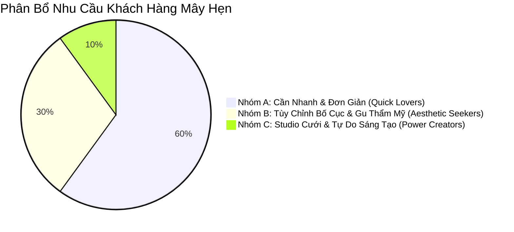
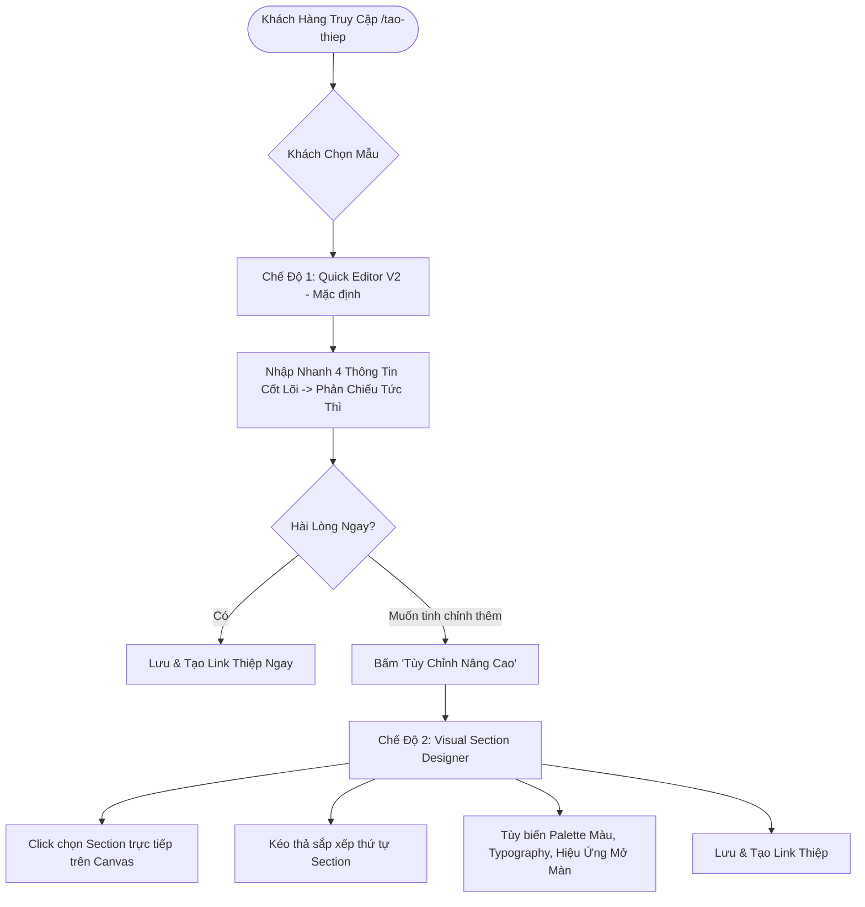

# 📋 PRODUCT REQUIREMENTS DOCUMENT (PRD) — MAYHEN.VN INVITATION EDITOR V2

> **Tên sản phẩm**: Mây Hẹn Invitation Studio V2  
> **Phiên bản**: 2.0.0 (Architecture Refactor)  
> **Trạng thái**: Kế hoạch đề xuất (Draft Proposal)  
> **Chủ trì**: Senior Product Designer & Senior Laravel Architect  
> **Ngày phê duyệt dự kiến**: 10/2026

---

## 1. TẦM NHÌN SẢN PHẨM & MỤC TIÊU CỐT LÕI

### 1.1. Tuyên Bố Tầm Nhìn
Mây Hẹn không đơn thuần là một website có form nhập tên cô dâu chú rể rồi in ra mẫu thiệp cưới tĩnh. Mây Hẹn Studio V2 là **nền tảng kiến tạo thiệp cưới số cao cấp chuẩn Quiet Luxury hàng đầu Việt Nam**, nơi mọi cặp đôi — dù không hề biết thiết kế — vẫn có thể tự tay tạo ra một tác phẩm thiệp mời điện ảnh, tinh khôi, giàu cảm xúc chỉ trong vài phút, với sự tự do tùy biến sâu sắc và trải nghiệm mượt mà trên mọi thiết bị di động.

### 1.2. Mục Tiêu Đo Lường (Key Success Metrics)
1. **Time-to-First-Preview (Thời gian xem bản thiệp đầu tiên)**: Giảm từ ~180 giây xuống **dưới 60 giây** qua luồng Quick-Start thông minh.
2. **Mobile Completion Rate (Tỷ lệ hoàn thành thiệp trên điện thoại)**: Đạt trên **85%** (giải quyết triệt để vấn đề form che khuất màn hình).
3. **Data Loss Rate (Tỷ lệ mất dữ liệu do thoát trang/lỗi mạng)**: Giảm về **0%** nhờ cơ chế Autosave ngầm & LocalStorage Recovery.
4. **Template Switch Retention**: 100% dữ liệu cưới (tên, ngày, giờ, sảnh tiệc, ảnh bìa, QR ngân hàng) được bảo toàn nguyên vẹn khi chuyển đổi qua lại giữa hàng trăm mẫu thiệp.

---

## 2. CHÂN DUNG NGƯỜI DÙNG MỤC TIÊU (USER PERSONAS)

### 2.1. Nhóm A — "Cần Nhanh & Đẹp Tức Thì" (Chiếm 60%)
- **Đặc điểm**: Bận rộn chuẩn bị đám cưới, không rành công nghệ, ngại các thanh công cụ thiết kế phức tạp.
- **Mong muốn**: Chọn mẫu thiệp ưng ý, gõ tên hai bạn, chọn ngày cưới, tải 1-2 bức ảnh đẹp nhất rồi bấm lấy link gửi ngay cho bạn bè qua Zalo.
- **Giải pháp phục vụ**: **Chế độ Quick Editor V2** — Giao diện tinh gọn, tập trung vào 4 bước cơ bản, gợi ý nội dung thông minh.

### 2.2. Nhóm B — "Muốn Thiệp Đẹp Đậm Gu Riêng" (Chiếm 30%)
- **Đặc điểm**: Trẻ trung, kỹ tính, yêu thích phong cách tối giản hoặc sang trọng, muốn thiệp phải đúng tông màu trang trí tiệc cưới.
- **Mong muốn**: Muốn đổi màu chủ đạo (ví dụ chuyển sang Sage Green hay Muted Rose), chọn font chữ thanh lịch, sắp xếp lại thứ tự các phần (đưa Album ảnh lên trước, chuyển Lịch trình xuống dưới), tắt bớt mục không dùng (như tài khoản ngân hàng).
- **Giải pháp phục vụ**: **Chế độ Visual Section Editor** — Chạm trực tiếp vào thiệp, kéo thả hoán đổi section, bật/tắt module bằng 1 chạm, bảng màu Palette Quiet Luxury có sẵn.

### 2.3. Nhóm C — "Studio Cưới, Wedding Planner & Nhà Thiết Kế" (Chiếm 10%)
- **Đặc điểm**: Đơn vị chụp ảnh cưới, người làm dịch vụ, cần tạo nhiều thiệp cho khách hàng, đòi hỏi độ chính xác cao.
- **Mong muốn**: Quản lý nhiều bản nháp, gửi link duyệt có watermark cho cô dâu chú rể, tinh chỉnh khoảng cách, thay đổi hiệu ứng mở màn độc bản, bàn giao link RSVP riêng cho khách.
- **Giải pháp phục vụ**: **Hệ thống Quản lý Đối tác & Chế độ Chỉnh sửa Chuyên sâu (Advanced Studio Tools)**.

---

## 3. KIẾN TRÚC TRẢI NGHIỆM 2 TẦNG (TWO-TIER EXPERIENCE MODEL)

Để giải quyết mâu thuẫn muôn thuở giữa **"Dễ dùng cho người mới"** và **"Linh hoạt cho người chuyên nghiệp"**, Mây Hẹn V2 áp dụng triết lý trải nghiệm 2 tầng đồng nhất:

### 3.1. Chế Độ 1: Quick Editor V2 (Fast & Delightful)
- **Đối tượng**: Mặc định cho mọi khách hàng mới.
- **Trọng tâm giao diện**:
  - Không hiển thị hàng chục thanh công cụ rối rắm.
  - Phân luồng 3 khối cốt lõi:
    1. *Đôi Uyên Ương & Ngày Vui*: Tên cô dâu chú rể, ngày cử hành hôn lễ.
    2. *Sảnh Tiệc & Định Vị GPS*: Tên nhà hàng, địa chỉ, bản đồ chỉ đường.
    3. *Khoảnh Khắc Cưới*: Ảnh đại diện, album ảnh kỷ niệm.
  - Mỗi thay đổi nhỏ được phản ánh ngay lập tức trên màn hình thiệp sống động.

### 3.2. Chế Độ 2: Visual Section Designer (Direct & Flexible)
- **Ranh giới kỹ thuật khả thi (Technical Boundaries)**:
  - **KHÔNG áp dụng mô hình Freeform Absolute Positioning (kéo thả tự do từng pixel như Canva/Photoshop)** vì:
    + Cực kỳ dễ phá vỡ cấu trúc responsive trên 500+ dòng điện thoại khác nhau của khách mời.
    + Chi phí bảo trì và xử lý va chạm layout (collision handling) bằng Vanilla JS quá nặng nề.
    + Khi đổi sang mẫu thiệp khác sẽ làm vỡ tan nát tọa độ phần tử.
  - **ÁP DỤNG mô hình Section-Based Visual Flow (Tương tự Squarespace / Webflow Section Engine)**:
    + Thiệp được cấu thành từ các **Semantic Sections** chuẩn mực: *Header / Cover*, *Lễ Vu Quy & Tiệc Cưới*, *Love Story*, *Album Ảnh*, *Lịch Trình*, *Sổ Lưu Bút*, *RSVP*, *Hộp Mừng Cưới*.
    + Khách hàng có thể:
      1. **Click-to-Select**: Bấm vào section nào trên Canvas, Inspector Panel sẽ trượt ra đúng công cụ của section đó.
      2. **Drag-to-Reorder**: Kéo thả khối section lên xuống để đổi thứ tự mượt mà.
      3. **Toggle Visibility**: Ẩn/Hiện bất kỳ section nào bằng công tắc Toggle.
      4. **Theme Customizer**: Thay đổi tông màu thương hiệu, kiểu font Serif, hoa văn nền giấy mỹ thuật.
      5. **Opening Preset**: Lựa chọn kiểu mở phong thư tem sáp, cửa rèm điện ảnh hay cánh hoa bay.

---

## 4. MA TRẬN YÊU CẦU TÍNH NĂNG CỐT LÕI (CORE FEATURE MATRIX)

| Mã Tính Năng | Tên Tính Năng | Mô Tả Nghiệp Vụ | Chế Độ | Mức Độ Ưu Tiên |
| :--- | :--- | :--- | :--- | :--- |
| **FEAT-01** | **Direct Canvas Click-to-Edit** | Click chuột/chạm tay vào bất kỳ khối nào trên thiệp để kích hoạt thanh chỉnh sửa tương ứng. | Visual Editor | **P0 (Bắt buộc)** |
| **FEAT-02** | **Section Reorder (Kéo thả)** | Di chuyển thứ tự các khối sự kiện, album ảnh, sổ lưu bút bằng tay cầm kéo thả (drag handle) mượt mà. | Visual Editor | **P0 (Bắt buộc)** |
| **FEAT-03** | **Zero-Loss Template Switching** | Đổi mẫu thiệp bất kỳ lúc nào mà không bị mất 1 chữ, 1 ảnh nào đã nhập. | Toàn hệ thống | **P0 (Bắt buộc)** |
| **FEAT-04** | **Autosave & Local Draft Recovery** | Tự động lưu ngầm định kỳ (debounce 1.5s), phục hồi bản nháp từ LocalStorage nếu mất mạng hoặc đóng tab. | Toàn hệ thống | **P0 (Bắt buộc)** |
| **FEAT-05** | **Undo / Redo Stack** | Hỗ trợ quay lại thao tác trước (Ctrl+Z / Ctrl+Y) tối thiểu 20 bước lịch sử. | Toàn hệ thống | **P0 (Bắt buộc)** |
| **FEAT-06** | **Media Library & Smart Cropper** | Quản lý thư viện ảnh cưới tập trung, cắt ảnh theo tỷ lệ vàng 3:4 hoặc 16:9 với vùng thở an toàn cho khuôn mặt. | Toàn hệ thống | **P0 (Bắt buộc)** |
| **FEAT-07** | **Opening Screen Customizer** | Tùy biến màn hình phong thư tem sáp: màu sáp, chữ dập nổi, lời chúc mừng đón khách. | Visual Editor | **P1 (Quan trọng)** |
| **FEAT-08** | **Mobile Contextual Bottom Sheet** | Khi sửa trên điện thoại, bàn phím và công cụ xuất hiện dạng sheet trượt từ đáy, không che khuất màn thiệp. | Mobile Editor | **P0 (Bắt buộc)** |
| **FEAT-09** | **Review Link with Watermark** | Sinh đường link xem thử có watermark cho cô dâu chú rể duyệt trước khi thanh toán kích hoạt chính thức. | Toàn hệ thống | **P1 (Quan trọng)** |
| **FEAT-10** | **Permanent QR & Slug Guard** | Cập nhật thông tin cưới không bao giờ làm thay đổi đường link `/thiep/{slug}` và mã QR đã phát hành. | Toàn hệ thống | **P0 (Bắt buộc)** |

---

## 5. NGUYÊN TẮC THIẾT KẾ THƯƠNG HIỆU (QUIET LUXURY BRAND GUIDELINES)

1. **Không biến Editor thành phần mềm thiết kế màu mè**:
   - Giao diện Editor phải mang phong cách **SaaS thanh lịch, gọn gàng, tinh tế** (Clean Studio Workspace).
   - Nền màu kem ấm nhạt (`#F8F6F0`), viền kim loại champagne mảnh (`#E8E3DA`), typography sắc nét font Sans (`Inter`), điểm xuyết tiêu đề font Serif (`Playfair Display`).
2. **Tôn vinh câu chuyện của đôi uyên ương**:
   - Mọi bản xem trước thiệp phải có tỷ lệ hiển thị trung thực 100% với phiên bản khách mời sẽ nhận được trên iPhone/Android.
   - Hiệu ứng chuyển động tự nhiên: độ mờ nhẹ (fade), trượt êm (spring motion), không giật lag.
