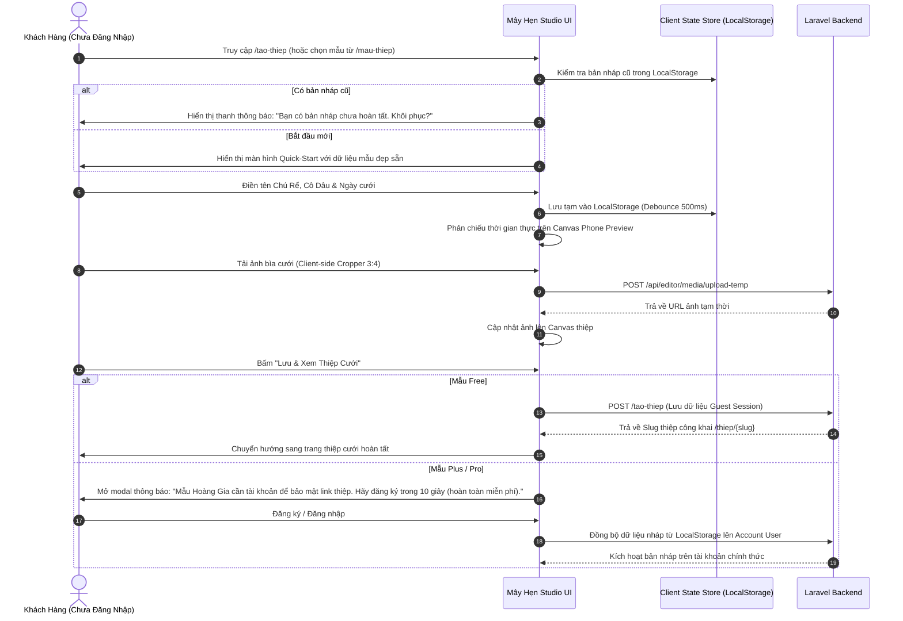
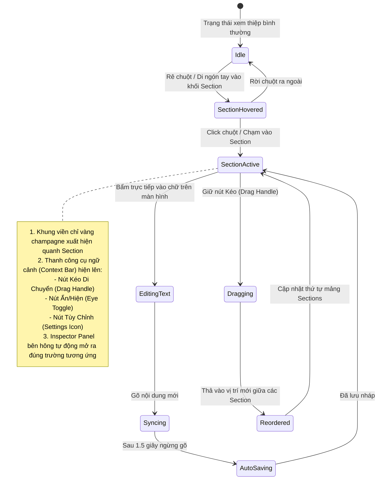
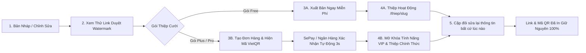

# 🔄 LUỒNG NGƯỜI DÙNG & CÁC KỊCH BẢN NGHIỆP VỤ (EDITOR V2 USER FLOWS)

> **Dự án**: Mây Hẹn (`mayhen.vn`)  
> **Tài liệu**: User Flows & Edge Cases Specification  
> **Mục đích**: Chuẩn hóa toàn bộ các kịch bản tương tác người dùng từ lúc bắt đầu tạo thiệp đến khi gửi lời mời cho khách.

---

## 1. FLOW 1: KHÁCH VÃNG LAI TẠO THIỆP MIỄN PHÍ (GUEST QUICK-START FLOW)

Mục tiêu: Đưa người dùng đến cảm giác "Aha Moment" trong vòng chưa đầy 60 giây mà không bắt buộc tạo tài khoản ngay từ đầu.



---

## 2. FLOW 2: ĐỔI MẪU THIỆP KHÔNG MẤT DỮ LIỆU (ZERO-LOSS SWITCH TEMPLATE FLOW)

Vấn đề trước đây: Đổi mẫu thiệp làm reload trang web, nếu mẫu mới có cấu trúc khác thì các trường thông tin bị mất hoặc hiển thị lỗi.

```mermaid
flowchart TD
    A[Khách đang chỉnh sửa Thiệp Mẫu A] --> B[Bấm 'Đổi Mẫu' trên Topbar]
    B --> C[Mở Template Drawer / Modal]
    C --> D[Khách duyệt qua danh sách mẫu có gắn nhãn Phong cách]
    D --> E[Bấm 'Xem thử với thông tin của tôi' (Live Preview Swap)]
    
    E --> F[Template Adapter Engine: Bóc tách Dữ Liệu Chung vs Dữ Liệu Riêng]
    
    F --> G1[Dữ Liệu Chung: Tên, Ngày, Giờ, Địa Điểm, Ảnh Bìa, Story, QR]
    G1 -->|100% Bảo Toàn| H[Áp Dụng Vào Mẫu B]
    
    F --> G2[Dữ Liệu Riêng: Preset Màu, Kiểu Nơ Ruy Băng, Hiệu Ứng Phong Thư]
    G2 -->|Fallback An Toàn| I[Sử Dụng Cấu Hình Chuẩn Của Mẫu B]
    
    H --> J[Iframe Canvas nạp lại Template B mà KHÔNG reload trang cha]
    I --> J
    J --> K[Hiển thị Toast: 'Đã đổi sang mẫu Thước Phim Tình Yêu thành công!']
    K --> L[Cho phép bấm 'Hoàn tác' (Undo) để quay lại Mẫu A nếu không ưng ý]
```

---

## 3. FLOW 3: CHỈNH SỬA TRỰC QUAN TRÊN CANVAS (IN-PLACE SECTION VISUAL FLOW)



---

## 4. FLOW 4: AUTOSAVE & PHỤC HỒI KHI MẤT KẾT NỐI (OFFLINE RESILIENCE)

1. **Chu kỳ Autosave**:
   - Mỗi khi có sự thay đổi từ người dùng (text change, color pick, reorder section), State Store chuyển trạng thái sang `isDirty = true`.
   - Cơ chế **Debounce 1500ms**: Chờ người dùng dừng gõ phím 1.5 giây mới kích hoạt gửi request API ngầm `POST /api/editor/autosave`.
   - Trạng thái Topbar hiển thị:
     - 🟡 Đang lưu thay đổi...
     - 🟢 Đã lưu nháp an toàn (kèm thời gian: 14:35).
     - 🔴 Mất kết nối mạng - Dữ liệu đã được lưu tạm trên máy của bạn.
2. **Kịch bản mất mạng / Reload bất ngờ**:
   - Mọi thay đổi đều được ghi đồng thời vào `localStorage.setItem('mayhen_draft_' + id, JSON.stringify(state))`.
   - Khi mạng có trở lại hoặc khi người dùng mở lại trang, State Store tự động đối chiếu `updated_at` giữa Server và LocalStorage để lấy bản mới nhất, không bao giờ làm mất 1 ký tự nào của khách hàng.

---

## 5. FLOW 5: XUẤT BẢN & THANH TOÁN (PUBLISH & ORDER LIFECYCLE)



---

## 6. MA TRẬN XỬ LÝ CÁC TRƯỜNG HỢP NGOẠI LỆ (EDGE CASES & ERROR HANDLING)

| Trường Hợp Ngoại Lệ (Edge Case) | Nguy Cơ Tiềm Ẩn | Cách Hệ Thống Editor V2 Xử Lý Chuẩn Xác |
| :--- | :--- | :--- |
| **Tên cô dâu chú rể quá dài** (ví dụ: *Nguyễn Hoàng Công Tằng Tôn Nữ Bích Chi*) | Làm tràn dòng, vỡ khung typography của thiệp | CSS sử dụng font size linh hoạt (`clamp()`), tự động ngắt dòng thông minh (`word-break: keep-all; hyphens: auto;`) và có cảnh báo thị giác nhẹ nếu vượt quá 40 ký tự. |
| **Không tải ảnh đại diện** | Mẫu thiệp bị khoảng trống đen hoặc icon vỡ | Hệ thống tự động fallback về minh họa Vector lãng mạn mạ vàng hoa văn Quiet Luxury của Mây Hẹn, thiệp vẫn đẹp hoàn hảo. |
| **Tải ảnh có dung lượng cực lớn (20MB - 40MB)** | Đứng trình duyệt, tốn băng thông, server timeout | Client-side xử lý nén trước qua HTML5 Canvas API (chuyển đổi sang WebP chất lượng 88%, chiều rộng tối đa 1920px) trước khi gửi lên server. |
| **Người dùng mở 2 tab cùng chỉnh sửa 1 thiệp** | Tab cũ ghi đè dữ liệu mới hơn của tab kia | Sử dụng cơ chế **Optimistic Concurrency Control (OCC)** với trường `revision_id`. Khi tab A lưu, `revision_id` tăng lên. Tab B gửi lưu với `revision_id` cũ sẽ nhận mã `409 Conflict` kèm thông báo: *"Dữ liệu thiệp vừa được cập nhật ở một tab khác. Bấm để nạp bản mới nhất."* |
| **Thiệp đã in mã QR thiệp cưới lên giấy** | Cô dâu chú rể đổi giờ tiệc cưới | Đường link `/thiep/{slug}` và hình ảnh mã QR tĩnh hoàn toàn không thay đổi; khách quét QR vẫn mở đúng thiệp với giờ tiệc mới nhất. |
| **Khách mời từ chối tham gia (RSVP Declined)** | Lời nhắn chúc phúc có nội dung tiêu cực | Hệ thống có cơ chế kiểm duyệt từ ngữ nhạy cảm tự động, đồng thời chủ thiệp có trang quản lý duyệt/xóa lời chúc trước khi hiển thị công khai. |
