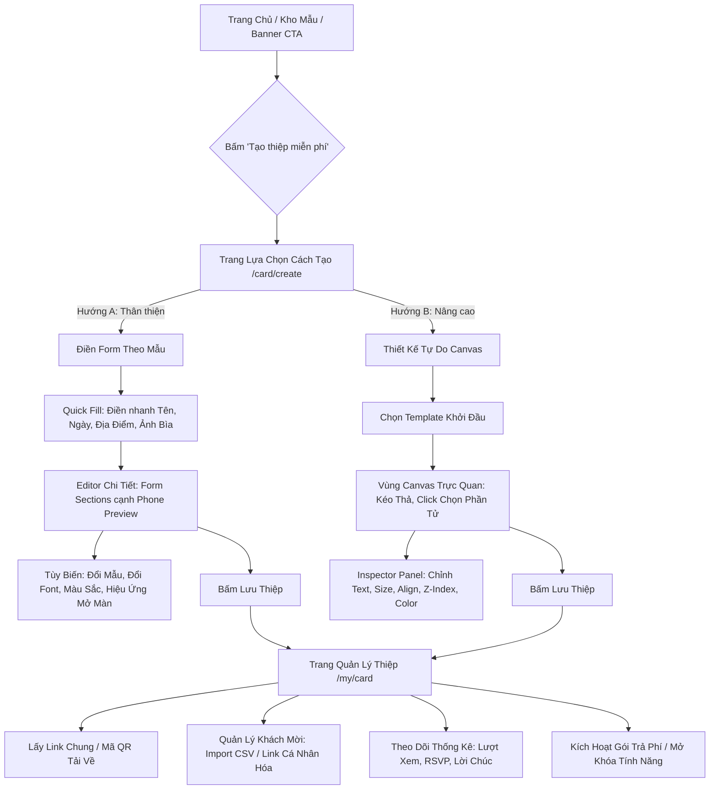

# 🔍 BÁO CÁO NGHIÊN CỨU & BENCHMARK ĐỐI THỦ: NGÀY CHUNG ĐÔI (NGAYCHUNGDOI.COM)

> **Dự án**: Mây Hẹn (`mayhen.vn`)  
> **Tài liệu**: Benchmark & Reverse-Engineering Nghiệp Vụ Đối Thủ  
> **Thời gian khảo sát thực tế**: 19/10/2026  
> **Nguồn dữ liệu khảo sát**: Cổng thông tin chính thức, tài liệu kỹ thuật công khai, hướng dẫn thao tác chi tiết (`/huong-dan/cach-tao-thiep-cuoi-online-mien-phi`), trang câu hỏi thường gặp (`/faq`), trang chương trình đối tác (`/chuong-trinh-doi-tac`), giao diện desktop và mobile responsive.

---

## 1. TỔNG QUAN VỀ ĐỐI THỦ NGÀY CHUNG ĐÔI

- **Tên thương hiệu**: Ngày Chung Đôi
- **Domain**: `ngaychungdoi.com`
- **Định vị**: Nền tảng tạo thiệp cưới online miễn phí trên điện thoại và máy tính, hướng đến đại chúng với phương châm đơn giản, nhanh chóng và hỗ trợ cả người dùng cá nhân lẫn studio cưới/wedding planner.
- **Nền tảng công nghệ quan sát được**: 
  - Framework: Next.js (SSR / Turbopack), React.js.
  - Styling: Tailwind CSS kết hợp CSS Modules.
  - CDN Asset: `assets.ngaychungdoi.com`, lưu trữ ảnh WebP tối ưu.

---

## 2. SITEMAP HÀNH TRÌNH TẠO THIỆP CỦA ĐỐI THỦ

---

## 3. DANH SÁCH CHỨC NĂNG CỦA ĐỐI THỦ

### 3.1. Nhóm Chức Năng Đã Xác Minh Thực Tế
| STT | Chức Năng | Mô Tả & Cơ Chế Thực Hiện |
| :--- | :--- | :--- |
| 1 | **Hai phương thức tạo thiệp song song** | Người dùng được chọn giữa **Điền form theo mẫu** (dễ tiếp cận) và **Thiết kế tự do** (canvas chuyên sâu). |
| 2 | **Quick Fill (Điền nhanh)** | Bước pop-up/màn hình đệm thu thập 4 thông tin sống còn: Tên chú rể/cô dâu, Ngày cưới, Địa điểm, Ảnh đại diện trước khi vào editor chi tiết. |
| 3 | **Hiệu ứng mở màn (Opening Screen)** | Tách riêng một module cài đặt cho màn hình chào/phong thư trước khi vào nội dung thiệp chính (chọn loại phong thư, sửa lời chào, nút mở). |
| 4 | **Bảo lưu mã QR & Link** | Khi cập nhật nội dung thiệp (đổi giờ, đổi ảnh, sửa tên), mã QR và đường link thiệp đã in hoặc đã gửi khách **không bị thay đổi**. |
| 5 | **Cá nhân hóa khách mời theo Link** | Cho phép nhập danh sách hoặc import CSV. Mỗi khách nhận 1 link độc nhất gắn tên lên bìa thiệp (ví dụ: *Kính mời Anh Hoàng & Gia đình*). |
| 6 | **Giới hạn & Phân tầng dịch vụ** | Thiệp free cho phép dùng 6 tháng, tối đa 10 khách mời cá nhân hóa, 200 lượt xem; các gói nâng cao (Chu đáo 1 năm, Trọn vẹn vĩnh viễn) mở rộng lưu lượng. |
| 7 | **Hệ thống Đối tác (Studio Partner Credit)** | Cho phép studio nạp credit, tạo nháp không giới hạn, gửi link duyệt có watermark cho cô dâu chú rể, kích hoạt trừ credit sau khi duyệt. |
| 8 | **Đổi giao diện / Đổi mẫu** | Cho phép chuyển mẫu thiệp ngay trong quá trình chỉnh sửa. |

### 3.2. Nhóm Chức Năng Giới Hạn / Chưa Thao Tác Trực Tiếp (Do Yêu Cầu An Toàn & Phân Quyền)
- **Thao tác thanh toán tiền thật**: Không thực hiện giao dịch ngân hàng thật trên môi trường đối thủ.
- **Hệ thống Canvas Drag & Drop trên thiết bị di động cấu hình yếu**: Chưa đo đạc FPS rendering khi kéo thả nhiều phần tử phức tạp cùng lúc trên điện thoại đời cũ.

---

## 4. PHÂN TÍCH TRẢI NGHIỆM NGƯỜI DÙNG (UX / UI AUDIT)

### 4.1. Điểm Mạnh Nổi Bật Của Ngày Chung Đôi
1. **Phân hóa đối tượng mục tiêu xuất sắc (Segmentation)**:
   - Thay vì ép mọi khách hàng vào một công cụ vẽ canvas phức tạp kiểu Canva, họ cung cấp chế độ **"Điền form theo mẫu"** cho 80% khách hàng không biết thiết kế và chỉ muốn thiệp đẹp nhanh trong 3 phút.
   - 20% còn lại (hoặc studio) chọn **"Thiết kế tự do"** để can thiệp sâu.
2. **Thu thập thông tin lũy tiến (Progressive Disclosure)**:
   - Không đập vào mắt người dùng một form 30 trường. Họ dùng bước Quick Fill lấy thông tin cơ bản trước, sau đó người dùng thấy thiệp đã có tên mình ngay lập tức (hiệu ứng "Aha Moment" cực mạnh).
3. **Mô hình Studio B2B2C thông minh**:
   - Tính năng **Link duyệt có Watermark** giúp studio gửi cho khách duyệt trước khi bỏ tiền kích hoạt. Link bàn giao cho cặp đôi chỉ để xem RSVP và khách mời, không cho sửa layout.

### 4.2. Điểm Bất Tiện & Giới Hạn Đã Quan Sát Được
1. **Thiếu tính liền mạch (In-place Direct Editing)**:
   - Ở chế độ điền form, người dùng vẫn phải gõ chữ ở cột form bên trái rồi liếc mắt sang phải nhìn iframe cập nhật. Chưa hỗ trợ bấm thẳng vào text trên màn hình xem trước để gõ trực tiếp (Click-to-Edit).
2. **Thẩm mỹ giao diện mang tính đại trà (Mass Market UI)**:
   - Thiết kế web đối thủ theo phong cách app tiện ích phổ thông, font chữ Noto Sans tiêu chuẩn, màu sắc chưa toát lên được sự sang trọng, tinh khôi hay cảm giác "Quiet Luxury" mà phân khúc cặp đôi trẻ hiện đại, có gu thẩm mỹ cao tìm kiếm.
3. **Chuyển đổi giữa 2 chế độ Form và Canvas còn tách biệt**:
   - Hai chế độ dường như là 2 module riêng biệt. Nếu khách đang làm form mà muốn kéo nhẹ 1 vị trí ảnh hay đổi thứ tự 1 section thì phải chuyển sang canvas và đối mặt với độ phức tạp cao hơn.

---

## 5. BẢNG ĐO LƯỜNG SỐ THAO TÁC CÁC TÁC VỤ CỐT LÕI

| Tác Vụ Người Dùng | Số Thao Tác Ước Tính (Ngày Chung Đôi) | Thời Gian Hoàn Thành Trung Bình | Mức Độ Thuận Tiện |
| :--- | :--- | :--- | :--- |
| **Bắt đầu tạo thiệp đầu tiên** | 2 click (Chọn mẫu -> Điền form) | ~15 giây | Rất nhanh |
| **Nhập thông tin cơ bản (Quick Fill)** | 4 input + 1 click tiếp tục | ~60 - 90 giây | Trực quan, dễ hiểu |
| **Thay đổi ảnh bìa** | 3 click (Chọn ô ảnh -> Tải lên -> Cắt ảnh 3:4) | ~30 giây | Ổn định |
| **Đổi mẫu thiệp khác** | 3 click (Giao diện -> Chọn mẫu -> Áp dụng) | ~10 giây | Giữ được text chính |
| **Bật/Tắt hiệu ứng mở màn** | 3 click (Tab Hiệu ứng -> Bật -> Chọn mẫu phong bì) | ~20 giây | Tách bạch rõ ràng |
| **Xuất bản & Lấy link chia sẻ** | 2 click (Lưu thiệp -> Vào Quản lý -> Sao chép link) | ~15 giây | Liền mạch |

---

## 6. BÀI HỌC VÀNG & ĐỀ XUẤT ỨNG DỤNG CHO MÂY HẸN (MAYHEN.VN)

1. **Áp dụng triết lý "Trải Nghiệm 2 Tầng" nhưng làm mượt mà hơn**:
   - **Tầng 1 (Quick Editor V2)**: Tối ưu hóa tuyệt đối cho tốc độ (2-3 phút có thiệp đẹp). Người dùng nhập nhanh thông tin cốt lõi, chọn theme màu và xem thiệp phản chiếu ngay lập tức.
   - **Tầng 2 (Section-based Visual Editor)**: Cho phép click chọn trực tiếp vào section trên canvas để chỉnh sửa in-place, kéo thả hoán đổi thứ tự section, ẩn/hiện section và tùy biến typography/màu sắc mà **không làm vỡ layout responsive mobile**.
2. **Tách biệt "Hiệu Ứng Mở Màn" (Greeting / Envelope / Door Opening)**:
   - Đối thủ tách mục này thành điểm nhấn riêng và khách hàng rất quan tâm vì đây là cảm xúc đầu tiên khách mời nhìn thấy. Mây Hẹn cần chuẩn hóa preset: *Phong thư mở tem sáp hoàng gia*, *Cửa rèm lụa điện ảnh*, *Cánh hoa bay lướt nhẹ*.
3. **Giữ nguyên Slug & Mã QR khi cập nhật thiệp**:
   - Đây là bài học sống còn. Cặp đôi thường in QR thiệp cưới lên giấy trước ngày cưới cả tháng. Mọi cập nhật nội dung sau đó phải được phản ánh ngay trên cùng một link `/thiep/{slug}` mà không làm hỏng QR đã in.
4. **Link Duyệt Bản Thảo Dành Cho Studio & Cặp Đôi (Review Link with Watermark)**:
   - Cho phép xem trước bản thiết kế thiệp kèm watermark bảo vệ thương hiệu trước khi thanh toán kích hoạt chính thức.
